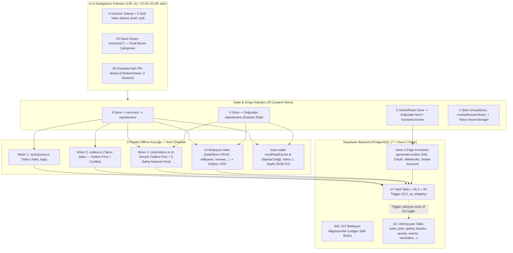
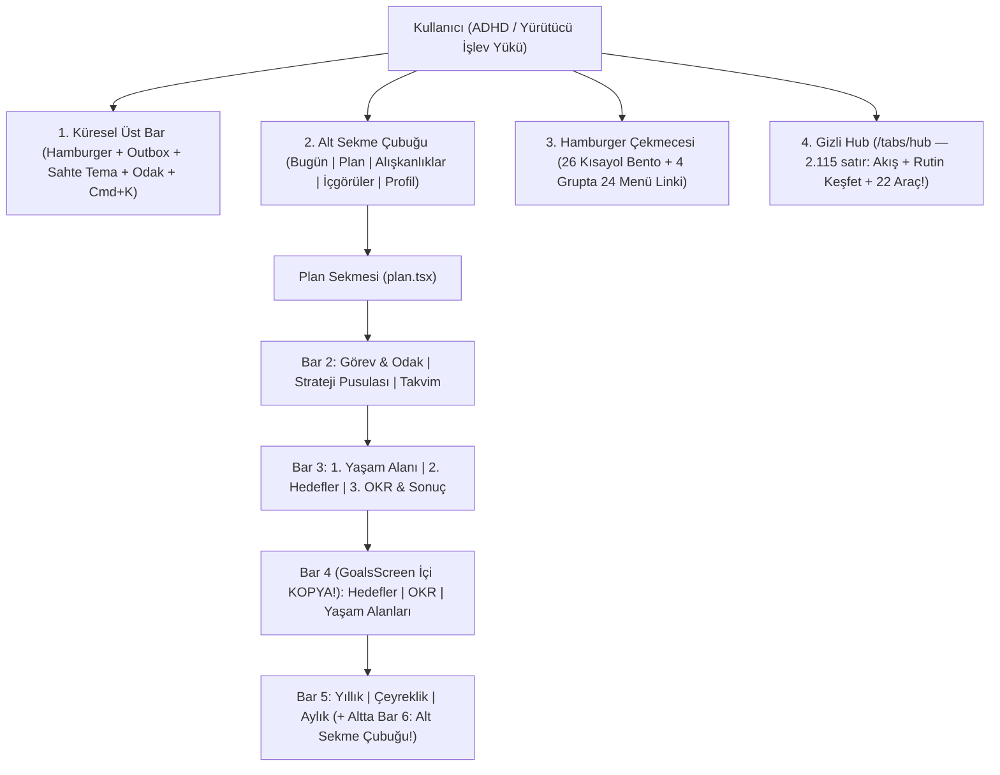
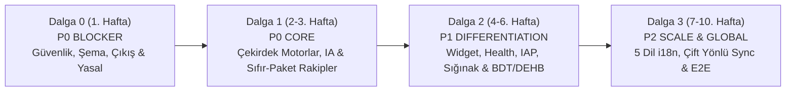

# Aderyth — 360° Mühendislik, Mimari, Teknik Borç, UI/UX, Production Hazırlık ve 27+ Rakip Teardown Master Raporu

**Denetim Tarihi:** 1 Kasım 2026  
**İncelenen Kod Tabanı:** `c:\Users\Trade Bilisim\Mobile_Uygulama` (`frontend/`, `supabase/`, `.github/workflows/`, `docs/`, `tools/`)  
**Niceliksel Denetim Hacmi:**
- **Frontend Uygulama Kodu (`__tests__` hariç):** 320 kaynak dosya · **71.765 satır TypeScript/TSX** · ~3,24 MB kaynak kod
- **Test Paketi (`frontend/__tests__/`):** 275 dosya (**264 Jest suite**, **3.449 çalışma zamanı testi**) · **40.328 satır**
- **Görsel Sanat Varlıkları (`frontend/assets/`):** 164 dosya (**158 WebP**, 5 PNG, 1 TTF) · **5,85 MB disk** / **401,17 MB açılmış RGBA8888 bitmap doku eşdeğeri**
- **Backend & Veritabanı (`supabase/`):** PostgreSQL 17 canlı şema (**69 tablo**, `live_schema.sql` 3.100+ satır), **37 SQL migrasyon dosyası** (`001..037`), Deno 2 tabanlı Edge Functions (`generate-routine`, `notion-auth`, `notion-sync`, `google-auth`, `spotify-auth`, `dispatch-webhooks`, `delete-account` vb.)
- **Rakip Teardown Havuzu:** **28 Rakip Uygulama** (*Inflow, Habitify, Rabit, HabitGenius, HabitKit, Apple Reminders & Due, Habit It, Loop Habit Tracker, MindShift CBT, WaterDo, Daylio, Alışkanlık Takip, Hedef ve Alışkanlık Takibi, Forest, Habit360, Todoist, TimeTune, Wipepp, Super Planner, RoutineDay, Routinery, Dear Me, HabitNow, Disciplined, HelloHabit, Fun Habit, Roubit, Hizo*)

---

## Yönetici Özeti: Denetimde Ortaya Çıkan En Çarpıcı 12 Bulgusu

> [!CAUTION]
> **Üretim (Production) Lansmanını Doğrudan Bloke Eden 4 Acil Kusur:**
> 1. **Giriş Ekranının Birincil Butonu "🚀 Girişi Geç (Demo Modu)" ([login.tsx](file:///c:/Users/Trade%20Bilisim/Mobile_Uygulama/frontend/app/(auth)/login.tsx#L49-L67), [L188-L196](file:///c:/Users/Trade%20Bilisim/Mobile_Uygulama/frontend/app/(auth)/login.tsx#L188-L196)):** `__DEV__` veya `isSeedingAllowed()` koruması olmadan ekranın en parlak birincil CTA'sı (`size="lg"`, `colors.accent`) gerçek kimlik doğrulamayı ve Onboarding'i tamamen bypass edip sahte Notion oturumu + demo veri tohumluyor; gerçek `"Giriş Yap"` butonu `variant="secondary"` olarak ikinci plana itilmiş durumda.
> 2. **Uygulamada Normal Bir "Çıkış Yap" (`signOut`) Butonu Yok & Hesaplar Arası RAM/AsyncStorage Sızıntısı ([_layout.tsx](file:///c:/Users/Trade%20Bilisim/Mobile_Uygulama/frontend/app/_layout.tsx#L105-L117), [settings.tsx](file:///c:/Users/Trade%20Bilisim/Mobile_Uygulama/frontend/app/tabs/settings.tsx#L500-L549)):** `supabase.auth.signOut` yalnızca şifre sıfırlama kurtarma akışında ([reset-password.tsx](file:///c:/Users/Trade%20Bilisim/Mobile_Uygulama/frontend/app/(auth)/reset-password.tsx#L123)) ve hesabı kalıcı silmede ([accountService.ts](file:///c:/Users/Trade%20Bilisim/Mobile_Uygulama/frontend/services/accountService.ts#L141)) çağrılıyor. Oturum kapandığında 29 Zustand store'un **24'ü RAM'deki verisini temizlemiyor** ve `focus.session.v1` ([focusStore.ts](file:///c:/Users/Trade%20Bilisim/Mobile_Uygulama/frontend/store/focusStore.ts#L50-L52)) gibi 5 `AsyncStorage` anahtarı `userId` kapsamı olmadığı için kullanıcıların görev başlıklarını aynı cihazdaki diğer hesaba sızdırıyor.
> 3. **Tamamen Sahte (Placebo) Açık/Koyu Tema Anahtarı ([_layout.tsx](file:///c:/Users/Trade%20Bilisim/Mobile_Uygulama/frontend/app/tabs/_layout.tsx#L40-L42), [settings.tsx](file:///c:/Users/Trade%20Bilisim/Mobile_Uygulama/frontend/app/tabs/settings.tsx#L311-L331), [themeStore.ts](file:///c:/Users/Trade%20Bilisim/Mobile_Uygulama/frontend/store/themeStore.ts#L31-L35)):** Üst barda ve Ayarlar'da görünen tema değiştirici `themeStore.isDark` değerini güncelliyor; ancak kod tabanındaki **259 UI dosyasının sıfırı (`0`)** `themeStore.theme` nesnesini okuyor. Tüm ekranlar [tokens.ts](file:///c:/Users/Trade%20Bilisim/Mobile_Uygulama/frontend/lib/tokens.ts#L41-L125) sabitlerini statik import ettiği için butona basıldığında **tek bir piksel bile renk değiştirmiyor**.
> 4. **Alışkanlık Gücü ve Seri (Streak) Motorlarında Sessiz Matematiksel Hatalar ([habitStrength.ts](file:///c:/Users/Trade%20Bilisim/Mobile_Uygulama/frontend/lib/habitStrength.ts#L154-L197), [behaviorIntelligence.ts](file:///c:/Users/Trade%20Bilisim/Mobile_Uygulama/frontend/lib/behaviorIntelligence.ts#L457-L468), [recovery.tsx](file:///c:/Users/Trade%20Bilisim/Mobile_Uygulama/frontend/app/screens/recovery.tsx#L184-L215)):** `habitStrength()` fonksiyonu `habit` takvimini parametre olarak bile almıyor ("takvim-körü"); haftada 3 gün (`Pzt/Çar/Cum`) planlanıp 90 gün %100 eksiksiz yapılan bir alışkanlığı diğer 4 günde log olmadığı için **`~%43` güçte kilitliyor** ve tatil/mola (`habit_pauses`) günlerini kaçırılmış (`miss`) sayıyor! Ayrıca `currentStreak()` sabah henüz işaretleme yapılmamışken aktif 30 günlük seriyi **`0`** gösteriyor ve kullanıcı Kintsugi telafi planını (`recovery_plans`) tamamlasa bile kaçan `source_date` köprülenmediği için serisi kırık kalıyor!

> [!IMPORTANT]
> **Stratejik Ürün & Mimari Sürprizler (Gizli Hazineler ve Yarım Kalan Köprüler):**
> 5. **Canlı Veritabanında Rakiplerin Ücretli Sattığı Oyunlaştırma Motorunun %80'i Zaten Kurulu ve Arka Planda Sessizce Çalışıyor ([live_schema.sql](file:///c:/Users/Trade%20Bilisim/Mobile_Uygulama/supabase/live_schema.sql)):** `user_pets` (her yeni kayıtta otomatik "Egg" pet üreten trigger aktif!), `pet_stages`, `global_bosses` + `boss_contributors` (**şu anda bile her `habit_logs` kaydında aktif boss'a 10 HP hasar vuran trigger canlıda çalışıyor!**), `quests` + `user_quests`, `shop_items` + `user_inventory`, `skills` + `user_skills`, `challenges` + `user_challenges`, `calendars` + `events` + `event_templates` + `reminders` tabloları ve RPC fonksiyonları canlı Postgres'te hazır; fakat **frontend'de %0 piksel bağlantısı var!**
> 6. **Kırık "Sesli Rutin Yürütücü" Vaadi ([focusFlowCatalog.ts](file:///c:/Users/Trade%20Bilisim/Mobile_Uygulama/frontend/lib/focusFlowCatalog.ts#L824) vs [routine-runner.tsx](file:///c:/Users/Trade%20Bilisim/Mobile_Uygulama/frontend/app/screens/routine-runner.tsx#L75)):** Uygulama kullanıcıya *"▶ Sesli Rutin Yürütücüyü Başlat"* diyor ve `expo-speech` zaten kurulu; fakat `routine-runner.tsx` yalnızca `AccessibilityInfo.announceForAccessibility` çağırıyor — yani VoiceOver/TalkBack kapalıysa rutin yürütücü **%100 sessiz**!
> 7. **`ADHDTaskSplitter` Yetim Görev Şişirmesi & Sahte AI ([taskDecomposition.ts](file:///c:/Users/Trade%20Bilisim/Mobile_Uygulama/frontend/lib/taskDecomposition.ts#L85), [L392-L406](file:///c:/Users/Trade%20Bilisim/Mobile_Uygulama/frontend/lib/taskDecomposition.ts#L392-L406)):** Veritabanı `tasks` tablosunda `is_subtask`, `parent_task_id`, `time_block_start`, `time_block_end` sütunları zaten var; fakat `ADHDTaskSplitter` canlı AI yerine sabit 3 satırlık şablon üretiyor ve `parent_task_id`/`is_subtask` alanlarını doldurmayıp listeye 3 bağımsız kök görev daha ekleyerek iş yükünü 1'den 4'e şişiriyor!
> 8. **"Matruşka Sekme Cehennemi" ve ADHD Bilişsel Aşırı Yüklemesi ([plan.tsx](file:///c:/Users/Trade%20Bilisim/Mobile_Uygulama/frontend/app/tabs/plan.tsx#L53-L128), [goals.tsx](file:///c:/Users/Trade%20Bilisim/Mobile_Uygulama/frontend/app/screens/goals.tsx#L167-L223)):** `Plan -> Strateji Pusulası` açıldığında ekranda aynı anda **6 navigasyon barı** üst üste biniyor (3. ve 4. bar aynı sekmelerin kopyası ve durumları senkron değil!). İlk günden 35+ modül (OKR, Eisenhower, Triage, Yaşam Alanları, Haftalık/Aylık İnceleme, TikTok tarzı dikey kaydırmalı `Odak Akışı`) hiçbir kademeli açılım (*progressive disclosure*) olmadan ADHD kullanıcısının önüne dökülüyor.
> 9. **Kurulu Ama Sıfır (`0/259`) Kullanılan Native Hareket Motorları ([package.json](file:///c:/Users/Trade%20Bilisim/Mobile_Uygulama/frontend/package.json#L51-L59)):** `react-native-reanimated` (`4.5.1`), `react-native-worklets` (`0.10.1`) ve `react-native-gesture-handler` (`~2.32.0`) native binary'ye derleniyor ama kodda **0 kez** import edilmiş! Satır kaydırma (swipe), sürükle-bırak (drag-and-drop) veya gerçek swipe-to-dismiss bottom sheet (`@gorhom/bottom-sheet`) yok; sekme geçişleri ([MorphingPillTabs.tsx](file:///c:/Users/Trade%20Bilisim/Mobile_Uygulama/frontend/components/motion/MorphingPillTabs.tsx#L69-L82)) `useNativeDriver: false` ile JS thread'ini kilitliyor.
> 10. **3 Paralel Offline Kuyruğu + "Sahte Outbox-First" Tuzağı ([syncQueue.ts](file:///c:/Users/Trade%20Bilisim/Mobile_Uygulama/frontend/lib/syncQueue.ts), [outbox.ts](file:///c:/Users/Trade%20Bilisim/Mobile_Uygulama/frontend/lib/outbox.ts), [coreOutbox.ts](file:///c:/Users/Trade%20Bilisim/Mobile_Uygulama/frontend/services/coreOutbox.ts)):** `coreOutbox` içindeki 10 varlığın 5'i (`goals`, `projects`, `reading_list`, `okr`, `life_areas`) aslında Network-First çalışıyor ve yalnız `status === 0` dönerse kuyruğa giriyor (HTTP 502/503/504 hatalarında yazım kayboluyor); `habitStore` CRUD/mola/checklist dahil **14 mutasyon alanı** ise hiçbir outbox kullanmıyor.
> 11. **401,17 MB Çözülmüş Bitmap Bellek Ayak İzi ([visualAssets.ts](file:///c:/Users/Trade%20Bilisim/Mobile_Uygulama/frontend/lib/visualAssets.ts), [monthBackgrounds.ts](file:///c:/Users/Trade%20Bilisim/Mobile_Uygulama/frontend/lib/monthBackgrounds.ts)):** 158 statik `require` WebP görseli diskte 5,75 MB olsa da GPU/RAM'de RGBA8888 açıldığında toplam 401,17 MB doku kapasitesine ulaşıyor; tek ekranda 5–7 katmanlı bindirme (~22–32 MB RAM) ve sekmeler arası `cachePolicy="memory-disk"` birikimi 3–4 GB RAM'li Android cihazlarda OOM/LMK riski yaratıyor.
> 12. **7 Karanlık Feature Gate + Dondurulmuş `028..037` Veritabanı Migrasyonları ([featureGates.ts](file:///c:/Users/Trade%20Bilisim/Mobile_Uygulama/frontend/lib/featureGates.ts#L1-L252)):** Spotify, Notion, Google Calendar, Paid Subscriptions (`RevenueCat` yok), Public Site URLs (`aderyth.com` 404), Coach Actions V2 ve Log Timezone üretimde `false`; `moodStore` ve `routineRunnerStore` ise `030` ve `031` migrasyonları canlıya basılmadığı için yalnızca yerel cihaz hafızasında yaşıyor.

### Mevcut Sistem Mimarisi & Parçalanma Röntgeni

---

## Bölüm 1 — Yazılım Dili, Runtime, Derleyici & Paket Ekosistemi Denetimi

### 1.1 TypeScript `6.0.3` Yapılandırması, Derleyici Katılığı ve 281 Tip Güvenliği Deliği

Aderyth istemci tarafında [package.json](file:///c:/Users/Trade%20Bilisim/Mobile_Uygulama/frontend/package.json#L71) üzerinde **`typescript: "~6.0.3"`** kullanmaktadır. Dil seçimi çapraz platform mobil + web + Deno 2 Edge paylaşımı (ör. [coachContractSchema.ts](file:///c:/Users/Trade%20Bilisim/Mobile_Uygulama/supabase/functions/_shared/coachContractSchema.ts)) için **tamamen doğru tercihtir**. Ancak derleyici katılığı ve tip sınırlarında ciddi yapısal çatlaklar tespit edilmiştir:

1. **Eksik Katı Derleyici Bayrakları ([tsconfig.json](file:///c:/Users/Trade%20Bilisim/Mobile_Uygulama/frontend/tsconfig.json#L1-L22)):**
   - `"strict": true` aktif olmakla birlikte, dizi/sözlük indeks erişimlerinde çalışma zamanı `undefined` çökmelerini yakalayan **`noUncheckedIndexedAccess`**, opsiyonel alan semantiğini koruyan **`exactOptionalPropertyTypes`**, **`noImplicitOverride`** ve **`noPropertyAccessFromIndexSignature`** kapalıdır.
2. **4 GB Node Heap Zorunluluğu ([package.json](file:///c:/Users/Trade%20Bilisim/Mobile_Uygulama/frontend/package.json#L14-L15)):**
   - `typecheck` ve `typecheck:ci` komutları `NODE_OPTIONS="--max-old-space-size=4096" tsc --noEmit` olmadan bellek sınırına takılmaktadır. Bunun ana nedeni 2.512 satırlık [database.types.ts](file:///c:/Users/Trade%20Bilisim/Mobile_Uygulama/frontend/lib/database.types.ts) içinde frontend'in hiç kullanmadığı 32 tablonun da yer alması ve derin koşullu PostgREST tip çıkarımlarıdır.
3. **Yerel Geliştirme vs CI Typecheck Ayrışması ([tsconfig.json](file:///c:/Users/Trade%20Bilisim/Mobile_Uygulama/frontend/tsconfig.json#L19) vs [tsconfig.ci.json](file:///c:/Users/Trade%20Bilisim/Mobile_Uygulama/frontend/tsconfig.ci.json#L1-L35)):**
   - `tsconfig.json` gitignore'lu `.expo/types/**/*.ts` dosyalarını derlemeye dahil ederken `tsconfig.ci.json` bunları dışlar. Yerelde geçen veya kırılan rota tipleri CI'da farklı davranmakta; bu durum [_layout.tsx](file:///c:/Users/Trade%20Bilisim/Mobile_Uygulama/frontend/app/_layout.tsx#L231) içindeki `const segs = segments as unknown as string[];` gibi tip kaçışlarını tetiklemektedir.
4. **Niceliksel Tip Kaçışı Envanteri (Toplam 281 Tip Güvenliği İhlali):**

| Kaynak Dizin | Dosya Sayısı | Satır Sayısı | `any` (`: any` / `as any`) | `as unknown as` | Non-null `!` Assertion | `eslint-disable` |
| :--- | ---: | ---: | ---: | ---: | ---: | ---: |
| `frontend/app/` | 53 | 22.541 | **84** | 1 | 13 | 5 |
| `frontend/components/` | 93 | 15.885 | **46** | 0 | **33** | 4 |
| `frontend/lib/` *(üretilmiş tipler hariç)* | 81 | 15.904 | 14 | 1 | 7 | 0 |
| `frontend/store/` | 29 | 6.478 | 5 | 9 | 5 | 0 |
| `frontend/services/` | 27 | 3.986 | 5 | 0 | 7 | 0 |
| `frontend/repositories/` | 31 | 3.831 | 1 | **50** | 0 | 0 |
| **TOPLAM** | **314** | **68.625** | **155** | **61** | **65** | **9** *(+2 `hooks/`)* |

> [!WARNING]
> **PostgREST Şema Korumasını Sıfırlayan Tek Satır ([repositories/shared.ts](file:///c:/Users/Trade%20Bilisim/Mobile_Uygulama/frontend/repositories/shared.ts#L18)):**  
> `export const dynamicClient = () => supabase as unknown as SupabaseClient;` ifadesi `SupabaseClient<Database>` üzerindeki tüm tablo/kolon tip güvenliğini silmektedir. `repositories/` altındaki **50 adet `as unknown as`** ([taskRepository.ts](file:///c:/Users/Trade%20Bilisim/Mobile_Uygulama/frontend/repositories/taskRepository.ts), [okrRepository.ts](file:///c:/Users/Trade%20Bilisim/Mobile_Uygulama/frontend/repositories/okrRepository.ts), [habitPauseRepository.ts](file:///c:/Users/Trade%20Bilisim/Mobile_Uygulama/frontend/repositories/habitPauseRepository.ts), [habitRepository.ts](file:///c:/Users/Trade%20Bilisim/Mobile_Uygulama/frontend/repositories/habitRepository.ts) vb.) veritabanı yanıtlarını çalışma zamanı şema doğrulaması olmadan doğrudan domain tiplerine cast etmektedir. Benzer şekilde `app.json` içinde `"typedRoutes": true` açık olmasına rağmen yalnız [today.tsx](file:///c:/Users/Trade%20Bilisim/Mobile_Uygulama/frontend/app/tabs/today.tsx) içinde **34 adet `as any`** ile rota tip kontrolü tamamen devre dışı bırakılmıştır!

---

### 1.2 Expo SDK `57.0.22` / React Native `0.86.3` / React `19.2.3` Hizalaması ve Derleme Yamaları

Proje yakın zamanda SDK 54 -> 56 -> **Expo SDK 57** (`react-native: 0.86.3`, `react: 19.2.3`, zorunlu New Architecture: Fabric + TurboModules + Bridgeless + Hermes) seviyesine yükseltilmiştir. `node_modules/expo/bundledNativeModules.json` referans tablosuna karşı yapılan denetimde aşağıdaki sapmalar ve kırılganlıklar bulunmuştur:

| Paket ([package.json](file:///c:/Users/Trade%20Bilisim/Mobile_Uygulama/frontend/package.json)) | Tanımlı Sürüm | SDK `57.0.22` Beklenen Sürüm | Durum & Risk |
| :--- | :--- | :--- | :--- |
| `expo-sqlite` (`L41`) | `"~57.0.4"` | `"~57.0.3"` | **Sapma:** Native JSI C++ modülü SDK'nın test ettiği patch seviyesinin önünde. |
| `expo-asset` (`L26`) | `"~57.0.16"` | `"~57.0.17"` | **Geride:** `npx expo install --fix` ile hizalanmalı. |
| `expo-constants` (`L29`) | `"~57.0.17"` | `"~57.0.18"` | **Geride:** `npx expo install --fix` ile hizalanmalı. |
| `expo-font` (`L31`) | `"~57.0.3"` | `"~57.0.4"` | **Geride:** `npx expo install --fix` ile hizalanmalı. |
| `@types/react-test-renderer` (`L66`) | `"19.1.0"` | `"19.2.x"` | `react` (`19.2.3`) ile minor sürüm uyumsuzluğu. |
| `@react-native-async-storage/async-storage` (`L21`) | `"^2.2.0"` | `"2.2.0"` | Sabitlenmemiş caret (`^`) aralığı native binary drift riski taşır. |
| `react-native-web` (`L57`) | `"^0.21.0"` | `"~0.21.0"` | Caret (`^`) yerine tilde (`~`) ile kilitlenmeli. |

- **Kırılgan `postinstall` Monkey-Patch ([scripts/fix-expo-tsconfig.js](file:///c:/Users/Trade%20Bilisim/Mobile_Uygulama/frontend/scripts/fix-expo-tsconfig.js#L1-L45)):** Her `npm install` sonrasında `node_modules/expo-web-browser/tsconfig.json` ve `node_modules/expo-module-scripts/package.json` dosyalarını disk üzerinde fiziksel olarak değiştirmektedir. Bu yaklaşım deterministik derlemeyi ve `expo-doctor` kontrollerini kırar.
- **React Compiler Kapalı ve 87 Kural İhlali Bastırılmış ([app.json](file:///c:/Users/Trade%20Bilisim/Mobile_Uygulama/frontend/app.json#L74-L76), [eslint.config.js](file:///c:/Users/Trade%20Bilisim/Mobile_Uygulama/frontend/eslint.config.js#L35-L90)):** React `19.2.3` kullanılmasına rağmen `experiments.reactCompiler` kapalıdır. Üstelik `eslint.config.js` içinde `app/**` ve `components/**` için React Compiler uyumluluk kuralları açıkça `'off'` yapılarak **87 kural ihlali** (`59` `react-hooks/refs`, `23` `react-hooks/set-state-in-effect`, `3` `preserve-manual-memoization`, `1` `purity`) halının altına süpürülmüştür.
- **Yapay Metro Darboğazı ([metro.config.js](file:///c:/Users/Trade%20Bilisim/Mobile_Uygulama/frontend/metro.config.js#L27)):** `config.maxWorkers = 2;` sabit kodlandığı için 8–16 çekirdekli geliştirici makinelerinde ve CI derlemelerinde JS bundle süresi yapay olarak 3x–4x yavaşlatılmaktadır.

---

### 1.3 Ölü/Yanlış Konumlandırılmış Bağımlılıklar vs Eksik Kritik Kütüphaneler

#### A. APK/IPA Boyutunu Şişiren Ölü veya Miras Paketler ([package.json](file:///c:/Users/Trade%20Bilisim/Mobile_Uygulama/frontend/package.json))
1. **`react-native-reanimated` (`4.5.1`) & `react-native-worklets` (`0.10.1`):** Kod tabanındaki **259 dosyanın sıfırında (`0`)** import edilmektedir! Şu haliyle sıfır fayda karşılığında ağır C++ JSI native kütüphaneleri uygulamaya derlenmektedir *(Çözüm: Paketi silmek değil, Bölüm 5'te detaylandırıldığı üzere eski JS-thread `Animated` kodlarını Reanimated worklet'lerine taşımaktır!)*.
2. **`react-native-gesture-handler` (`~2.32.0`):** Uygulama kodunda **0 doğrudan import** vardır; hiçbir listede swipe veya drag-and-drop yapılmamaktadır.
3. **`react-native-animatable` (`^1.4.0`):** Yıllardır bakımı yapılmayan eski JS tabanlı animasyon kütüphanesi; yalnızca [timeline.tsx](file:///c:/Users/Trade%20Bilisim/Mobile_Uygulama/frontend/app/tabs/timeline.tsx#L17) ve [habits.tsx](file:///c:/Users/Trade%20Bilisim/Mobile_Uygulama/frontend/app/tabs/habits.tsx#L18) içinde `fadeInUp` için tutulmaktadır. Tamamen kaldırılıp `Reanimated` `FadeInDown` ile değiştirilmelidir.
4. **`react-native-dotenv` (`^3.4.11`):** **0 import.** Expo'nun yerleşik `EXPO_PUBLIC_*` ortam değişkeni sistemi varken ölü pakettir.
5. **`@expo/ngrok` (`^4.1.3`):** Geliştirme tüneli CLI paketi yanlışlıkla üretim `dependencies` (`L19`) altına eklenmiştir (**0 import**; `devDependencies`'e taşınmalı veya kaldırılmalıdır).

#### B. Üretim Kalitesi İçin Eksik Olan Kritik Kütüphaneler
1. **`zod`:** Çalışma zamanı şema doğrulaması için `zod` bulunmadığından [routineProposal.ts](file:///c:/Users/Trade%20Bilisim/Mobile_Uygulama/frontend/lib/routineProposal.ts) (**1.209 satır!**), [taskDecomposition.ts](file:///c:/Users/Trade%20Bilisim/Mobile_Uygulama/frontend/lib/taskDecomposition.ts) (406 satır), [coachActions.ts](file:///c:/Users/Trade%20Bilisim/Mobile_Uygulama/frontend/lib/coachActions.ts) (373 satır) ve [backupFormat.ts](file:///c:/Users/Trade%20Bilisim/Mobile_Uygulama/frontend/lib/backupFormat.ts) içinde **2.300+ satır elle yazılmış `typeof` doğrulayıcısı** bakım yükü yaratmaktadır.
2. **`@shopify/flash-list` (`2.0.2`):** Expo SDK 57 ile yerleşik uyumlu olmasına rağmen kurulu değildir; 57 ekranda sanallaştırılmamış `ScrollView + .map()` kullanılmaktadır.
3. **`@gorhom/bottom-sheet`:** Reanimated + Gesture Handler zaten kuruluyken eksik olan tek halkadır; 35 dosyadaki ham `<Modal>` yorgunluğunu bitirecek temel bileşendir.
4. **`expo-localization` + `i18next` / `react-i18next`:** Küresel lansman için zorunlu yerelleştirme katmanı (%0 mevcut).
5. **`@testing-library/react-native`:** React 19'da kullanımdan kaldırılan (`deprecated`) `react-test-renderer` yerine geçmesi gereken modern erişilebilirlik-odaklı test motoru.
6. **`@sentry/react-native` + `react-native-purchases` (RevenueCat):** Gerçek üretim hata izleme ve gerçek App Store / Google Play abonelik doğrulama SDK'ları.

---

### 1.4 Backend Dil & Runtime Değerlendirmesi (PostgreSQL 17 / PLpgSQL + Deno 2 TypeScript vs Go/Node)

Önceki mimari temizlikte eski Python/FastAPI (`backend/server.py`) katmanı kaldırılarak **%100 Supabase Native (PostgreSQL 17 RLS + PLpgSQL RPC + Deno 2 TypeScript Edge Functions)** mimarisine geçilmiştir.
- **Neden Mevcut Dil Yığını Doğru?**
  - İstemci ile Edge Functions arasında sıfır kod tekrarıyla ortak sözleşme paylaşımı ([coachContractSchema.ts](file:///c:/Users/Trade%20Bilisim/Mobile_Uygulama/supabase/functions/_shared/coachContractSchema.ts)) yapılabilmektedir.
  - Aderyth'in iş yükünün %90'ı kullanıcıya özel CRUD, çevrimdışı senkronizasyon, atomik kredi/XP muhasebesi (`deduct_focus_points`, `012_xp_integrity`) ve LLM SSE akışıdır (`generate-routine`). Bunlar I/O-bağımlı (I/O-bound) işlemlerdir; Go'ya tam göç yapmak RLS güvenlik sınırını ve ortak TS şemalarını kaybedip çift kod tabanı maliyeti doğuracaktır.
- **Ne Zaman Ek Bir Go / Worker Servisi Düşünülmeli?**
  - Yalnızca ileride **100.000+ eşzamanlı kullanıcı için yüksek frekanslı özel APNs/FCM akıllı bildirim zamanlayıcısı** veya **ağır arka plan takvim/sağlık çift-yönlü webhook fan-out işçisi (queue worker)** Deno Edge Function CPU/süre limitlerine (`2 sn CPU / 150 sn wall-clock`) takılırsa, ana veritabanını değiştirmeden sadece bu asenkron kuyruk işçisi Go mikro-servisi olarak ayrıştırılabilir. Bugünkü aşamada **TS + Deno 2 + Postgres 17 PLpgSQL** en yüksek mühendislik kaldıracını sunmaktadır.

---

## Bölüm 2 — Frontend Mimarisi, State Yönetimi & Çevrimdışı (Offline) Motorlar

### 2.1 29 Zustand Store Envanteri, Katman Sınır İhlalleri ve Yarış Koşulları

`frontend/store/` dizininde **29 ayrı Zustand store** bulunmaktadır. Kod tabanında hedeflenen temiz mimari `UI -> Store -> Service -> Repository -> Supabase` şeklinde tanımlanmış olsa da pratikte üç farklı nesil mimari iç içe geçmiş durumdadır:

1. **Katman Atlayan Store'lar:**
   - **9 Store `services/` katmanını tamamen atlayıp doğrudan `repositories/` çağırır:** [deepWorkStore.ts](file:///c:/Users/Trade%20Bilisim/Mobile_Uygulama/frontend/store/deepWorkStore.ts#L7), [goalStore.ts](file:///c:/Users/Trade%20Bilisim/Mobile_Uygulama/frontend/store/goalStore.ts#L10), [insightsStore.ts](file:///c:/Users/Trade%20Bilisim/Mobile_Uygulama/frontend/store/insightsStore.ts#L5), [lifeAreasStore.ts](file:///c:/Users/Trade%20Bilisim/Mobile_Uygulama/frontend/store/lifeAreasStore.ts#L5), [okrStore.ts](file:///c:/Users/Trade%20Bilisim/Mobile_Uygulama/frontend/store/okrStore.ts#L11), [profileStore.ts](file:///c:/Users/Trade%20Bilisim/Mobile_Uygulama/frontend/store/profileStore.ts#L9), [projectStore.ts](file:///c:/Users/Trade%20Bilisim/Mobile_Uygulama/frontend/store/projectStore.ts#L8), [readingListStore.ts](file:///c:/Users/Trade%20Bilisim/Mobile_Uygulama/frontend/store/readingListStore.ts#L13), [subscriptionStore.ts](file:///c:/Users/Trade%20Bilisim/Mobile_Uygulama/frontend/store/subscriptionStore.ts#L1).
   - **5 Store hem `services/` hem `repositories/` katmanını atlayıp doğrudan `fetch` / `supabase.functions.invoke` çağırır:** [spotifyStore.ts](file:///c:/Users/Trade%20Bilisim/Mobile_Uygulama/frontend/store/spotifyStore.ts), [notionStore.ts](file:///c:/Users/Trade%20Bilisim/Mobile_Uygulama/frontend/store/notionStore.ts), [googleCalendarStore.ts](file:///c:/Users/Trade%20Bilisim/Mobile_Uygulama/frontend/store/googleCalendarStore.ts), [notionSessionStore.ts](file:///c:/Users/Trade%20Bilisim/Mobile_Uygulama/frontend/store/notionSessionStore.ts) ve [routineStore.ts](file:///c:/Users/Trade%20Bilisim/Mobile_Uygulama/frontend/store/routineStore.ts#L203).
2. **Atomik Olmayan Çapraz-Store Mutasyonları ve Yarış Koşulları (Race Conditions):**
   - **İrade Bütçesi Kayması ([habitStore.ts](file:///c:/Users/Trade%20Bilisim/Mobile_Uygulama/frontend/store/habitStore.ts#L284-L312)):** `activateHabit` önce `habits` tablosunda durumu `active` yapar, ardından `useWillpowerStore.getState().spend(...)` çağırır. İkinci istek ağ hatası alırsa alışkanlık aktifleşir ama irade bütçesi düşülmez.
   - **Bootstrap Stale-Overwrite Yarışı ([todayBootstrapService.ts](file:///c:/Users/Trade%20Bilisim/Mobile_Uygulama/frontend/services/todayBootstrapService.ts#L174-L205)):** `hydrateStoresFromBootstrap` tek seferde 5 store'un (`useHabitStore`, `useLogStore`, `useTaskStore`, `useWillpowerStore`, `useRecoveryStore`) `.setState()` metodunu dışarıdan ezer. Eşzamanlı bir kullanıcı mutasyonu veya tekil `fetch*` uçuş halindeyse eski snapshot yeni verinin üstüne yazılabilir.
3. **`expo-sqlite` Potansiyelinin Harcanması ([localReadCache.ts](file:///c:/Users/Trade%20Bilisim/Mobile_Uygulama/frontend/lib/localReadCache.ts#L50-L53)):**
   - Projede güçlü bir JSI SQLite motoru kurulu olmasına rağmen ilişkisel sorgulama, filtreleme veya tam çevrimdışı okuma için **kullanılmamaktadır**. Tek bir `read_cache(user_id, cache_key, payload, updated_at)` tablosuna JSON blob basan basit bir Key-Value önbelleği olarak yalnız 1. sayfaları (`goals:p1`, `notes:p1`, `projects:p1`, `okrs:q8`, `today_bootstrap:v1:*`) saklamakta; buna karşın `AsyncStorage` 23 ayrı dosyada dağınık biçimde kullanılmaktadır.

---

### 2.2 Üç Paralel Offline Kuyruğu ve "Sahte Outbox-First" Tuzağı

Aderyth'te tek bir birleşik senkronizasyon motoru yerine tarihsel olarak üst üste eklenmiş **3 ayrı çevrimdışı kuyruk** çalışmaktadır ([unifiedOutbox.ts](file:///c:/Users/Trade%20Bilisim/Mobile_Uygulama/frontend/services/unifiedOutbox.ts#L1-L60) yalnızca 2. ve 3. kuyruğu birleştirir, 1. kuyruğu kapsamaz!):

1. **Motor 1 — [syncQueue.ts](file:///c:/Users/Trade%20Bilisim/Mobile_Uygulama/frontend/lib/syncQueue.ts) (`atlas_sync_queue_v1:<uid>`):** Yalnızca `habit_logs` taşır. `OutboxStatusModal` üzerinden tekil yeniden deneme / silme arayüzüne bağlı değildir; çakışma kontrolü yoktur.
2. **Motor 2 — [outbox.ts](file:///c:/Users/Trade%20Bilisim/Mobile_Uygulama/frontend/lib/outbox.ts) (`aderyth.outbox.v1:<uid>`):** Yalnızca `tasks` taşır. Gerçek **Outbox-First** (önce yerel kuyruğa kalıcı yazım + anında optimist UI + arka plan flush + `updated_at` çakışma yakalama) standardındadır.
3. **Motor 3 — [coreOutbox.ts](file:///c:/Users/Trade%20Bilisim/Mobile_Uygulama/frontend/services/coreOutbox.ts) (`aderyth.outbox.v1:core:<uid>`):** 10 varlık tipi barındırır; **ancak burada kritik bir mimari yanılsama vardır:**
   - **Gerçek Outbox-First Çalışan 4 Varlık:** `note`, `journal_entry`, `recovery_plan`, `focus_session`.
   - **Sahte Outbox-First (Aslında Network-First!) Çalışan 5 Store (6 Varlık):** [goalStore.ts](file:///c:/Users/Trade%20Bilisim/Mobile_Uygulama/frontend/store/goalStore.ts#L123-L134), [projectStore.ts](file:///c:/Users/Trade%20Bilisim/Mobile_Uygulama/frontend/store/projectStore.ts#L129-L141), [readingListStore.ts](file:///c:/Users/Trade%20Bilisim/Mobile_Uygulama/frontend/store/readingListStore.ts#L183-L196), [okrStore.ts](file:///c:/Users/Trade%20Bilisim/Mobile_Uygulama/frontend/store/okrStore.ts#L117-L122) ve [lifeAreasStore.ts](file:///c:/Users/Trade%20Bilisim/Mobile_Uygulama/frontend/store/lifeAreasStore.ts#L126-L139) önce `await insert*(...)` ile ağ yanıtını bekler ve **yalnızca `res.offline === true` (`HTTP status === 0`) dönerse** `coreOutbox.enqueue(...)` çağırır! Metro tünelinde veya zayıf hücresel veride kullanıcı 15–30 sn TCP zaman aşımı boyunca bekler; sunucu HTTP `502/503/504` veya rate-limit döndürdüğünde ise `offline` `false` olduğu için veri kuyruğa bile alınmadan kaybolur!

#### Üç Outbox Motorunu da Tamamen Atlayan (Offline Desteği %0) 14 Mutasyon Alanı
- **Tüm Alışkanlık Yaşam Döngüsü ([habitStore.ts](file:///c:/Users/Trade%20Bilisim/Mobile_Uygulama/frontend/store/habitStore.ts)):** Alışkanlık ekleme (`L211`), düzenleme + hedef versiyonlama (`L243`), silme/geri yükleme (`L260-L279`), etkinleştirme/duraklatma (`L284-L303`), tatil/mola aralıkları (`habit_pauses`, `L160-L182`) ve kontrol listesi adımları/işaretleri (`habit_checklist_*`, `L336-L382`).
- **Diğer Çevrimiçi-Zorunlu Yazımlar:** `willpowerStore` (`spend`/`refund`), `focusStore` (`focus_tasks` CRUD), `deepWorkStore`, `BadHabitsTracker` (`bad_habits`), `reviewService` (`weekly_reviews`, `monthly_reviews`), `webhookService`, `profileStore` (`setUsername`), `onboardingStore`, `routineStore` (`confirmInstall`), `insightsStore` (`journal_insights`).
- **Buluta Hiç Yazmayan (Yalnız Cihazda Kalan) 2 Store:** [moodStore.ts](file:///c:/Users/Trade%20Bilisim/Mobile_Uygulama/frontend/store/moodStore.ts#L1-L55) ve [routineRunnerStore.ts](file:///c:/Users/Trade%20Bilisim/Mobile_Uygulama/frontend/store/routineRunnerStore.ts#L1-L178) — kullanıcı uygulamayı silip yüklediğinde veya telefon değiştirdiğinde tüm duygu geçmişi ve özel rutin şablonları kalıcı olarak yok olur!

### 2.3 Tüm Domain'ler İçin Kalıcılık, Outbox, Çakışma & Hesap İzolasyonu Matrisi

| Domain / Store | Yerel Önbellek | Offline Yazım Kuyruğu | Çakışma Koruması | Hesap İzolasyonu (`SIGNED_OUT`) |
| :--- | :--- | :--- | :--- | :--- |
| `taskStore` (`tasks`) | AsyncStorage + SQLite bootstrap | **Motor 2 (Gerçek Outbox-First)** | **Var** (`updated_at`) | **Tam** (`<uid>` + `resetForAccount`) |
| `noteStore` (`notes`) | SQLite KV (`notes:p1`) | **Motor 3 (Gerçek Outbox-First)** | **Var** (`updated_at` Map) | **Kısmi** (RAM & `serverVersion` sıfırlanmaz) |
| `journalStore` (`journal_entries`) | AsyncStorage (`<uid>:<date>`) | **Motor 3 (Gerçek Outbox-First)** | **Var** (`baseContent` 3-way) | **Kısmi** (RAM & `serverContent` sıfırlanmaz) |
| `recoveryStore` (`recovery_plans`) | SQLite bootstrap | **Motor 3 (Gerçek Outbox-First)** | Yok (Koşulsuz upsert) | **Kısmi** (RAM sıfırlanmaz) |
| `focusStore` (`focus_sessions`) | AsyncStorage (**`<uid>` YOK!**) | **Motor 3 (Gerçek Outbox-First)** | Yok (Append-only) | **Kusurlu** (`focus.session.v1` hesaplar arası sızar!) |
| `logStore` (`habit_logs`) | AsyncStorage + SQLite bootstrap | **Motor 1 (`syncQueue.ts`)** | Yok (Koşulsuz upsert) | **Kusurlu** (`queueOwnerId` yenilenmez, RAM kalır) |
| `goalStore`, `projectStore`, `readingListStore`, `okrStore`, `lifeAreasStore` | SQLite KV (Yalnız 1. sayfa) | **Sahte Outbox** (Network-First; yalnız `status===0` ise Motor 3) | Yok (Son yazan ezer) | **Kısmi** (SQLite `<uid>`'li; RAM sıfırlanmaz) |
| `habitStore` (`habits`, `pauses`, `checklists`) | SQLite bootstrap (Salt-okunur 1 gün) | **YOK** (Doğrudan ağ) | Yok | **Kısmi** (RAM sıfırlanmaz) |
| `moodStore` & `routineRunnerStore` | Yalnız AsyncStorage (`<uid>`) | **YOK (Sunucuya hiç gitmez!)** | Yok | **Kısmi** (RAM sıfırlanmaz) |
| `BadHabitsTracker` (`bad_habits`) | AsyncStorage (**`<uid>` YOK!**) | **YOK** (Store bile yok) | Yok | **Kusurlu** (`deflected_urges_count` tüm hesaplarda ortak) |
| `aiConversationStore` | AsyncStorage (**`<uid>` YOK!**) | **YOK** (Canlı SSE) | Yok | **Kusurlu** (`lastConversationId` unscoped + RAM kalır) |

---

### 2.4 [featureGates.ts](file:///c:/Users/Trade%20Bilisim/Mobile_Uygulama/frontend/lib/featureGates.ts#L1-L252) Altında Üretimde Kapalı (`false`) Bekleyen 7 Özellik

| Feature Gate Bayrağı | Mevcut Değer | Kapatılma Gerekçesi & Üretimde Açılma Koşulu |
| :--- | :---: | :--- |
| `SPOTIFY_OAUTH_ENABLED` (`L59`) | `false` | `spotify-auth` içinde doğrulanmamış `redirectUri` (open-redirect), imzasız state (CSRF) ve sızmış secret riski; PKCE + HMAC state ile yeniden yazılmalı. |
| `NOTION_INTEGRATION_ENABLED` (`L119`) | `false` | Canlı ortamda `NOTION_CLIENT_ID` eksik (`undefined`), state imzasız ve `notion-sync` tarafında çoğaltma/rate-limit kusurları mevcut. |
| `GOOGLE_CALENDAR_INTEGRATION_ENABLED` (`L120`) | `false` | `google-auth` Edge Function canlıya deploy edilmemiş (HTTP 404) ve takvim etkinliklerini çeken/çizen servis katmanı henüz yazılmamış. |
| `PAID_SUBSCRIPTIONS_ENABLED` (`L178`) | `false` | Gerçek StoreKit 2 / Google Play Billing / RevenueCat makbuz doğrulama altyapısı yok; eski sahte `mock_activate_subscription` RPC'si güvenlik nedeniyle kapatıldı. |
| `PUBLIC_SITE_URLS_LIVE` (`L222`) | `false` | `https://aderyth.com/privacy`, `/support` ve `/delete-account` URL'leri HTTP 404 dönüyor (App Store / Play Store incelemesi için kritik blokaj!). |
| `COACH_ACTIONS_V2_ENABLED` (`L242`) | `false` | `032` migrasyonu ve V2 koç aksiyonları (`edit_habit`, `pause_habit`, `create_task`, `complete_task`) canlı DB'ye henüz uygulanmadı; 400+ satır UI kodu karanlıkta bekliyor. |
| `LOG_TIMEZONE_ENABLED` (`L251`) | `false` | `033` migrasyonu (`habit_logs.tz` kolonu) canlı DB'ye uygulanmadığı için istemci saat dilimi etiketi gönderilmiyor. |

---

## Bölüm 3 — Kod Kalitesindeki Teknik Bozukluklar & Teknik Borç (Acımasız Kod Röntgeni)

### 3.1 En Büyük 20 Monolitik "God File" Tablosu ve Kopyala-Yapıştır Çatallanması

| # | Dosya Yolu | Toplam Satır | Boyut | Teşhis Edilen Mimari Anti-Pattern |
| ---: | :--- | ---: | ---: | :--- |
| 1 | [database.types.ts](file:///c:/Users/Trade%20Bilisim/Mobile_Uygulama/frontend/lib/database.types.ts) | **2.512** | 70,2 KB | 69 tablonun 32'si UI'da hiç kullanılmadığı halde derleyiciyi 4 GB RAM'e zorlayan dev şema. |
| 2 | [hub.tsx](file:///c:/Users/Trade%20Bilisim/Mobile_Uygulama/frontend/app/tabs/hub.tsx) | **2.115** | 71,0 KB | **God Screen:** 3 ayrı ekran (Akış + Rutin Keşfet + 22 Araç Kataloğu) ve modallar tek dosyada. |
| 3 | [FocusFlowView.tsx](file:///c:/Users/Trade%20Bilisim/Mobile_Uygulama/frontend/components/FocusFlowView.tsx) | **1.855** | 61,4 KB | **God Component:** Reels/akış oynatıcı, TTS, zamanlayıcılar, teşhis kartları ve klavye/jest mantığı tek bileşende. |
| 4 | [today.tsx](file:///c:/Users/Trade%20Bilisim/Mobile_Uygulama/frontend/app/tabs/today.tsx) | **1.490** | **73,9 KB** | **En Ağır El Yazımı God Screen:** 7 store aboneliği, 5 modal, `useMemo`'suz seçiciler ve **34 adet `any`**. |
| 5 | [ai-coach.tsx](file:///c:/Users/Trade%20Bilisim/Mobile_Uygulama/frontend/app/screens/ai-coach.tsx) | **1.251** | 58,4 KB | **God Screen:** SSE akışı, STT dikte, TTS okuma, V1/V2 aksiyon doğrulama ve konuşma yönetimi iç içe. |
| 6 | [HabitOnboarding.tsx](file:///c:/Users/Trade%20Bilisim/Mobile_Uygulama/frontend/components/HabitOnboarding.tsx) | **1.243** | 59,3 KB | **God Modal:** Çok adımlı sihirbaz, sıklık editörü, triaj, irade hesabı ve 12 `any` tek modalda. |
| 7 | [routineProposal.ts](file:///c:/Users/Trade%20Bilisim/Mobile_Uygulama/frontend/lib/routineProposal.ts) | **1.209** | 60,6 KB | `zod` eksikliği nedeniyle elle yazılmış devasa JSON doğrulayıcı + kapasite simülatörü. |
| 8 | [habitSchedule.ts](file:///c:/Users/Trade%20Bilisim/Mobile_Uygulama/frontend/lib/habitSchedule.ts) | **1.131** | 57,1 KB | Tüm takvim, `dueOn` ve V3 `periodStatus` hesaplamalarını tek dosyada toplayan çekirdek monolit. |
| 9 | [settings.tsx](file:///c:/Users/Trade%20Bilisim/Mobile_Uygulama/frontend/app/tabs/settings.tsx) | **1.126** | 41,5 KB | **God Screen:** Tema, bildirim, yedekleme/geri yükleme, hesap silme, webhook CRUD, entegrasyonlar + 5 modal. |
| 10 | [timeline.tsx](file:///c:/Users/Trade%20Bilisim/Mobile_Uygulama/frontend/app/tabs/timeline.tsx) | **1.064** | 54,3 KB | **God Screen + Kopya Kod:** `habits.tsx` ile ~150 satır kopyala-yapıştır state makinesi + 6 modal. |
| 11 | [focusFlowCatalog.ts](file:///c:/Users/Trade%20Bilisim/Mobile_Uygulama/frontend/lib/focusFlowCatalog.ts) | **969** | 38,1 KB | Uygulama paketine statik gömülmüş Türkçe mikro-ders içerik dizisi. |
| 12 | [recovery.tsx](file:///c:/Users/Trade%20Bilisim/Mobile_Uygulama/frontend/app/screens/recovery.tsx) | **906** | 46,3 KB | Kintsugi telafi oluşturma, yük önizleme simülasyonu ve geçmiş listesi tek dosyada. |
| 13 | [habits.tsx](file:///c:/Users/Trade%20Bilisim/Mobile_Uygulama/frontend/app/tabs/habits.tsx) | **892** | 41,7 KB | Tab bar'dan gizlenmiş (`href: null`) ama hala çağrılan miras alışkanlık yönetimi ekranı. |
| 14 | [habit-detail.tsx](file:///c:/Users/Trade%20Bilisim/Mobile_Uygulama/frontend/app/screens/habit-detail.tsx) | **848** | 39,9 KB | 4 sekme + 3 modal + `useMemo`'suz tam tarihçe istatistik motoru. |
| 15 | [behaviorIntelligence.ts](file:///c:/Users/Trade%20Bilisim/Mobile_Uygulama/frontend/lib/behaviorIntelligence.ts) | **835** | 41,7 KB | Seri, kırılganlık, trend ve hafta içi analiz motoru. |
| 16 | [onboardingStore.ts](file:///c:/Users/Trade%20Bilisim/Mobile_Uygulama/frontend/store/onboardingStore.ts) | **796** | 33,3 KB | Zustand store içine gömülmüş ağır iş kuralları ve başlangıç planı kurucusu. |
| 17 | [generate-routine/index.ts](file:///c:/Users/Trade%20Bilisim/Mobile_Uygulama/supabase/functions/generate-routine/index.ts) | **709+** | 36,3 KB | Hem rutin üretimini hem AI Koç sohbetini/SSE akışını tek Edge Function'da birleştiren monolit. |
| 18 | [Drawer.tsx](file:///c:/Users/Trade%20Bilisim/Mobile_Uygulama/frontend/components/Drawer.tsx) | **708** | 28,5 KB | 26 modül kataloğu, Bento kısayol düzenleyici ve menü ağacı tek bileşende. |
| 19 | [monthly-review.tsx](file:///c:/Users/Trade%20Bilisim/Mobile_Uygulama/frontend/app/screens/monthly-review.tsx) | **680** | 34,7 KB | Aylık analiz + yerel taslak + yansıma formu tek bileşende. |
| 20 | [demoSeed.ts](file:///c:/Users/Trade%20Bilisim/Mobile_Uygulama/frontend/lib/demoSeed.ts) | **663** | 20,3 KB | Üretim derlemesine dahil edilen demo tohumlama verisi (`login.tsx`'ten doğrudan çağrılıyor). |

- **Somut Kopyala-Yapıştır Çatallanma Örneği ([habits.tsx](file:///c:/Users/Trade%20Bilisim/Mobile_Uygulama/frontend/app/tabs/habits.tsx#L88-L233) vs [timeline.tsx](file:///c:/Users/Trade%20Bilisim/Mobile_Uygulama/frontend/app/tabs/timeline.tsx#L153-L253)):** Silme nedenleri, 6 saniyelik geri alma zamanlayıcısı (`deleteTimer`), etkinleştirme ve kapasite kontrol fonksiyonları ortak bir `useHabitLifecycleActions()` kancasına çıkarılmak yerine iki dosyaya kopyalanmıştır. Sonuçta `habits.tsx:205-214` kapasite dolduğunda `explainActivation` ile *"Yine de etkinleştir"* (`override: true`) seçeneği sunarken, asıl aktif sekme olan `timeline.tsx:201-204` eski sert `'Kapasite Dolu'` uyarısında kalmış ve kullanıcıdan override hakkını gizlemiştir!

---

### 3.2 Çekirdek Domain Motorlarında Tespit Edilen 4 Kritik Mantık Hatası

1. **`[P0 HATA]` `habitStrength.ts` Takvim-Körü (`Schedule-Blind`) Çalışıyor ([habitStrength.ts](file:///c:/Users/Trade%20Bilisim/Mobile_Uygulama/frontend/lib/habitStrength.ts#L154-L197)):**
   - Fonksiyon imzası `habitStrength(logs, todayStr)` şeklindedir — **`habit` nesnesini parametre olarak bile almamaktadır!**
   - `dayOffset = 0..89` arasındaki **her takvim gününü** gezer ve log bulamadığı her günü `expected += 1, credit += 0` (`miss`) yazar.
   - **Yıkıcı Sonuç:** Haftada 3 gün (`Pzt/Çar/Cum` veya `Haftada 3 kez`) spor yapan ve **90 gün boyunca %100 fire vermeden** çalışan bir kullanıcının Alışkanlık Gücü, diğer 4 gün log olmadığı için **yapısal olarak `~%43` ("Gelişiyor") seviyesinde kilitlenir!** Ayrıca `habit_pauses` ile tatile ayrılmış günler de `miss` sayılarak cezalandırılır ve [habit-detail.tsx](file:///c:/Users/Trade%20Bilisim/Mobile_Uygulama/frontend/app/screens/habit-detail.tsx#L369) `ratio` parametresini geçirmediği için `9/10` yapılan `partial` günler sabit `0.5` krediye ezilir.
2. **`[P0 HATA]` `currentStreak` Sabahleyin `0` Gösteriyor ve Kintsugi Telafisi Seriyi Kurtarmıyor ([behaviorIntelligence.ts](file:///c:/Users/Trade%20Bilisim/Mobile_Uygulama/frontend/lib/behaviorIntelligence.ts#L457-L468), [recovery.tsx](file:///c:/Users/Trade%20Bilisim/Mobile_Uygulama/frontend/app/screens/recovery.tsx#L184-L215)):**
   - `currentStreak` döngüsü `i = 0` (`bugün`) gününden başlar. Bugün yapılması gereken bir alışkanlığı kullanıcı sabah 09:00'da henüz işaretlemediyse `done.has(today)` `false` döner ve **30 günlük aktif seri ekranda `0` görünür** ([stats.tsx](file:///c:/Users/Trade%20Bilisim/Mobile_Uygulama/frontend/app/tabs/stats.tsx#L138) bunu yerel bir `if (!todayDone)` yamasıyla gizlemiş ama `behaviorIntelligence.ts` ve `habit-detail.tsx:491` kırık kalmıştır).
   - İkinci olarak, kullanıcı dünkü kaçan günü (`source_date`) Kintsugi Onarım Atölyesi'nde (`push_tomorrow` / `split_two_days`) başarıyla telafi ettiğinde `completePlanWithMakeup` kaydı bugüne (`target_date`) yazar; `source_date` üzerinde hiçbir köprü oluşmadığı için **kullanıcı telafi emeği verdiği halde serisi yine `0`'a kırılır!**
3. **`[P0 HATA]` `ADHDTaskSplitter` Yetim Kök Görev Şişirmesi ([taskDecomposition.ts](file:///c:/Users/Trade%20Bilisim/Mobile_Uygulama/frontend/lib/taskDecomposition.ts#L392-L406), [taskRepository.ts](file:///c:/Users/Trade%20Bilisim/Mobile_Uygulama/frontend/repositories/taskRepository.ts#L31-L38)):**
   - `tasks` tablosunda `is_subtask` ve `parent_task_id` sütunları mevcut olduğu halde `insertSplitTasks` bunları **hiç set etmez**. Bir görevi 3 adıma bölen DEHB kullanıcısının listesinde orijinal görev + 3 yeni kök görev olmak üzere **4 bağımsız görev** oluşur ve `dailyLoad` iş yükü yapay olarak 4 katına fırlar!
4. **`[P0 HATA]` Kırık "Sesli Rutin Yürütücü" ([routine-runner.tsx](file:///c:/Users/Trade%20Bilisim/Mobile_Uygulama/frontend/app/screens/routine-runner.tsx#L75)):**
   - `expo-speech` yerine yalnızca `AccessibilityInfo.announceForAccessibility` çağrıldığı için ekran okuyucu kullanmayan kullanıcıların %99'unda sesli rutin yürütücü tamamen sessizdir.

---

### 3.3 Render Performansı, Liste Sanallaştırma Kıtlığı ve 401,17 MB Bitmap RAM Tehlikesi

- **57 Dosyada Sanallaştırılmamış `ScrollView + .map()`:** `@shopify/flash-list` kullanımı `0`, `FlatList` kullanımı yalnızca `6` dosyadır. [ai-coach.tsx](file:///c:/Users/Trade%20Bilisim/Mobile_Uygulama/frontend/app/screens/ai-coach.tsx) içindeki tüm mesaj geçmişi, [today.tsx](file:///c:/Users/Trade%20Bilisim/Mobile_Uygulama/frontend/app/tabs/today.tsx), [timeline.tsx](file:///c:/Users/Trade%20Bilisim/Mobile_Uygulama/frontend/app/tabs/timeline.tsx) ve [stats.tsx](file:///c:/Users/Trade%20Bilisim/Mobile_Uygulama/frontend/app/tabs/stats.tsx#L284-L305) içindeki **365 adet ayrı `<TouchableOpacity>` ısı haritası hücresi** tek seferde belleğe mount edilmektedir.
- **`useMemo` Eksik Senkron JS-Thread Taramaları:**
  - [today.tsx](file:///c:/Users/Trade%20Bilisim/Mobile_Uygulama/frontend/app/tabs/today.tsx#L291-L367): Herhangi bir modal veya filtre state'i değiştiğinde `selectTodayHabits`, `selectPeriodDoneHabits`, `dueToday()`, `overdue()` ve sıralama dizileri hiçbir `useMemo` olmadan yeniden hesaplanır.
  - [habit-detail.tsx](file:///c:/Users/Trade%20Bilisim/Mobile_Uygulama/frontend/app/screens/habit-detail.tsx#L366-L398): Alt sekmeler arasında her geçişte tüm yaşam boyu loglar üzerinden 10 ayrı analitik fonksiyon (`habitStrength`, `habitFragility`, `completionTrend`, `streakStability` vb.) senkron olarak baştan koşturulur.
- **158 Statik WebP Görselin 401,17 MB Çözülmüş RGBA8888 Bellek Ayak İzi:**
  - [visualAssets.ts](file:///c:/Users/Trade%20Bilisim/Mobile_Uygulama/frontend/lib/visualAssets.ts) (146 `require`) ve [monthBackgrounds.ts](file:///c:/Users/Trade%20Bilisim/Mobile_Uygulama/frontend/lib/monthBackgrounds.ts) (12 `require`) diskte 5,75 MB yer kaplar; ancak RIFF/VP8 piksel boyutlarına göre (`12 × 941×1672` ay görseli = 72 MB, `16 × 900×1600` kanvas/hero = 87,9 MB, `19 × 1260×540` banner = 49,3 MB, `14 × 720×1280` kanvas = 49,2 MB vb.) tamamı açıldığında **401,17 MB** RGBA doku belleğine karşılık gelir.
  - Tek bir sekmede (ör. `today.tsx`) üst üste bindirilen tam ekran kanvas + doku + hero + filigranlar **~22–32 MB** bitmap açar; Expo Router sekmeleri unmount etmeden bellekte tuttuğu ve `cachePolicy="memory-disk"` kullanıldığı için 4–5 sekme gezildiğinde **100–160 MB native bitmap heap** dolmakta, orta/giriş seviyesi Android telefonlarda GPU overdraw ve LMK (Low Memory Killer) çökme riski oluşturmaktadır.
  - **Çözüm:** Sekme odak dışına çıktığında (`useIsFocused() === false`) arka plan `AtmosphericScreenCanvas` görsellerini `cachePolicy="disk"` ile serbest bırakmak veya `allowDownscaling` + hedef ekran piksel yoğunluğuna uygun boyutlandırma uygulamak.

---

### 3.4 Test Mimarisi Kırılganlığı: Kaynak Kodu `fs.readFileSync` İle Dilimleyen 112 Test

264 Jest suite (**3.449 test**) ilk bakışta yüksek güven verse de denetim kritik bir yapısal zafiyet ortaya koymuştur:
1. **Testlerin %42,4'ü (264 suite'in 112'si) Kodu Çalıştırmıyor, Metin Dosyası Olarak Okuyor!**
   - 112 test dosyası `.ts/.tsx/.sql` kaynak dosyalarını `fs.readFileSync(..., 'utf8')` ile düz metin olarak okuyup regex araması yapmakta; **45 test dosyası** `.indexOf(...)` ile kaynak kodu string olarak dilimlemektedir (ör. [generateRoutineToolContract.test.ts](file:///c:/Users/Trade%20Bilisim/Mobile_Uygulama/frontend/__tests__/edge/generateRoutineToolContract.test.ts#L125-L126): `call.slice(0, call.indexOf('});'))`).
   - Bu yaklaşım en ufak kod formatlama/refactor işleminde yanlış-negatif (false-negative) kırılmalara, çalışma zamanı hatası olan kodlarda ise aranan kelime geçtiği sürece yanlış-pozitif (false-positive) yeşil testlere yol açmaktadır.
2. **Görsel Katmanın Testlerde Tamamen Atlanması (`NODE_ENV === 'test'` Bypass):**
   - [AtmosphericScreenCanvas.tsx](file:///c:/Users/Trade%20Bilisim/Mobile_Uygulama/frontend/components/spatial/AtmosphericScreenCanvas.tsx#L85-L87) ve [today.tsx](file:///c:/Users/Trade%20Bilisim/Mobile_Uygulama/frontend/app/tabs/today.tsx#L567) test ortamında görsel/animasyon ağacını render etmeden erken çıkmaktadır.
3. **Kullanımdan Kaldırılmış Render Aracı & Sıfır E2E:**
   - Yalnızca 31 suite bileşen render etmekte ve React 19'da deprecated olan `react-test-renderer` kullanmaktadır. Depoda **0 Maestro mobil E2E akışı** ve **0 Playwright web E2E testi** bulunmaktadır.

---

## Bölüm 4 — Backend Mimarisi, 69 Tabloluk Veritabanı Şeması Röntgeni, Edge Functions & Güvenlik

### 4.1 69 Veritabanı Tablosunun Tam Röntgeni (`58` Canlı + `11` Uygulanmamış `028..036`)

[live_schema.sql](file:///c:/Users/Trade%20Bilisim/Mobile_Uygulama/supabase/live_schema.sql) (5.214 satır) içinde **58 canlı tablo**, [supabase/migrations/](file:///c:/Users/Trade%20Bilisim/Mobile_Uygulama/supabase/migrations) içindeki uygulanmamış `028..036` dosyalarında ise **11 ek tablo** (+ `037` RPC) yer almaktadır. Toplam **69 tablonun** kod kanıtlı gerçek dağılımı şöyledir:

- **Kategori A — Uçtan Uca Aktif Kullanılan Tablolar (`32 Tablo`):** `profiles`, `profile_badges`, `user_onboarding`, `user_subscriptions`, `credit_transactions`, `habits`, `habit_logs`, `habit_deletions`, `willpower_state`, `recovery_plans`, `bad_habits`, `tasks`, `projects`, `goals`, `okrs`, `key_results`, `notes`, `reading_list`, `life_area_logs`, `focus_tasks`, `focus_sessions`, `deep_work_sessions`, `journal_entries`, `journal_insights`, `weekly_reviews`, `monthly_reviews`, `weekly_xp`, `ai_conversations`, `ai_messages`, `ai_conversation_actions`, `ai_requests`, `webhooks`.
- **Kategori B — `028..037` İçinde Yazılmış Ama Canlıda Uygulanmamış (`11 Tablo + 1 RPC`):**

| Migrasyon | Tablolar / Nesneler | Kritik Gerçeklik Testi (Kod Kanıtı) |
| :--- | :--- | :--- |
| [028_habit_pauses_and_goal_versions.sql](file:///c:/Users/Trade%20Bilisim/Mobile_Uygulama/supabase/migrations/028_habit_pauses_and_goal_versions.sql) | `habit_pauses`, `habit_goal_versions` | [habitPauseRepository.ts](file:///c:/Users/Trade%20Bilisim/Mobile_Uygulama/frontend/repositories/habitPauseRepository.ts#L32-L46) sorguluyor; canlıda tablo olmadığı için `42P01`/`PGRST205` alıp `{ available: false }` fallback'ine düşüyor. |
| [029_habit_checklists.sql](file:///c:/Users/Trade%20Bilisim/Mobile_Uygulama/supabase/migrations/029_habit_checklists.sql) | `habit_checklist_items`, `habit_checklist_checks` | [habitChecklistRepository.ts](file:///c:/Users/Trade%20Bilisim/Mobile_Uygulama/frontend/repositories/habitChecklistRepository.ts#L21-L50) sorguluyor; canlıda `available: false` dönüyor. `(user_id)` indeksi eksik! |
| [030_routine_runner.sql](file:///c:/Users/Trade%20Bilisim/Mobile_Uygulama/supabase/migrations/030_routine_runner.sql) | `routine_templates`, `routine_template_versions`, `routine_sessions` | **FRONTEND BAĞLANTISI %0!** [routineRunnerStore.ts](file:///c:/Users/Trade%20Bilisim/Mobile_Uygulama/frontend/store/routineRunnerStore.ts#L5-L10) yalnızca `AsyncStorage` kullanır; migrasyon bugün basılsa bile tablolar boş kalır! |
| [031_moods_and_review_actions.sql](file:///c:/Users/Trade%20Bilisim/Mobile_Uygulama/supabase/migrations/031_moods_and_review_actions.sql) | `mood_definitions`, `mood_checkins`, `review_next_actions` | **FRONTEND BAĞLANTISI %0!** [moodStore.ts](file:///c:/Users/Trade%20Bilisim/Mobile_Uygulama/frontend/store/moodStore.ts#L2-L5) ve [reviewActions.ts](file:///c:/Users/Trade%20Bilisim/Mobile_Uygulama/frontend/lib/reviewActions.ts#L12-L23) yalnızca `AsyncStorage` kullanır; hiçbir Supabase repository yazılmamıştır! |
| [032](file:///c:/Users/Trade%20Bilisim/Mobile_Uygulama/supabase/migrations/032_coach_actions_v2.sql)..[035](file:///c:/Users/Trade%20Bilisim/Mobile_Uygulama/supabase/migrations/035_coach_week_lighten_action.sql) | `ai_conversation_actions.kind` V2 + `habit_logs.note/tz` + `profiles.timezone` | Canlıda uygulanmadığı için V2 koç aksiyonları DB `CHECK (23514)` ile reddedilir (`COACH_ACTIONS_V2_ENABLED = false`). |
| [036_live_audit_hardening.sql](file:///c:/Users/Trade%20Bilisim/Mobile_Uygulama/supabase/migrations/036_live_audit_hardening.sql) | `habit_xp_awards` + RLS/GRANT sıkılaştırması | Canlıda uygulanmadığı için **`S11` XP farming ve `weekly_xp` liderlik tablosu ele geçirme açığı şu an aktiftir!** |
| [037_today_bootstrap_rpc.sql](file:///c:/Users/Trade%20Bilisim/Mobile_Uygulama/supabase/migrations/037_today_bootstrap_rpc.sql) | `get_today_bootstrap(p_today)` | [todayBootstrapRepository.ts](file:///c:/Users/Trade%20Bilisim/Mobile_Uygulama/frontend/repositories/todayBootstrapRepository.ts#L60) her açılışta çağırır, `PGRST202` hatası alıp 6+ paralel sorguya geri düşer (her soğuk açılışta 1 boşa giden RTT). |

> [!WARNING]
> **`028..031` İçinde Unutulan `GRANT` Tehlikesi ([config.toml](file:///c:/Users/Trade%20Bilisim/Mobile_Uygulama/supabase/config.toml#L36)):**  
> Supabase Cloud `auto_expose_new_tables` davranışını kaldırdığı halde `028..031` dosyalarında yeni tablolar için açık `GRANT SELECT, INSERT, UPDATE, DELETE ON TABLE ... TO authenticated;` ve `REVOKE ALL ... FROM anon;` ifadeleri yazılmamıştır!

- **Kategori C — Canlı `live_schema.sql` İçindeki Yetim, Uyuyan veya Yarı-Kalmış 26 Tablo (Canlı Şemanın %44,8'i!):**
  1. **Arka Planda Hâlâ Trigger Çalıştıran 3 "Zombi / Uyuyan" Oyunlaştırma Tablosu:** `global_bosses` (`L2021`), `boss_contributors` (`L1791`), `user_pets` (`L2785`). `on_habit_completed_damage_boss` trigger'ı (`L3482`) her `habit_logs` kaydında aktif boss satırını kilitliyor; `on_profile_created_pet` (`L3497`) her yeni kullanıcıya "Egg" pet üretiyor.
  2. **UI Bağlantısı %0 Olan 10 Oyunlaştırma Katalog/Durum Tablosu:** `pet_stages`, `quests`, `user_quests`, `shop_items`, `user_inventory`, `skills`, `user_skills`, `challenges`, `user_challenges`, `user_gamification` *(Not: Bu tablolar ya Bölüm 4.3'teki kilitlenme düzeltmeleriyle güvenli hale getirilip Bölüm 7'deki Calm Gamification stratejisiyle paraya/tutundurmaya çevrilmeli ya da tamamen arşivlenmelidir; zombi halde bırakılamazlar!)*.
  3. **Terk Edilmiş / Yerine Başka Yapı Geçmiş 9 Tablo:** `ai_calls` (terk edilmiş rate-limit tablosu), `calendars`, `events`, `event_templates`, `reminders` (Bölüm 7'de Birleşik Zaman Şeridi & Gün Şablonları için yeniden canlandırılmaya hazır!), `daily_capacity` (`willpower_state` aldı), `habit_reminders` (`habits.reminders` JSONB aldı), `habit_templates` (`exploreCatalog.ts` aldı), `routine_items`.
  4. **Yarım / Kilitli 4 Tablo:** `routines` (yalnız `SELECT *` var, hiçbir `INSERT/UPDATE` yok), `google_calendar_integrations`, `notion_integrations`, `spotify_accounts`.

---

### 4.2 Migration Ledger Split-Brain (`001..037` vs Uzak `20260606..`) ve Sıfır-Kesintili Çözüm

- **Kök Neden ([supabase/migrations/README.md](file:///c:/Users/Trade%20Bilisim/Mobile_Uygulama/supabase/migrations/README.md#L20-L93), [MIGRATION_MAPPING.md](file:///c:/Users/Trade%20Bilisim/Mobile_Uygulama/docs/implementation-v3/MIGRATION_MAPPING.md#L28-L162)):** Canlı veritabanındaki `supabase_migrations.schema_migrations` defterinde `20260606075913..20260908133800` tarihli **45 uzak kayıt** varken, repoda `001..037` sıralı dosyalar bulunmaktadır. Canlıdaki **58 tablonun 42'sinin `CREATE TABLE` ifadesi `001..027` içinde mevcut değildir** (`schema_reproducible_from_repo: NO`). Ham `supabase db push` çalıştırmak `002/010/014/019/023` üzerinden canlı güvenlik yamalarını geri alma riski taşıdığı için [predeploy_guard.sh](file:///c:/Users/Trade%20Bilisim/Mobile_Uygulama/supabase/predeploy_guard.sh) ile dondurulmuştur.
- **Sıfır-Kesintili (Zero-Downtime) Onarım Protokolü:**
  1. `supabase/live_schema.sql` temel alınarak (uzak geçmişteki `20260606134848_create_test_user_v2` test parolası izi temizlenerek) tek bir **`20260908133800_canonical_baseline.sql`** üretilmeli, eski `001..027` dosyaları `supabase/migrations/_archive_v1/` altına taşınmalı ve `supabase migration repair` ile uzak defter hizalanmalıdır.
  2. `028..037` dosyaları zaman damgalı (`20261101000100_...`) formata çevrilmeli, `028..031` içine açık `GRANT/REVOKE` blokları eklenmeli ve yeni bir `038_production_hardening_and_indexes.sql` yazılarak önce **Supabase Staging Branch** üzerinde boş DB'den `supabase db reset` ile uçtan uca kanıtlandıktan sonra canlıya basılmalıdır.

---

### 4.3 Güvenlik, XP/Liderlik İstismarları (`S11`+), Eksik İndeksler ve UTC+3 Saat Dilimi Hataları

> [!CAUTION]
> **Canlıda Aktif Olan ve `036` Sonrasında Bile Kısmen Açık Kalan P0 Güvenlik & Ölçek Bulguları:**
> 1. **`weekly_xp` Liderlik Tablosu Sabotajı ([live_schema.sql](file:///c:/Users/Trade%20Bilisim/Mobile_Uygulama/supabase/live_schema.sql#L3892)):** `"System can manage weekly xp"` RLS politikası tüm giriş yapmış kullanıcılara kendi `weekly_xp` satırlarında doğrudan `INSERT/UPDATE` izni vermektedir; tek bir PostgREST çağrısıyla `xp_earned = 9999999` yazılıp liderlik tablosu ele geçirilebilir (`036` bunu kapatıyor, acilen uygulanmalı).
> 2. **Canlı `S11` XP Farming & `036` Sonrası Kalan `purged_xp` Sonsuz XP Açığı ([live_schema.sql](file:///c:/Users/Trade%20Bilisim/Mobile_Uygulama/supabase/live_schema.sql#L573-L665), [036_live_audit_hardening.sql](file:///c:/Users/Trade%20Bilisim/Mobile_Uygulama/supabase/migrations/036_live_audit_hardening.sql#L32)):**
>    - Canlıda `habit_logs` silip eklemek veya `done -> partial -> done` güncellemek sınırsız XP ve `1.5x` çarpan üretmektedir.
>    - **`036`'nın Kaçırdığı Açık:** `habit_logs.completed_at` üzerinde tarih aralığı `CHECK` kısıtı yoktur. Kullanıcı yeni bir alışkanlığa `1990..1995` yılları arasında 1.800 farklı gün insert edip (her `(habit_id, day)` ilk kez olduğu için `036` tümüne XP verir!) ardından alışkanlığı sildiğinde `trg_habits_record_purged_xp` bu XP'yi `profiles.purged_xp`'ye kalıcı yazar ve `habit_xp_awards` `ON DELETE CASCADE` ile silindiğinden döngü sonsuz kez tekrarlanabilir! **Çözüm:** Canlı `habit_logs` insert'lerinde `completed_at BETWEEN CURRENT_DATE - 30 AND CURRENT_DATE + 1` sınırı konmalı; eski tarihli veri göçleri `xp = 0` yazan ayrı RPC'den geçmeli ve `habit_xp_awards` `(user_id, habit_id, day)` üzerinde `ON DELETE CASCADE` yerine kalıcı muhasebe tutmalıdır.
> 3. **100.000 Kullanıcıda Tek Satır Kilidi (`global_bosses` Contention — [live_schema.sql](file:///c:/Users/Trade%20Bilisim/Mobile_Uygulama/supabase/live_schema.sql#L513-L552)):** `on_habit_completed_damage_boss` trigger'ı her kullanıcının her alışkanlık tamamlamasında **aynı tekil aktif `global_bosses` satırına `UPDATE` atarak** tüm veritabanı yazımlarını tek bir row-lock üzerinde seri kuyruğa sokar! Ayrıca boss öldüğünde `profiles.total_xp`'yi doğrudan artırarak `xp_drift()` denetimini bozar. **Çözüm:** Senkron `UPDATE global_bosses` trigger'ı derhal kaldırılmalı (`DROP TRIGGER`); Co-op Boss özelliği UI'a açılacağında hasar `boss_damage_events` append-only tablosundan veya `boss_contributors` toplamından periyodik okunmalıdır.
> 4. **`notion_integrations` OAuth Token Sızıntısı ([live_schema.sql](file:///c:/Users/Trade%20Bilisim/Mobile_Uygulama/supabase/live_schema.sql#L4084)):** `"Users manage own notion integration"` `FOR ALL` politikası kalıcı Notion OAuth `access_token` kolonunu istemci JWT'sine açık tutmaktadır (`google_calendar_integrations` gibi yalnız `service_role` erişimine kapatılmalıdır).

- **Eksik Kritik SQL İndeksleri (100K Ölçekte Sequential Scan Yaratan Tablolar):**
  - **`user_id` İndeksi Hiç Olmayan 8 Canlı + 4 Bekleyen Tablo:** `projects`, `goals`, `okrs`, `focus_tasks`, `deep_work_sessions`, `habit_deletions`, `routines`, `key_results` + (`029..031`: `habit_checklist_items`, `routine_templates`, `routine_template_versions`, `mood_definitions`).
  - **Sıcak Sorgu Bileşik İndeks Eksikleri:**
    - `tasks(user_id, created_at DESC, id DESC)` — keyset sayfalama ve `037` bootstrap her çağrıda filesort yapıyor; ayrıca `tasks_parent_task_id_fkey` (`L3760`) `ON DELETE CASCADE` içermediği için alt görevi olan ana görev silinemiyor!
    - `profiles(total_xp DESC)` ve `weekly_xp(week_start, xp_earned DESC)` — `get_user_rank(target_user_id)` (`L1019`) şu an 100.000 satırın tamamına `RANK() OVER (...)` window taraması yapıyor (ve BOLA açığıyla başkasının UUID'sini sorgulamaya izin veriyor!).
- **Sınırsız JSONB / TEXT Büyümesi:** `monthly_reviews.answers` dışındaki hiçbir JSONB kolonunda (`habits.reminders`, `habits.frequency_config`, `recovery_plans.distributed_days`, `webhooks.headers`, `ai_requests.response`) `pg_column_size(...) <= 16384` sınırı yoktur.
- **UTC vs `Europe/Istanbul` (UTC+3) Saat Dilimi Kayması:** `track_weekly_xp` ve `get_weekly_leaderboard` (`live_schema.sql:1088, 1565`) `CURRENT_DATE` (UTC) kullandığı için Türkiye'de **Pazartesi 00:00 – 02:59** arasında kazanılan tüm XP yeni haftaya değil **geçen haftanın liderlik tablosuna** yazılmaktadır! Ayrıca `habit_deletions` tablosuna hem istemci ([habitRepository.ts](file:///c:/Users/Trade%20Bilisim/Mobile_Uygulama/frontend/repositories/habitRepository.ts#L141)) hem DB trigger'ı (`L655`) aynı silmede çift satır eklemektedir.

---

### 4.4 Edge Functions (`supabase/functions/*`) ve Entegrasyon Kusurları

1. **Deno 2 Yapılandırma Parçalanması:** [config.toml](file:///c:/Users/Trade%20Bilisim/Mobile_Uygulama/supabase/config.toml#L395) `deno_version = 2` kullanırken 4 fonksiyon (`google-auth`, `notion-auth`, `notion-sync`, `spotify-auth`) hala deprecated `deno.land/std@0.168.0` ve pinlenmemiş `esm.sh/@supabase/supabase-js@2` kullanmakta; `deno.lock` bulunmamakta ve `config.toml` içinde `[functions.<slug>]` `verify_jwt = false` tanımları yer almadığı için bayraksız bir `supabase functions deploy subscription-webhook` komutu tüm ödeme webhook'larını `401` ile düşürme riski taşımaktadır.
2. **`subscription-webhook` Sonsuz Ücretsiz Abonelik & Kredi İstismarı ([subscription-webhook/index.ts](file:///c:/Users/Trade%20Bilisim/Mobile_Uygulama/supabase/functions/subscription-webhook/index.ts#L14-L54), [live_schema.sql](file:///c:/Users/Trade%20Bilisim/Mobile_Uygulama/supabase/live_schema.sql#L52-L78)):**
   - **Webhook Idempotency Yok:** `ev.id` / `ev.transaction_id` tekil bir `webhook_events` tablosunda tutulmadığı için her RevenueCat retry çağrısı krediyi baştan yazar.
   - **`UNCANCELLATION` İstismarı:** `ACTIVATE_TYPES` içinde `UNCANCELLATION` ve `PRODUCT_CHANGE` yer alır; çağrılan `activate_subscription` RPC'si ise RevenueCat'in gerçek `ev.expiration_at_ms` bitiş tarihini yok sayıp `now() + 1 month` ve tam `monthly_grant` (`1.000 FP`) verir! Mağazadan İptal Et / Geri Al yapan kullanıcı **sıfır ödemeyle sonsuz abonelik ve sonsuz AI kredisi** kazanır!
   - **Haftalık Plan 4x Kredi Hatası & Anonim ID Çökmesi:** `weekly` plan her 7 günde bir tam aylık kredi yükler; `ev.app_user_id` `\$RCAnonymousID:...` formatında gelirse `uuid` dönüşümü `500` fırlatır.
   - **Lazy Kredi Yenilemede `FOR UPDATE` Eksikliği (`live_schema.sql:846-906`):** `get_or_init_subscription` satır kilidi almadığı için ay dönümündeki paralel iki istek çift `'monthly_renewal'` kredisi basar.
3. **Google Calendar %100 İşlevsiz ("Hayalet Entegrasyon"):** [google-auth/index.ts](file:///c:/Users/Trade%20Bilisim/Mobile_Uygulama/supabase/functions/google-auth/index.ts) yalnızca token kaydeder; etkinlik çeken, yazan veya 1 saat sonra dolan `access_token`'ı `refresh_token` ile yenileyen **hiçbir `google-sync` fonksiyonu yoktur** ve [calendar.tsx](file:///c:/Users/Trade%20Bilisim/Mobile_Uygulama/frontend/app/screens/calendar.tsx) `googleCalendarStore`'u import bile etmez.
4. **Notion Sync Kopya Üretimi, Tip Hatası ve Rate-Limit Çöküşü ([notion-sync/index.ts](file:///c:/Users/Trade%20Bilisim/Mobile_Uygulama/supabase/functions/notion-sync/index.ts#L51-L191)):**
   - Dönen Notion `page.id` saklanmadığı için kullanıcı her "Senkronize Et" dediğinde aynı görev ve alışkanlıklar Notion'a **kopya satırlar** olarak tekrar eklenir.
   - `tasks.due_date` (`timestamptz`) ile `YYYY-MM-DD` metni `.eq()` karşılaştırıldığı için o gün saatli olan görevler (`2026-11-01T14:00:00Z`) senkronizasyondan düşer!
   - `Promise.allSettled` tüm istekleri aynı anda paralel attığı için Notion'ın **3 istek/saniye (`HTTP 429`)** duvarına çarpar.
5. **AI Motoru ([generate-routine/index.ts](file:///c:/Users/Trade%20Bilisim/Mobile_Uygulama/supabase/functions/generate-routine/index.ts#L492-L614)):**
   - `ai_calls` tablosu terk edildiği için kullanıcı başına **RPM / burst rate-limit yoktur**.
   - Tek model (`claude-haiku-4-5-20251001`) sabit kodlanmıştır; Anthropic `529 Overloaded` anında ikincil sağlayıcı (Gemini 2.5 Flash / OpenAI) devre kesicisi yoktur ve `Nexus Pro` katmanında vaat edilen *"Gelişmiş AI modeli"* ([subscription.ts](file:///c:/Users/Trade%20Bilisim/Mobile_Uygulama/frontend/lib/subscription.ts#L66-L67)) karşılıksızdır.
   - `summarize` ve `insights` modları DB yerine ham istemci metnini kabul ederek genel amaçlı LLM proxy suistimaline kapı aralar; `routine` modu hala `tool_choice` yerine kırılgan regex `JSON.parse` kullanır.

---

## Bölüm 5 — Tasarım Sistemi, Spatial UI, UX, Bilgi Mimarisi & Erişilebilirlik

### 5.1 Bilgi Mimarisi (IA): "Matruşka Sekme Cehennemi" ve ADHD Seçim Paradoksu

Aderyth'in görsel sanat yönetimi (*Warm Dark Editorial Atlas & Kintsugi*) son derece özgün ve üst düzeydir; ancak **Bilgi Mimarisi (IA)** bir ADHD kullanıcısı için tehlikeli boyutta parçalanmış ve aşırı yüklenmiştir:

1. **Tek Ekranda 6 Navigasyon Çubuğu ve Senkron Bozulması ([plan.tsx](file:///c:/Users/Trade%20Bilisim/Mobile_Uygulama/frontend/app/tabs/plan.tsx#L53-L128) + [goals.tsx](file:///c:/Users/Trade%20Bilisim/Mobile_Uygulama/frontend/app/screens/goals.tsx#L167-L223)):**
   - Yukarıdaki şemada görüldüğü üzere `Plan -> Strateji Pusulası -> 2. Hedefler` açıldığında dikey ekranın yarısı **6 ayrı bar** tarafından işgal edilir. Kullanıcı 4. bardan (`GoalsScreen` içi `viewSwitch`) `OKR` seçtiğinde içerik `OKRScreen`'e döner ama hemen üstündeki 3. bar hala **`2. Hedefler`** seçili kalır!
2. **6 Gizli "Yetim Sekme" (`href: null`) ve Dual-Mount Kimlik Krizi ([tabs/_layout.tsx](file:///c:/Users/Trade%20Bilisim/Mobile_Uygulama/frontend/app/tabs/_layout.tsx#L185-L190)):**
   - `tasks`, `focus`, `stats`, `habits`, `hub`, `settings` tab bar'dan gizlenmiştir ancak `today.tsx`, `Drawer.tsx`, `CommandPalette.tsx` ve `HabitListView.tsx` hala bu rotalara `router.push('/tabs/...')` yapar. Kullanıcı oraya düştüğünde **üstte Geri butonu çıkmaz** (sabit Hamburger ikonu vardır) ve altta hiçbir sekme aktif görünmez.
   - Aynı ekran bileşenleri hem sekme içine JSX çocuk olarak gömülmekte (`plan.tsx`, `insights.tsx`, `profile.tsx`) hem de `/screens/*` Stack rotası olarak açılmaktadır; bu da çift `<SafeAreaView>` (47–59pt ölü boşluk) ve çift `<AtmosphericScreenCanvas>` (2x GPU belleği) yaratmaktadır.
3. **Birbiriyle Yarışan Zihinsel Modeller & Kopuk Veri Adaları:**
   - **Kopuk Görev Tabloları ([focus.tsx](file:///c:/Users/Trade%20Bilisim/Mobile_Uygulama/frontend/app/tabs/focus.tsx#L33)):** Kullanıcının `Plan / Görevler` sekmesinde oluşturduğu görevler (`tasks` tablosu) Pomodoro ekranında **görünmez**; çünkü `focus.tsx` `focus_tasks` adında tamamen ayrı bir tabloyu okur!
   - **Bağsız 4 Strateji Katmanı:** `life_areas` (1–10 puan), `goals` (%0–100 manuel), `okrs` (Objective/KR) ve `projects` arasında otomatik ilerleme aktaran hiçbir foreign-key bağı yoktur.
   - **Yanıltıcı Rota & Kopya Vitrinler:** `Drawer` içindeki `"Triage & Matris"` linki ([dashboard.tsx](file:///c:/Users/Trade%20Bilisim/Mobile_Uygulama/frontend/app/screens/dashboard.tsx#L8-L26)) matris değil düz liste açar; `Profil` içindeki yan yana `Bağlantılar` ve `Ayarlar` sekmelerinin ikisi de 23 tanesinin **22'si `"Yakında"` (`comingSoon`)** olan aynı entegrasyon listesini kopyalar.
4. **ADHD Kademeli Açılım (Progressive Disclosure) Eksikliği & Ölçülebilir Alışkanlık Sürtünmesi:**
   - İlk günden 35+ kurumsal modül ve `today.tsx` tepesindeki Reels-benzeri `Odak Akışı` kartı aynı anda açıktır.
   - **Kritik Sürtünme ([today.tsx](file:///c:/Users/Trade%20Bilisim/Mobile_Uygulama/frontend/app/tabs/today.tsx#L454-L457)):** Kullanıcı `Bugün` ekranında `"2000 ml Su İç"` veya `"20 dk Kitap Oku"` alışkanlığına dokunduğunda giriş modalı açılmaz; kullanıcı sessizce `/tabs/timeline` ekranına fırlatılır ve alışkanlığı tekrar listede aramak zorunda kalır!

---

### 5.2 Görsel Sistem, Placebo Tema Anahtarı, Responsive Hatalar ve FAB Çarpışması

1. **Placebo Açık/Koyu Tema Anahtarı & Yarım Kalan `useAccent` ([themeStore.ts](file:///c:/Users/Trade%20Bilisim/Mobile_Uygulama/frontend/store/themeStore.ts#L31-L35), [useAccent.ts](file:///c:/Users/Trade%20Bilisim/Mobile_Uygulama/frontend/lib/useAccent.ts)):**
   - Tema değiştirici **0 dosyada** okunduğu için çalışmamaktadır. *Mimari Öneri:* Spatial karanlık parşömen/altın sanat yönetimini ucuzlatacak yarım bir beyaz tema yapmak yerine yanıltıcı "Açık Tema" anahtarını kaldırın (veya yüksek kontrastlı gece/parşömen varyantına dönüştürün); buna karşılık sadece 3 dosyada çalışan `useAccent()` (Toprak, Adaçayı, Arduvaz, Kehribar) seçimini tüm aktif bileşenlere gerçekten bağlayın ve `constants/features.ts` / `timeline.tsx` içindeki neon `#6366f1`, `#ec4899` SaaS renklerini Atlas paletine temizleyin.
2. **Görsel Yükleme Sıçraması & Gerçek Cam Bulanıklığı Eksikliği:**
   - 158 WebP görselin hiçbirinde `placeholder` / `blurhash` / `thumbhash` tanımlı değildir.
   - [GlassPanel.tsx](file:///c:/Users/Trade%20Bilisim/Mobile_Uygulama/frontend/components/ui/GlassPanel.tsx#L50-L71) `expo-blur` kullanmadığı için gerçek buzlu cam ayrımı yapmaz; yoğun kanvaslar üzerinde `textFaint` (`#7E796E`) okunabilirliği düşer.
   - [OnboardingScaffold.tsx](file:///c:/Users/Trade%20Bilisim/Mobile_Uygulama/frontend/components/onboarding/OnboardingScaffold.tsx#L55-L84) aynı kare illüstrasyonu hem tam ekran arka plana gererek hem de öndeki `132px` kutuya koyarak çift render eder.
3. **Responsive & Safe-Area / Koordinat Çakışmaları:**
   - **Sabit `Dimensions.get('window')` ([stats.tsx](file:///c:/Users/Trade%20Bilisim/Mobile_Uygulama/frontend/app/tabs/stats.tsx#L27-L38), [journal-reader.tsx](file:///c:/Users/Trade%20Bilisim/Mobile_Uygulama/frontend/app/screens/journal-reader.tsx#L26)):** Modül import anında genişliği dondurduğu için Web pencere boyutlandırmasında ve iPad Split View'da grafikler ve sayfalama kırılır.
   - **iPhone SE (320pt) Taşması ([life-areas.tsx](file:///c:/Users/Trade%20Bilisim/Mobile_Uygulama/frontend/app/screens/life-areas.tsx#L27)):** Sabit `SVG_W = 310` radar grafiği 260pt kalan iç genişlikten `50pt` taşar.
   - **Çift `edges={['top']}` Boşluğu:** [timeline.tsx](file:///c:/Users/Trade%20Bilisim/Mobile_Uygulama/frontend/app/tabs/timeline.tsx#L451), [habits.tsx](file:///c:/Users/Trade%20Bilisim/Mobile_Uygulama/frontend/app/tabs/habits.tsx#L355) ve [settings.tsx](file:///c:/Users/Trade%20Bilisim/Mobile_Uygulama/frontend/app/tabs/settings.tsx#L278) üst barın altında 47–59pt boş şerit bırakır.
   - **FAB ve Undo Toast Çarpışması ([timeline.tsx](file:///c:/Users/Trade%20Bilisim/Mobile_Uygulama/frontend/app/tabs/timeline.tsx#L951-L971)):** Hem `+` FAB (`L953`) hem `"Geri Al"` bildirimi (`L963`) birebir aynı `bottom: 100` (iOS) / `80` (Android) koordinatında üst üste biner!

---

### 5.3 Jest (Gesture) Yokluğu, Modal Yorgunluğu, Animasyon Darboğazı, a11y & %0 i18n

1. **Sıfır Swipe, Sıfır Drag-and-Drop, 35 Ham `<Modal>`:**
   - Alışkanlık ve görev satırlarında sağa kaydırıp tamamlama / sola kaydırıp erteleme veya sürükle-bırak sıralama (`ChecklistEditor`, rutin adımları, görevler) yoktur; `Drawer` bile parmakla kaydırılarak kapatılamaz.
   - `today.tsx` (5 Modal), `timeline.tsx` (6 Modal), `focus.tsx` (5 Modal), `settings.tsx` (5 Modal) ham RN `<Modal>` kullanır. [ChecklistSheet.tsx](file:///c:/Users/Trade%20Bilisim/Mobile_Uygulama/frontend/components/ChecklistSheet.tsx#L51-L59) arkaplana dokununca kapanmaz; kapatmanın tek yolu sağ üstteki `hitSlop`'suz `20×20pt` çarpı ikonudur!
   - **Android ve Web'de Kırık `Alert.alert` Çağrıları:** [today.tsx](file:///c:/Users/Trade%20Bilisim/Mobile_Uygulama/frontend/app/tabs/today.tsx#L370-L378) `openMoreMenu()` 6 butonlu `Alert.alert` açar (Android son 3 butonu yutar, Web hiç açmaz!). [routine-runner.tsx](file:///c:/Users/Trade%20Bilisim/Mobile_Uygulama/frontend/app/screens/routine-runner.tsx#L361-L364) ve [ChecklistEditor.tsx](file:///c:/Users/Trade%20Bilisim/Mobile_Uygulama/frontend/components/ChecklistEditor.tsx#L37-L40) onay diyalogları da Web'de çalışmadığı için kullanıcı rutini bitiremez ve adım silemez.
2. **JS-Thread Animasyon Takılması & `Reduce Motion` Kaçakları:**
   - [MorphingPillTabs.tsx](file:///c:/Users/Trade%20Bilisim/Mobile_Uygulama/frontend/components/motion/MorphingPillTabs.tsx#L69-L82) sekme genişlik ve X kaymasını `useNativeDriver: false` ile JS thread'de çalıştırdığı için ağır sekme geçişlerinde takılır (Reanimated `useSharedValue` ile UI thread'e taşınmalıdır).
   - [useReducedMotion.ts](file:///c:/Users/Trade%20Bilisim/Mobile_Uygulama/frontend/components/seasonalMotion/useReducedMotion.ts#L7-L21) ilk karede `false` başladığı için `StaggeredReveal` ilk kare sıçraması yapar; `Drawer`, `Skeleton`, `FloatingLabelInput`, `focus.tsx` ve `timeline.tsx` ise `Reduce Motion` ayarını tamamen yok sayar.
3. **Erişilebilirlik (a11y), Web DOM Hatası ve %0 Yerelleştirme (i18n):**
   - **Dokunma Hedefi (`< 44×44pt`) İhlalleri:** Küresel üst bar ikonları (`32×32pt`), `Drawer` silme rozeti (`18×18pt`), `ChecklistSheet` kapatma (`20×20pt`), `routine-runner` adım butonları (`18×18pt`), `life-areas` puan çubukları (`10pt` yükseklik!) ve `stats.tsx` ısı haritası hücreleri (`6×6pt`).
   - **Web DOM & Klavye Hatası:** [Drawer.tsx](file:///c:/Users/Trade%20Bilisim/Mobile_Uygulama/frontend/components/Drawer.tsx#L258-L291) `<TouchableOpacity>` içine `<TouchableOpacity>` koyarak geçersiz HTML `<button><button>` üretir; arayüzdeki `⌘ K` ve `ESC` rozetlerinin arkasında hiçbir `keydown` dinleyicisi yoktur.
   - **[register.tsx](file:///c:/Users/Trade%20Bilisim/Mobile_Uygulama/frontend/app/(auth)/register.tsx#L274-L283) Tıklanamayan Yasal Metin:** Kullanım Koşulları ve Gizlilik Politikası metni tıklanabilir link değildir (App Store 5.1.1 ret nedeni).
   - **%0 i18n:** 139 `.tsx` bileşeninin tamamında ve 20 tarih/sıralama dosyasında Türkçe metinler ve `'tr-TR'` locale'i sabit kodlanmıştır; küresel pazar çıkışı için `expo-localization` + `i18next` mimarisi kurulmalıdır.

---

## Bölüm 6 — Production-Ready Eksikler & Operasyonel Tamamlayıcılar

100.000 aktif kullanıcıya sahip gerçek bir App Store / Google Play üretim lansmanı için tamamlanması gereken operasyonel katmanlar:

| Alan | Mevcut Durum (Kod Kanıtı) | Production Standardı İçin Yapılması Gereken |
| :--- | :--- | :--- |
| **1. Gerçek Ödeme & Mağaza Aboneliği (IAP)** | `react-native-purchases` kurulu değil; `PAID_SUBSCRIPTIONS_ENABLED = false`; `subscription-webhook` canlıda ama `UNCANCELLATION` ve replay açıkları var. | `react-native-purchases` (RevenueCat SDK) entegrasyonu + StoreKit 2 / Play Billing ürün tanımları + `webhook_events(event_id PK)` idempotency tablosu + `ev.expiration_at_ms` doğrulaması. |
| **2. Uzak Bildirimler (APNs / FCM) & Arka Plan Aksiyonları** | %100 cihaz içi yerel bildirim (`maxPending = 56`, 7 gün uygulama açılmazsa bildirimler tamamen susar!). `profiles.push_token` ölü kolon. Bildirimde `"Tamamla"` butonuna basmak `opensAppToForeground: true` ([notifications.ts](file:///c:/Users/Trade%20Bilisim/Mobile_Uygulama/frontend/lib/notifications.ts#L72-L80)) yüzünden uygulamayı zorla açıyor ve `shouldPlaySound: false` (`L26`) sabit! | Çoklu cihaz destekli `user_push_tokens(id, user_id, platform, token, last_seen_at)` tablosu + Expo Push / FCM / APNs sunucu işçisi + bildirim aksiyonlarında `opensAppToForeground: false` ve ölçülebilir alışkanlıklar için `"+1 Bardak"` arka plan hızlı artırım aksiyonu. |
| **3. Hata İzleme (Sentry) & Ürün Analitiği** | `@sentry/react-native` kurulu ve PII temizliği güçlü; fakat canlı runtime event doğrulaması eksik, anonim kurulum ID'si silindiği için *crash-free users* ölçülemiyor ve 7 Edge Function'da sıfır Sentry/korelasyon logu var. `lib/analytics.ts:151` **`noopSink`** (0 veri!). | Anonim dönen `installation_id` ile PII-siz *crash-free user rate* ölçümü + Edge Functions yapılandırılmış JSON hata/gecikme telemetrisi + KVKK/GDPR uyumlu AB-merkezli `PostHog` veya `TelemetryDeck` sink bağlantısı. |
| **4. Yedekleme / Geri Yükleme (`restoreRepository.ts` Saatli Bombası!)** | 1) `expo-document-picker` olmadığı için kullanıcı MB'larca JSON'u panodan yapıştırmak zorunda. 2) **`[P0 SAATLİ BOMBA]`** [restoreRepository.ts](file:///c:/Users/Trade%20Bilisim/Mobile_Uygulama/frontend/repositories/restoreRepository.ts#L44) her tabloda `.order('id')` çağırıyor; ancak `028`'deki `habit_goal_versions` ve `029`'daki `habit_checklist_checks` tablolarında **`id` kolonu YOK** — migrasyonlar basıldığı an yedekleme `42703` ile çökecek! | `restoreRepository.ts` içinde tablo bazlı birincil anahtar sıralamasına geçiş + `expo-document-picker` & `expo-sharing` ile gerçek dosya seçme/paylaşma + `030/031` bulut senkronu + XP-güvenli (`xp=0`) tarihsel log içe aktarım RPC'si. |
| **5. `pg_cron` Arka Plan İşleri & Felaket Kurtarma (DR)** | Canlı DB'de **0 `pg_cron` işi** var (`ai_requests` sınırsız şişiyor, süresi biten abonelikler düşürülmüyor). Ayrı bir `staging` projesi ve sunucu PITR geri dönüş tatbikatı yok. | Günlük `pg_cron`: (1) `ai_requests` 7 günlük TTL temizliği, (2) `user_subscriptions` süre sonu uzlaştırması (`sub_period_end < now()`). Supabase PITR aktifliği + Staging Branch kurulumu. |
| **6. KVKK / GDPR / App Store / Play Store Hukuki Uyumluluk** | `https://aderyth.com/{privacy,support,delete-account}` adresleri **HTTP 404** dönüyor (`docs/store/web/` altında HTML hazır ama yayınlanmamış). `delete-account` 3. parti OAuth token'larını sağlayıcıda revoke etmiyor ve aktif mağaza aboneliği uyarısı vermiyor. Auth CAPTCHA kapalı (`config.toml:201`). | `aderyth.com` yasal ve web hesap silme sayfalarının yayına alınması + `register.tsx` tıklanabilir gizlilik/koşul linkleri + `delete-account` içinde Google/Notion/Spotify token revocation + aktif IAP abonelik kontrolü + Cloudflare Turnstile Auth CAPTCHA. |

---

## Bölüm 7 — 28 Rakip Uygulama Agresif Teardown & Aderyth Mimarisine Eşlenmiş Özellik Boşluğu Analizi

Kullanıcının talep ettiği **28 rakip uygulamanın tamamı** (*Inflow, Habitify, Rabit, HabitGenius, HabitKit, Apple Reminders & Due, Habit It, Loop Habit Tracker, MindShift CBT, WaterDo, Daylio, Alışkanlık Takip, Hedef ve Alışkanlık Takibi, Forest, Habit360, Todoist, TimeTune, Wipepp, Super Planner, RoutineDay, Routinery, Dear Me, HabitNow, Disciplined, HelloHabit, Fun Habit, Roubit, Hizo*) mekanik düzeyde parçalarına ayrılmış ve her bir özelliğin Aderyth'in mevcut kod tabanı + veritabanı şemasıyla nasıl birleşeceği çıkarılmıştır.

### 7.0 Stratejik Keşif: Canlı Veritabanındaki "Uyuyan Hazine" (Dormant Schema) & Güvenlik Uzlaştırması

Rakiplerde olup Aderyth arayüzünde bulunmayan özelliklerin **%60'ından fazlasının veritabanı tabloları, kolonları ve RPC fonksiyonları canlı Supabase şemasında ([live_schema.sql](file:///c:/Users/Trade%20Bilisim/Mobile_Uygulama/supabase/live_schema.sql)) ve [database.types.ts](file:///c:/Users/Trade%20Bilisim/Mobile_Uygulama/frontend/types/database.types.ts) içinde zaten inşa edilmiş fakat arayüze hiç bağlanmamıştır:**

| Rakip Yetenek Kümesi | Canlı DB'de Hazır Bekleyen Atıl Tablo / Kolon / RPC | Mevcut Frontend Durumu |
| :--- | :--- | :--- |
| **Sakin Evcil Dost & Bitki Büyütme** (*Rabit, Roubit, Forest*) | `user_pets` (`L2785`), `pet_stages` (`L2383`), `get_user_pet_status`, `interact_with_pet` | **%0 UI** (`frontend/` içinde tek referans yok) |
| **Günlük Görevler, Ekonomi & Ödül Dükkanı** (*Fun Habit, Habitica-lite*) | `quests` (`L2470`), `user_quests` (`L2800`), `shop_items` (`L2604`), `user_inventory` (`L2720`), `skills` (`L2618`), `profiles.coins` | **%0 UI** (`economyStore` yerine sadece yerel `focus_points` var) |
| **21 Günlük Rehberli Meydan Okumalar** (*Wipepp, Habitify, Roubit*) | `challenges` (`L1845`), `user_challenges` (`L2704`) | **%0 UI** |
| **Topluluk Co-op Hedefi / Boss Raid** (*Forest, Fun Habit*) | `global_bosses` (`L2021`), `boss_contributors` (`L1791`), `get_active_boss_status` | **%0 UI — DİKKAT: `DB-03` Satır Kilidi Hatası Var!** |
| **Görsel Zaman Bloklama & Gün Şablonları** (*TimeTune, Super Planner*) | `tasks.time_block_start`, `tasks.time_block_end`, `calendars` (`L234`), `events` (`L381`), `event_templates` (`L357`), `reminders` (`L1689`) | **%0 UI** (`calendar.tsx` sadece aylık nokta takvimi çiziyor) |
| **Gerçek Alt Görev Hiyerarşisi** (*Todoist, Super Planner*) | `tasks.is_subtask`, `tasks.parent_task_id`, `tasks.category`, `tasks.list_name` | **%0 UI** (`ADHDTaskSplitter` alt görevleri bağımsız düz görev olarak basıyor) |
| **Alışkanlık Zincirleme / Habit Stacking** (*Habitify, Routinery*) | `habits.cue_habit_id` (`L2217`) | **%10 UI** (`HabitOnboarding`'de seçiliyor ama tetikleyici/grup olarak hiç çalışmıyor) |
| **Fotoğraf & Sesli Kanıt / Mikro-Anı** (*Daylio, HabitGenius*) | `habit_logs.photo_url` (`L773`), `habit_logs.voice_note_url` (`L774`) | **%0 UI** |

> [!CAUTION]
> **Mimari Uzlaştırma Kuralı (`DB-03` vs Oyunlaştırma Aktivasyonu):** Bölüm 4'te kanıtlandığı üzere canlı veritabanındaki `on_habit_completed_damage_boss` tetikleyicisi her `habit_logs` kaydında tek bir `global_bosses` satırını senkron kilitler ve `profiles.total_xp` kolonunu kanonik XP defteri (`xp_drift()`) dışında günceller. Bu nedenle:
> 1. **Dalga 0'da** `on_habit_completed_damage_boss` senkron tetikleyicisi derhal kaldırılacaktır.
> 2. **Dalga 2'de** topluluk hedefi (*Co-op Raid / Ortak Kintsugi Anıtı*) arayüze açılırken hasar kaydı kilitsiz, yalnızca-eklenir (`append-only`) `boss_contributors` üzerinden toplanacak; XP ödülleri ise kanonik `quest_xp_awards` defterinden geçirilecektir.
> 3. **Calm-Tech Sınır Kuralı:** Hiçbir oyunlaştırma öğesi (`pet`, `coins`, `quests`, `boss`) [today.tsx](file:///c:/Users/Trade%20Bilisim/Mobile_Uygulama/frontend/app/tabs/today.tsx) ekranına sokulmayacak; tümü [hub.tsx](file:///c:/Users/Trade%20Bilisim/Mobile_Uygulama/frontend/app/tabs/hub.tsx) (**"Kintsugi Sığınağı"**) sekmesinde izole edilecektir.

---

### 7.1 28 Rakip Uygulama Karşılaştırma Özet Matrisi

| # | Rakip Uygulama | Rakipteki İmza Mekanik (Killer Feature) | Aderyth Mevcut Durum | Aderyth Entegrasyon Hedefi | Öncelik |
| :--- | :--- | :--- | :--- | :--- | :--- |
| **1** | **Inflow** | Canlı Sessiz Body Doubling, Görev Felci SOS + AI Parçalama, Dopamin Menüsü | 5 statik TTS slaytı var; `lowEnergy: false` sabit; `ADHDTaskSplitter` yerel şablon; solo odak | Canlı AI parçalayıcı + `today.tsx` SOS butonu + Supabase Realtime Presence sessiz odak odası + `DopamineMenuSheet` | **P0 / P1** |
| **2** | **MindShift CBT** | Bilişsel Çarpıtma ("Düşünce Tuzağı") Çözücü, İnanç Deneyi, Bağımsız Chill Zone | `journal.tsx` sadece serbest metin; nefes sayacı `BadHabitsTracker` içine hapsolmuş | `journal.tsx` BDT Düşünce Tuzağı modu + paylaşımlı `ChillZoneModal` + `SmallStartSheet` İnanç Deneyi | **P1** |
| **3** | **RoutineDay** | Görsel adım kartları, TTS sesli koç, başlamadan önce dinamik bitiş saati | `routine-runner.tsx` başladıktan sonra bitiş saati gösteriyor; Act 1 kartında süre yok; TTS sessiz | Act 1 kartlarında `"18 dk · Şimdi başlarsan 08:47'de biter"` + gerçek `expo-speech` sesli koç | **P0** |
| **4** | **Routinery** | Pozitif aşım (`+overtime`), `+1/+5 dk`, adım içi ölçülebilir giriş (`500 ml`), çapa tetikleyici | `+2 dk` var ama ölçülebilir alışkanlıklar atlanıyor (`routineRunner.ts:275`); `030` senkronsuz | Rutin içi ölçülebilir değer çipi + pozitif overtime + `030` bulut senkronu + `cue_habit_id` tetikleyici | **P0 / P1** |
| **5** | **Forest** | Uygulamadan çıkınca solan fidan (Strict Focus), izometrik odak bahçesi, ortak ağaç dikimi | `focus.tsx:110` arka plana atılınca sessizce duraklıyor; seans geçmişi görsel bahçe üretmiyor | Opsiyonel `"🛡️ Derin Kalkan"` modu + `focus_sessions` verisinden **Kintsugi Odak Bahçesi** | **P1** |
| **6** | **WaterDo** | Günün #1 "Odak Balonu" hiyerarşisi + akşam tamamlanan balonları patlatma ritüeli | `today.tsx` akşam kapanışı (`shutdownOpen`) metin tabanlı ve kuru | Akşam Kapanışında 10 sn'lik `Reanimated` + Haptic **"Gün Sonu Küre Hasadı"** ritüeli | **P2** |
| **7** | **Rabit** | Alışkanlıkla büyüyen bitki saksısı, nazik görsel büyüme evreleri | Canlı DB'de `user_pets` + `pet_stages` hazır ama %0 UI | `hub.tsx` içinde ölümü olmayan, `recovery_plans` ile altın damarlarla iyileşen **Kintsugi Bonsai/Dost** | **P1** |
| **8** | **Fun Habit** | Alışkanlık -> Altın -> Kullanıcının kendi gerçek hayat ödül dükkanı (*Wish List*) | `profiles.coins`, `quests`, `shop_items` DB'de hazır ama %0 UI | `hub.tsx` Kişisel Ödül Menüsü (*"1 Bölüm Dizi = 100 Altın"*) + `Urge Shield` altın ödülü | **P1** |
| **9** | **Roubit** | Tam ekran illüstratif yoldaş yuvası + tek tık mikro-başlangıç paketleri | `packs.tsx` var ama sığınakla duygusal bağ kurmuyor | `hub.tsx` Spatial Kintsugi Sığınağı + yoldaş durumu ile `packs.tsx` mikro-rutin bağlantısı | **P1** |
| **10** | **Hizo** | Sıfır suçluluk, yüksek boşluklu editoryal kağıt/defter dinginliği | `TexturedSurface` ve Kintsugi paleti çok güçlü ama `today.tsx` 7 kartla kalabalık | `today.tsx` kademeli açılım (*progressive disclosure*) + oyunlaştırmanın `hub.tsx`'te tutulması | **P0** |
| **11** | **Wipepp** | Kırılgan olmayan 21 günlük rehberli alışkanlık yolculukları | `challenges` + `user_challenges` DB'de hazır ama %0 UI | **"21 Günde 17 Gün + Kintsugi Onarım = Başarı"** kurallı rehberli yolculuklar | **P1** |
| **12** | **Dear Me** | Öz-şefkat dili + gelecekteki kendine mühürlü Zaman Kapsülü mektupları | `recovery.tsx:548` hala parlak kırmızı (`colors.error`) *"İki kez kaçırma!"* uyarısı veriyor | `recovery.tsx` sıcak altın şefkat dili + **zincir kırıldığında açılan (`low_day`) Zaman Kapsülü mektubu** | **P0 / P1** |
| **13** | **Habitify** | Apple Health / Health Connect oto-tamamlama, Habit Stacking, log başı his/not, konum, arkadaş yarışması | Health `'comingSoon'`; `cue_habit_id` pasif; log başı his yok; ses paketi kurulu ama bağlı değil | HealthKit/Health Connect senkronu + aktif `cue_habit_id` zincir rayı + check-in sonrası 3 sn ses/his notu | **P0 / P1** |
| **14** | **HabitKit** | Ana ekranda çoklu-alışkanlık GitHub katkı ızgarası + 1-tap check-in + viral paylaşım kartı | `timeline.tsx` sadece 7 gün matris gösteriyor; `fetchCompletedHabitLogsRange` `partial`/`skip`'i eliyor | `timeline.tsx` **16×7 SVG GitHub Izgara Görünümü** (altın Kintsugi `skip` çerçeveli) + Story paylaşım kartı | **P0 / P1** |
| **15** | **Loop (`uhabits`)** | Sıklık-ölçekli bilimsel EMA Alışkanlık Gücü (`0-100%`), saat histogramı, açık CSV pivot dışa/içe aktarım | `habitStrength.ts` takvim-körlüğü hatalı; `morningEveningDifference` `'unsupported'`; CSV içe aktarım yok | Takvim-duyarlı EMA Güç skoru (`%91 Güç`) + `performed_at` saat histogramı + Loop/Habitify CSV göç sihirbazı | **P0 / P1** |
| **16** | **HabitNow** | Görev + Alışkanlık + Rutin birleşimi, satır içi canlı kronometre, zengin alt-kontrol listesi | `ChecklistSheet` var; fakat `duration` alışkanlıklar elle sayı yazdırıyor, satır üstü sayaç yok | Sıfır paketle `activeHabitTimerStore` + `duration` alışkanlık satırında canlı `[▶ 20:00]` sayacı | **P0** |
| **17** | **Habit360** | Zengin kategori şablonları, çoklu gün-içi hatırlatıcı, yıl boyu çoklu istatistik | `reminders` tek saat; yıllık ısı haritası tek modlu | Alışkanlık başına çoklu hatırlatıcı dizisi + alışkanlık bazlı 365 gün ısı haritası | **P1** |
| **18** | **Habit It** | Kilit ekranı / bildirim üzerinden uygulamayı açmadan `"+1"` hızlı tamamlama | `notifications.ts:74` `opensAppToForeground: true` yüzünden uygulamayı zorla açıyor | `opensAppToForeground: false` + ölçülebilir alışkanlıklar için arka plan `"+1"` bildirim aksiyonu | **P0** |
| **19** | **HabitGenius** | İnteraktif Ana Ekran Widget'ları, Fotoğraf Kanıtı (Before/After), AI içgörü kartları | Native widget %0; `habit_logs.photo_url` kolonu hazır ama %0 UI | `@bacons/apple-targets` + `react-native-android-widget` interaktif widget + `habit-proofs` fotoğraf galerisi | **P1 / P2** |
| **20** | **HelloHabit** | Canlı saniyelik bırakma sayacı (`Gün:Saat:Dk:Sn`), kurtarılan para/zaman ve biyolojik iyileşme eşikleri | `BadHabitsTracker` sadece tam gün sayıyor; relapse/sıfırlama butonu ve tetikleyici kaydı yok | Canlı saniye/kuruş sayacı + fizyolojik iyileşme rozetleri (*72s Nikotin*) + şefkatli Relapse & tetikleyici analizi | **P1** |
| **21** | **Disciplined** | Kırılmayı önleyen Streak Freeze + keskin mikro-haptik seri geri bildirimi | `pause_until` sadece ileri tarihli; sabah kontrolünde seri `0` görünüyor (`habitEngine.ts:289`) | Sabah grace-period düzeltmesi + **`recovery_plans` destekli altın dikişli "Kintsugi Onarılmış Seri"** | **P0** |
| **22** | **Alışkanlık Takip** | Yerel TR sürtünmesiz su/namaz/okuma/spor şablonları ve sade tek ekran takibi | Türkçe metinler var ama hızlı yerel mikro-şablon başlangıcı dağınık | Onboarding ve `packs.tsx` içinde tek dokunuş yerel günlük ritim şablonları | **P1** |
| **23** | **Hedef ve Alışkanlık Takibi** | Uzun vadeli Hedef (`goals`) ilerleme çubuğunun bağlı alışkanlık loglarıyla otomatik dolması | `goals.tsx` ve `habits` arasında otomatik yüzdesel ilerleme köprüsü zayıf | `goal_id` bağlı alışkanlık/görev tamamlandıkça `goals.tsx` zirve taşının (`cairn`) otomatik yükselmesi | **P1** |
| **24** | **Todoist** | Doğal dil (NLP) hızlı görev ekleme, `her!` tamamlama-bazlı tekrar, gerçek alt görevler, Kanban, Ramble | NLP %0; `tasks` tekrarı %0; `tasks.tsx` yeni görev modalında tarih/proje seçici bile yok! | Sıfır-token TR/EN `taskNlpParser.ts` + `fixed`/`on_completion` görev tekrarı + `parent_task_id` + Kanban | **P0 / P1** |
| **25** | **TimeTune** | 24 saatlik blok şablonları (*Ofis Günü / Ev Günü*), boşluk (gap) analizi ve zaman bütçesi | `event_templates` + `tasks.time_block_*` DB'de hazır ama %0 UI | `event_templates` Gün Şablonları aktivasyonu + `>=25 dk` tıklanabilir **Boşluk Avcısı (Gap Matcher)** | **P0 / P1** |
| **26** | **Super Planner** | Takvim + Görev + Alışkanlık birleşik 24s zaman şeridi + sarkan günü tek tuşla yeniden planlama | `calendar.tsx` aylık nokta takvimi; `dailyLoad` takvimdeki 6 saatlik toplantıdan habersiz! | Birleşik 24s `DayRibbon` + **`"Öğleden Sonrayı Yeniden Planla"` (`replanRemainingDay`)** + toplantı-duyarlı `dailyLoad` | **P0** |
| **27** | **Apple Reminders & Due** | Israrcı otomatik takip hatırlatıcısı (*Auto-Snooze Nagging*: `+10/+20/+30 dk`), Akıllı Listeler | Görevler için bildirim **%0**; `shouldPlaySound: false` sabit! | iOS 64 bildirim bütçeli sunucusuz **Görev Nagging Cascade (`T+0..T+30dk`)** + sesli `timeSensitive` kanal | **P0** |
| **28** | **Daylio** | 5 saniyelik klavyesiz `Mod + Bağlam İkonu` girişi, alışkanlık-mod korelasyonu, *Year in Pixels* | `moodStore` buluta yazmıyor; `context_tags` yok; korelasyon `journal-archive`'da gizli ve eksik | `031` bulut senkronu + 5 sn klavyesiz bağlam check-in + sıfır-token **4-Kaynak Korelasyon Motoru** + *Year in Pixels* | **P0 / P1** |

---

### 7.2 Küme A Detaylı Teardown — DEHB (ADHD), BDT (CBT), Rutin Yürütücüler, Sakin Oyunlaştırma & Öz-Şefkat

#### 1. Inflow (ADHD BDT & Yürütücü İşlev Desteği)
- **Rakipte Nasıl Çalışıyor?** DEHB'li yetişkinler için 5 dakikalık sesli BDT mikro-dersleri, günlük enerji iskelesi, **Canlı Sessiz Body Doubling (Ortak Odak) Odaları** (kamera/sohbet olmadan *"Şu an 142 kişi seninle odaklanıyor"* sosyal çapası), **Görev Felci SOS + Quinn AI Görev Parçalama** ve önceden doldurulmuş etkileşimli **Dopamin Menüsü** (*Appetizers 2–5dk, Mains 30+dk, Sides, Desserts* — mola anında TikTok batağına düşmemek için).
- **Aderyth'te Şu An Ne Var / Ne Eksik?**
  - [focusFlowCatalog.ts](file:///c:/Users/Trade%20Bilisim/Mobile_Uygulama/frontend/lib/focusFlowCatalog.ts#L1-L260) içinde 5 adet statik `inflow_interactive` slaytı (`expo-speech` TTS'li), [SmallStartSheet.tsx](file:///c:/Users/Trade%20Bilisim/Mobile_Uygulama/frontend/components/SmallStartSheet.tsx), [today.tsx](file:///c:/Users/Trade%20Bilisim/Mobile_Uygulama/frontend/app/tabs/today.tsx#L632) `lowEnergyFilter` ve [BadHabitsTracker.tsx](file:///c:/Users/Trade%20Bilisim/Mobile_Uygulama/frontend/components/BadHabitsTracker.tsx#L567) içinde gömülü 60 sn `Urge Shield` mevcut.
  - **Eksikler:** (1) [FocusFlowView.tsx](file:///c:/Users/Trade%20Bilisim/Mobile_Uygulama/frontend/components/FocusFlowView.tsx#L200) akış seçicisine `lowEnergy: false` sabit kodla geçiyor! (2) Dopamin Menüsü sadece okunup geçilen statik bir metin slaytı; kullanıcının kaydedip mola anında açabildiği bir araç değil. (3) [focus.tsx](file:///c:/Users/Trade%20Bilisim/Mobile_Uygulama/frontend/app/tabs/focus.tsx) %100 solo. (4) [ADHDTaskSplitter.tsx](file:///c:/Users/Trade%20Bilisim/Mobile_Uygulama/frontend/components/ADHDTaskSplitter.tsx#L85) gerçek AI çağırmıyor (`buildLocalSplitProposal` ile sabit metin şablonu üretiyor), alt görevleri `parent_task_id` olmadan düz görev diye basıyor ve `today.tsx` üzerinde anlık bir **"⚡ Başlayamıyor musun? (SOS)"** tetikleyicisi yok.
- **Aderyth Mimarisine Entegrasyon Planı:**
  - **`[P0]` Gerçek AI Görev Felci Çözücü + Küresel Enerji Durumu:** `ADHDTaskSplitter` canlı `ai-coach` / `generate-routine` uç noktasına bağlanacak (offline ise yerel şablona düşecek), üretilen mikro-adımları şemadaki mevcut `tasks.parent_task_id` + `tasks.is_subtask = true` kolonlarına yazacak ve ilk 2 dakikalık mikro-adımı doğrudan `SmallStartSheet` sayacıyla başlatacak. `today.tsx`'teki `lowEnergyFilter` yeni bir `energyStore` (`low | steady | high`) ile tüm ekranlara (`FocusFlowView`, `dailyLoad`) yayılacak.
  - **`[P1]` Sıfır-Tablolu Supabase Realtime Presence "Sessiz Kütüphane (Body Doubling)":** Yeni veritabanı tablosu veya sohbet moderasyon yükü açmadan `supabase.channel('focus_room:silent_library')` Presence API ile `focus.tsx` üzerinde *"🟢 Şu an 38 kişi Sessiz Kütüphane'de odaklanıyor (14'ü Derin Odak, 24'ü Küçük Başlangıç)"* canlı yoldaş göstergesi ve seans sonunda anonim tek-tık `✨ Tebrik Kıvılcımı` eklenecek.
  - **`[P1]` Kişisel `DopamineMenuSheet`:** `profiles.dopamine_menu` JSONB alanına kaydedilen 4 kategorili menü, `focus.tsx` mola ekranına ve `today.tsx` SOS çekmecesine bağlanacak.

#### 2. MindShift CBT (Bilişsel Davranışçı Terapi & Kaygı/Erteleme Araçları)
- **Rakipte Nasıl Çalışıyor?** 4 adımlı **Düşünce Günlüğü + Bilişsel Çarpıtma ("Düşünce Tuzakları": Ya Hep Ya Hiç, Felaketleştirme, Zihin Okuma, -meli/-malı İfadeleri)** etiketleyici, **İnanç Deneyleri** (başlamadan önce beklenen zorluk/kaygı `1-10` vs bitince gerçekleşen zorluk), **Korku/Kaçınma Merdiveni** ve tek dokunuşluk **Chill Zone** (nefes + topraklama + Başa Çıkma Kartları).
- **Aderyth'te Şu An Ne Var / Ne Eksik?** [journal.tsx](file:///c:/Users/Trade%20Bilisim/Mobile_Uygulama/frontend/app/screens/journal.tsx) sadece serbest metin ve `#etiket` destekliyor; 60 sn nefes sayacı ise `BadHabitsTracker` içine kilitlenmiş durumda.
- **Aderyth Mimarisine Entegrasyon Planı:**
  - **`[P1]` `journal.tsx` "🧠 Düşünce Tuzağı Çözücü" Modu:** Serbest yazının yanına 60 saniyelik 4 adımlı yapılandırılmış BDT kartı (*Tetikleyici -> Otomatik Düşünce -> 10 Bilişsel Çarpıtma Çipi -> Dengeli Yeniden Çerçeveleme* + isteğe bağlı AI Koç sokratik sorusu) eklenecek (`cbt_thought_records` tablosu).
  - **`[P1]` Paylaşımlı `ChillZoneModal.tsx`:** `BadHabitsTracker` içindeki nefes kalkanı bağımsız bileşene çıkarılarak *Fizyolojik İç Çekme (2 nefes al + uzun ver)*, *Kutu Nefesi (4-4-4-4)*, *5-4-3-2-1 Duyusal Topraklama* ve *Kişisel Başa Çıkma Kartları* ile hem `today.tsx` SOS menüsünden hem `focus.tsx`'ten açılabilir olacak.
  - **`[P2]` `SmallStartSheet` İnanç Deneyi:** 5 dakikalık küçük başlangıç öncesi tek kaydırıcı (*"Tahmini zorluk: 9/10"*) -> 5 dk sonra (*"Gerçekte nasıldı: 4/10"*), erteleme kaygısını kanıtla kıran içgörü verisi üretecek.

#### 3. RoutineDay & 4. Routinery (Adım Adım Sesli Zamanlayıcılı Rutin Yürütücüler)
- **Rakipte Nasıl Çalışıyor?** Başlamadan önce rutin kartı üzerinde **canlı bitiş saati projeksiyonu** (*"5 adım · 22 dk · Şimdi başlarsan 08:47'de biter"*), telefon ekranına bakmadan banyoda/mutfakta yönlendiren **TTS Sesli Koç** (*"Sıradaki adım: Su iç, 2 dakika"*, *"Son 1 dakika"*), süre bitince cezalandırmayan **pozitif aşım sayacı (`+01:24 overtime`)**, `+1 / +5 dk uzat`, adım içinde ölçülebilir değer girişi (`500 ml`) ve çapa alışkanlık tetikleyicisi.
- **Aderyth'te Şu An Ne Var / Ne Eksik?**
  - [routine-runner.tsx](file:///c:/Users/Trade%20Bilisim/Mobile_Uygulama/frontend/app/screens/routine-runner.tsx#L200-L231) rutin **başladıktan sonra** `projectedEndClock` ve `+2 dk` butonunu gösteriyor; ancak **Act 1 şablon seçim kartlarında (`L108-L131`) toplam dakika ve bitiş saati hiç yazmıyor (yalnızca `"3 adım"`)!**
  - `expo-speech` kurulu olmasına rağmen `routine-runner.tsx:75` yalnızca sessiz `Haptics.notificationAsync` ateşliyor; sesli anons yok.
  - [routineRunner.ts](file:///c:/Users/Trade%20Bilisim/Mobile_Uygulama/frontend/lib/routineRunner.ts#L275) ölçülebilir (`numeric`/`duration`) alışkanlıkları rutin tamamlanırken sessizce atlıyor ve `030_routine_runner.sql` uygulanmadığı için tüm rutinler yalnızca yerel `AsyncStorage`'da duruyor!
- **Aderyth Mimarisine Entegrasyon Planı:**
  - **`[P0]` Gerçek `expo-speech` Sesli Koç + Başlangıç Öncesi Bitiş Saati:** Act 1 kartlarına `"18 dk · Şimdi başlarsan 08:47'de biter"` satırı, Act 2 yürütücüsüne kapatılabilir `🔊 Sesli Rehber` (`Speech.speak` ile adım başlangıcı ve son 60 sn uyarısı) ve pozitif `+MM:SS` overtime göstergesi eklenecek.
  - **`[P1]` `030` Bulut Senkronu + Ölçülebilir Adım Çipi:** `routineRunnerRepository.ts` yazılarak rutinler buluta bağlanacak; ölçülebilir adımlarda rutin ekranından çıkmadan `[+250 ml]` / `[Hedefi Tamamla]` hızlı çipi sunulacak.

#### 5. Forest, 6. WaterDo, 7. Rabit, 8. Fun Habit, 9. Roubit & 10. Hizo (Sakin Oyunlaştırma & Editoryal Dinginlik)
- **Rakiplerde Nasıl Çalışıyor?**
  - **Forest:** Odak sayacı çalışırken uygulamadan çıkarsan fidanın kurur (*Strict Focus*), her odak seansı aylık izometrik bahçene gerçek bir ağaç/taş ekler ve toplulukla ortak orman büyütülür.
  - **WaterDo:** Günün en önemli görevini dev bir "Günün Odak Balonu" yapar; akşam değerlendirmesinde tamamlanan balonları parmakla patlatmak tatmin edici bir kapanış ritüeli yaratır.
  - **Rabit & Roubit:** Alışkanlıklarla büyüyen botanik saksı ve tam ekran sığınak yoldaşı sunar.
  - **Fun Habit:** Kazanılan altınlarla kullanıcının **kendi belirlediği gerçek hayat ödüllerini** (*"Kahve molası = 50 Altın", "1 Bölüm Dizi = 120 Altın"*) satın aldığı öz-ödül ekonomisi kurar.
  - **Hizo:** Oyunlaştırma gürültüsünü tamamen sıfırlayıp bol boşluklu kağıt/mürekkep dinginliği sunar.
- **Aderyth'te Şu An Ne Var / Ne Eksik?**
  - [focus.tsx](file:///c:/Users/Trade%20Bilisim/Mobile_Uygulama/frontend/app/tabs/focus.tsx#L110-L117) arka plana atılınca hiçbir uyarı vermeden sessizce duraklıyor; `focus_sessions` geçmişi görsel bir bahçe üretmiyor.
  - Canlı DB'de `user_pets`, `pet_stages`, `quests`, `user_quests`, `shop_items`, `user_inventory`, `global_bosses` ve `profiles.coins` hazır bekliyor ama arayüzde **%0** kullanılıyor!
- **Aderyth Mimarisine Entegrasyon Planı ("Kintsugi Sığınağı" Yaklaşımı):**
  - **`[P0]` Hizo Dinginlik Sınırı:** `today.tsx` ekranı %100 sakin ve editoryal kalacak; hiçbir oyunlaştırma sayacı veya pet animasyonu `today.tsx`'e girmeyecek.
  - **`[P1]` [hub.tsx](file:///c:/Users/Trade%20Bilisim/Mobile_Uygulama/frontend/app/tabs/hub.tsx) Kintsugi Sığınağı (`user_pets` + `quests` + Kişisel `shop_items`):** Canlı DB'deki `user_pets` ve `pet_stages` tabloları `sanctuaryStore.ts` ile `hub.tsx`'e bağlanacak. **Aderyth'in Rakiplerden Ayrışan İmza Farkı:** Alışkanlık kaçırıldığında sığınaktaki Bonsai/Yoldaş **asla ölmez** (DEHB utanç sarmalı yaratmaz); yalnızca dinlenme moduna geçer ve kullanıcı [recovery.tsx](file:///c:/Users/Trade%20Bilisim/Mobile_Uygulama/frontend/app/screens/recovery.tsx) üzerinde bir Kintsugi telafi planı tamamladığında **altın Kintsugi damarlarıyla tam canlılığa (`health: 100`) döner!** Aynı ekranda `shop_items` tablosu kullanıcının kendi gerçek hayat ödüllerini eklediği **Kişisel Ödül Menüsü** olarak çalışacak (`Urge Shield` tamamlamak da +15 Altın kazandıracak).
  - **`[P1]` Forest Tarzı Opsiyonel `"🛡️ Derin Kalkan"` & Kintsugi Bahçesi:** `focus.tsx` içine isteğe bağlı *Derin Kalkan* anahtarı (uygulamadan çıkınca 15 sn içinde dönmezsen seans taşı çatlar bildirimi) ve tamamlanan `focus_sessions` kayıtlarından oluşan aylık görsel Kintsugi Taş/Bonsai Bahçesi eklenecek.
  - **`[P2]` WaterDo Tarzı Akşam Hasat Ritüeli:** `today.tsx` Akşam Kapanışı modalında (`shutdownOpen`, `L1183`) tamamlanan maddeleri 10 saniyelik `Reanimated` + Haptic dokunuşla hasat etme mikro-etkileşimi sunulacak.

#### 11. Dear Me & 12. Wipepp (Öz-Şefkat, Zaman Kapsülü Mektupları & Kırılgan Olmayan 21 Gün Yolculukları)
- **Rakipte Nasıl Çalışıyor?** **Dear Me**, sert öz-eleştiriyi Kristin Neff'in 3 adımlı öz-şefkat çerçevesiyle yumuşatır ve gelecekteki kendine mühürlü **Zaman Kapsülü Mektupları** yazdırmayı sağlar. **Wipepp**, tek gün kaçırınca yanmayan 21 günlük rehberli alışkanlık yolculukları sunar.
- **Aderyth'te Şu An Ne Var / Ne Eksik?**
  - [recovery.tsx](file:///c:/Users/Trade%20Bilisim/Mobile_Uygulama/frontend/app/screens/recovery.tsx#L548-L555) Kintsugi felsefesine rağmen hala **parlak hata kırmızısı (`colors.error`)** kenarlıkla *"İki kez kaçırma!"* uyarısı basıyor!
  - Canlı DB'deki `challenges` ve `user_challenges` tabloları %100 atıl.
- **Aderyth Mimarisine Entegrasyon Planı:**
  - **`[P0]` `recovery.tsx` Kırmızı Ceza Renginin Kaldırılması:** `colors.error` tamamen sıcak Kintsugi altınına (`#D4AF37`) çevrilecek ve 3 cümlelik şefkat karşılaması eklenecek.
  - **`[P1]` "Zincirim Kırıldığında Açılacak Zaman Kapsülü" (`time_capsules`):** Kullanıcı iyi hissettiği bir günde [journal.tsx](file:///c:/Users/Trade%20Bilisim/Mobile_Uygulama/frontend/app/screens/journal.tsx) üzerinden hem tarih kilitli (`30/90/365 gün`) hem de **`unlock_type = 'low_day'` ("Gelecekte Zorlandığım Bir Gün İçin Mektup")** mühürleyebilecek; kullanıcı bir alışkanlık serisini kaçırıp `recovery.tsx` ekranına düştüğünde **kendi yazdığı şefkat mektubunun mührü kırılacak!** (Hiçbir rakipte olmayan benzersiz bir Kintsugi deneyimi).
  - **`[P1]` Wipepp Tarzı `challenges` Aktivasyonu:** Canlı DB'deki `challenges` + `user_challenges` tabloları **"21 Günde 17 Gün + Kintsugi Onarım Hakkı = Başarı"** kuralıyla `packs.tsx` / `hub.tsx` üzerinden açılacak.

---

### 7.3 Küme B Detaylı Teardown — Güçlü Alışkanlık, Görsel Izgara & Bırakma/Abstinans Takipçileri

#### 13. Habitify (Biyometrik Oto-Tamamlama, Habit Stacking, Mikro-Not & Sosyal Meydan Okuma)
- **Rakipte Nasıl Çalışıyor?** Apple Health / Google Health Connect verisinden (adım, uyku, su, antrenman, farkındalık dakikası) alışkanlıkları el sürmeden otomatik tamamlar; bir alışkanlığı diğerinin arkasına zincirler (*Habit Stacking*); her check-in'e duygu ikonu ve sesli/yazılı mikro-not ekler; konum geofence tetikleyicisi ve arkadaş meydan okumaları sunar.
- **Aderyth'te Şu An Ne Var / Ne Eksik?**
  - [integrations.ts](file:///c:/Users/Trade%20Bilisim/Mobile_Uygulama/frontend/lib/integrations.ts#L79-L91) içinde Apple Health & Google Fit `'comingSoon'`. Oysa [habitEngine.ts](file:///c:/Users/Trade%20Bilisim/Mobile_Uygulama/frontend/lib/habitEngine.ts#L69-L91) (`measuredEntryFor`) ve [habitLogService.ts](file:///c:/Users/Trade%20Bilisim/Mobile_Uygulama/frontend/services/habitLogService.ts#L220-L310) (`persistCompletion`) dışarıdan sayısal toplam almaya **%100 hazır!**
  - `habits.cue_habit_id` kolonu şemada ve [HabitOnboarding.tsx](file:///c:/Users/Trade%20Bilisim/Mobile_Uygulama/frontend/components/HabitOnboarding.tsx#L498) içinde zaten var ama yalnızca pasif `"İpucu: X"` yazısı basıyor; ne zincir sırası ne de tamamlama tetikleyicisi var!
  - `expo-speech-recognition` zaten kurulu ama alışkanlık check-in sonrası sesli/duygusal mikro-not akışı yok ve `033` (`habit_logs.note`) canlıya basılmamış.
- **Aderyth Mimarisine Entegrasyon Planı:**
  - **`[P0]` Aktif Habit Stacking (`lib/habitChains.ts`):** `cue_habit_id` grafını topolojik sıralayıp `today.tsx` ve `timeline.tsx` üzerinde dikey altın Kintsugi zincir rayıyla gruplayacak; çapa alışkanlık tamamlandığında *"Sıradaki halka: 10 dk Esneme -> [Başlat]"* mikro-banner'ı çıkacak ve tüm zincir tek dokunuşla `routine-runner.tsx` içinde yürütülebilecek.
  - **`[P1]` Apple Health & Health Connect Oto-Tamamlama:** `@kingstinct/react-native-healthkit` (iOS) + `react-native-health-connect` (Android) + `habits.health_sync_config` JSONB + `habit_logs.source = 'apple_health' | 'health_connect'` ile uygulama ön plana geldiğinde ve arka plan teslimatında su, adım, uyku, meditasyon ve egzersiz hedefleri otomatik dolacak.
  - **`[P1]` Check-in Sonrası 3 Saniyelik Zorlamayan His + Sesli Not Çubuğu:** `033` migrasyonuna `mood SMALLINT` eklenecek; alışkanlık işaretlenince akışı kesmeyen `"✓ Kaydedildi · [+ His / 🎙️ Sesli Not]"` alt çubuğu 3.5 sn görünecek.
  - **`[P2]` Konum Geofence (`expo-location` + `expo-task-manager`, `<= 20` bölge) & `leaderboard.tsx` Ortak Meydan Okuma Sekmesi.**

#### 14. HabitKit (Çoklu-Alışkanlık GitHub Katkı Izgarası & Viral Paylaşım Kartları)
- **Rakipte Nasıl Çalışıyor?** Ana ekranda her alışkanlığı kendi renginde **16–20 haftalık mini GitHub katkı ızgarası (tile heatmap)** ve sağ üstte tek dokunuşluk check-in butonuyla gösterir; kısmi tamamlama opaklıkla ayrışır ve Instagram/X için şık ızgara kartı paylaşılır.
- **Aderyth'te Şu An Ne Var / Ne Eksik?**
  - [YearlyHeatmap.tsx](file:///c:/Users/Trade%20Bilisim/Mobile_Uygulama/frontend/components/YearlyHeatmap.tsx) yalnızca `stats.tsx`'te tüm alışkanlıkların toplamını tek haritada gösteriyor.
  - [timeline.tsx](file:///c:/Users/Trade%20Bilisim/Mobile_Uygulama/frontend/app/tabs/timeline.tsx#L533-L547) sadece `'flow' | 'matrix'` (yalnızca 7 gün!) sunuyor ve [habitRepository.ts](file:///c:/Users/Trade%20Bilisim/Mobile_Uygulama/frontend/repositories/habitRepository.ts#L166-L185) içindeki `fetchCompletedHabitLogsRange` `.eq('is_completed', true)` filtresi yüzünden **`partial` ve `skip` kayıtlarını tamamen eliyor!**
- **Aderyth Mimarisine Entegrasyon Planı:**
  - **`[P0]` `timeline.tsx` "Izgara (Grid)" Görünümü (`HabitTileGridCard.tsx`):** `react-native-svg` zaten kurulu! `fetchHabitGridStatesRange` son 112 günü (`16×7`) tek toplu sorguda (`habit_id, completed_date, status, value`) çekecek; her alışkanlık kartında tek `<Svg>` içinde `done` (`1.0` opaklık), `partial` (`0.45` opaklık) ve **`skip / pause` (altın Kintsugi çerçeveli hücre — seri kırılmadı görseli!)** çizilecek + sağ üstte 1-tap check-in yer alacak.
  - **`[P1]` Viral Kintsugi Paylaşım Kartları:** `react-native-view-shot` + `expo-sharing` ile `9:16` Story ve `1:1` Post boyutunda, *"Alışkanlık adını gizle"* gizlilik anahtarlı Kintsugi dokulu ızgara paylaşım kartı üretilecek.

#### 15. Loop Habit Tracker (`uhabits` — Bilimsel EMA Alışkanlık Gücü, Saat Histogramı & Açık CSV Göçü)
- **Rakipte Nasıl Çalışıyor?** Kırılgan seri sayısına mahkum etmeyen sıklık-ölçekli üstel hareketli ortalama (**EMA Habit Strength `0–100%`**), haftanın günü ve günün saati başarı histogramları, esnek *"10 günde 3 kez"* sıklığı ve tek tıkla tam CSV pivot / SQLite veri taşınabilirliği sunar.
- **Aderyth'te Şu An Ne Var / Ne Eksik?**
  - Bölüm 3'te kanıtlandığı üzere [habitStrength.ts](file:///c:/Users/Trade%20Bilisim/Mobile_Uygulama/frontend/lib/habitStrength.ts#L42-L90) takvim sıklığına kördür (`Haftada 2` alışkanlığı dinlenme günlerinde cezalandırır) ve arayüzde serinin yanında görünmez.
  - [behaviorIntelligence.ts](file:///c:/Users/Trade%20Bilisim/Mobile_Uygulama/frontend/lib/behaviorIntelligence.ts#L793-L796) `morningEveningDifference` her zaman `'unsupported'` döner; çünkü `habit_logs` gerçek yapılma saatini (`performed_at`) geçmiş gün telafisinden (`is_backfill`) ayırmaz.
  - [settings.tsx](file:///c:/Users/Trade%20Bilisim/Mobile_Uygulama/frontend/app/tabs/settings.tsx#L140-L162) CSV dışa aktarıyor ama **hiçbir rakip uygulamadan (Loop, Habitify, HabitKit) CSV içe aktaramıyor!**
- **Aderyth Mimarisine Entegrasyon Planı:**
  - **`[P0]` Takvim-Duyarlı Bilimsel EMA Alışkanlık Gücü (`0–100%`):** `habitStrength.ts` Loop'un kanıtlanmış sıklık yarım-ömür çarpanıyla (`multiplier = 0.5 ^ (sqrt(freq) / 13.0)`) yeniden yazılacak; yalnızca `carriesDayLoad(habit, date) === true` günlerinde güncellenecek, `pause_until` / `skip` günlerinde dondurulacak ve `today.tsx` + `timeline.tsx` satırlarında `%91 Güç` rozeti olarak gösterilecek (1 gün kaçırınca *"Serin 0 oldu"* yıkımı yerine *"Gücün %94 -> %89"* şefkatli gerçeği!).
  - **`[P1]` `performed_at` Saat Histogramı & Akıllı Hatırlatıcı Kaydırma:** `habit_logs`'a `performed_at TIMESTAMPTZ` ve `is_backfill BOOLEAN` eklenecek; `habit-detail.tsx` üzerinde *"Hatırlatıcın 09:00'da ama %82 oranla 21:30'da tamamlıyorsun — hatırlatıcıyı 21:15'e çekelim mi?"* tek-tık önerisi sunulacak.
  - **`[P1]` Esnek `rolling_window` (*"Y Günde X Kez"*) + Kayan `interval_days` (`anchor_mode: 'floating'`)** desteği.
  - **`[P1]` Loop / Habitify / HabitKit CSV Göç Sihirbazı (`lib/importers/habitCsvImporter.ts`):** `012_xp_integrity` liderlik tablosu kurallarını delmeden tarihsel logları `xp = 0, source = 'import'` ile yazan `import_historical_habit_logs` RPC'siyle rakip kullanıcıları 30 saniyede Aderyth'e taşıyacak.

#### 16. HabitNow, 17. Habit360, 18. Habit It, 19. HabitGenius, 20. HelloHabit, 21. Disciplined, 22. Alışkanlık Takip & 23. Hedef ve Alışkanlık Takibi
- **Süreli (`duration`) Alışkanlık Satırına Gömülü Canlı Sayaç (*HabitNow, HelloHabit*):**
  - *Eksik:* `"20 dk Kitap Oku"` alışkanlığında kullanıcı ayrı odak sekmesine gitmek veya elle `"20"` yazmak zorunda.
  - *Çözüm **`[P0]`** (Sıfır Native Paket):* `activeHabitTimerStore.ts` (`startedAtEpochMs` tabanlı, arka planda kaymayan sayaç) ile `duration` alışkanlık satırına doğrudan `[▶ 20:00]` butonu eklenecek; süre dolunca otomatik `persistCompletion` çağrılacak.
- **Arka Plan Bildirim Aksiyonları (*Habit It*) & İnteraktif Ana Ekran / Kilit Ekranı Widget'ları (*HabitGenius, HabitKit*):**
  - *Eksik:* [notifications.ts](file:///c:/Users/Trade%20Bilisim/Mobile_Uygulama/frontend/lib/notifications.ts#L72-L80) `opensAppToForeground: true` yüzünden bildirimde `"Tamamla"` tuşuna basınca uygulamayı zorla açıyor; native widget %0.
  - *Çözüm **`[P0]`**:* `opensAppToForeground: false` + ölçülebilir alışkanlıklar için bildirimden uygulamayı açmadan `"+1 Bardak"` (`quick_increment`) arka plan kaydı.
  - *Çözüm **`[P1]`**:* `@bacons/apple-targets` (iOS WidgetKit + Lock Screen + Dynamic Island Live Activities, App Groups üzerinden paylaşımlı durum) ve `react-native-android-widget` (Android Glance) ile ana ekrandan 1-tap tamamlama ve mini 7x4 ısı haritası widget'ı.
- **Canlı Saniyelik Bırakma / Abstinans Motoru, Biyolojik Rozetler & Tetikleyici Analizi (*HelloHabit, HabitNow*):**
  - *Eksik:* [BadHabitsTracker.tsx](file:///c:/Users/Trade%20Bilisim/Mobile_Uygulama/frontend/components/BadHabitsTracker.tsx#L412-L565) sadece tam gün sayıyor, kayma/relapse sıfırlama butonu bile yok (`updateBadHabit` mevcut değil!) ve `Urge Shield` hangi tetikleyiciyle (*Stres, Yalnızlık, Gece, Sosyal*) açıldığını kaydetmiyor.
  - *Çözüm **`[P1]`**:* `bad_habits` tablosuna `started_at TIMESTAMPTZ`, `unit_cost_cents`, `daily_minutes_wasted`, `longest_streak_seconds` ve yeni `bad_habit_events` (`urge_resisted | slip | reset`, `trigger_tag`) tablosu eklenecek. Ekranda saniyesine kadar akan `14g 06s 42dk 19sn` + biriken TL/dakika sayacı, kategori bazlı fizyolojik iyileşme eşikleri (*"20 dk: Nabız normale döndü"*, *"72 saat: Nikotin temizlendi"*) ve en uzun seriyi silmeden şefkatle sıfırlayan Relapse akışı sunulacak.
- **Streak Freeze vs "Kintsugi Onarılmış Seri" (*Disciplined*) & Hedef-Alışkanlık İlerleme Köprüsü (*Hedef ve Alışkanlık Takibi, Alışkanlık Takip*):**
  - *Çözüm **`[P0]`**:* `currentStreak` sabah grace-period hatası düzeltilecek (`habitEngine.ts:289`); tamamlanan `recovery_plans` kaydı kaçırılan günü altın Kintsugi dikişiyle (`GoldMendShimmer`) köprüleyerek seriyi utançsız onaracak (+ hastalık/seyahat için ayda 2 haklı retroaktif dün-`skip` "Şefkat İzni").
  - *Çözüm **`[P1]`**:* `habits.goal_id` / `tasks.project_id` üzerinden tamamlanan her alışkanlık ve görev [goals.tsx](file:///c:/Users/Trade%20Bilisim/Mobile_Uygulama/frontend/app/screens/goals.tsx) zirve taşını (`cairn`) otomatik yükseltecek; yerel TR günlük ritim şablonları (*Su, Okuma, Yürüyüş, Dijital Detoks, İbadet/Farkındalık*) 1-tıkla kurulabilecek.
  - *Çözüm **`[P2]`**:* Şemadaki hazır `habit_logs.photo_url` kolonu `expo-image-picker` + özel RLS'li `habit-proofs` bucket'ı ile görsel *Before/After* ilerleme galerisine bağlanacak.

---

### 7.4 Küme C Detaylı Teardown — Planlayıcılar, Görsel Zaman Bloklama, Israrcı Hatırlatıcılar & Daylio Korelasyonu

#### 24. Todoist (TR/EN Doğal Dil Hızlı Ekleme, Çift Modlu Görev Tekrarı, Gerçek Alt Görevler, Kanban & Ramble)
- **Rakipte Nasıl Çalışıyor?** Yazarken anında ayrıştıran doğal dil motoru (*`"Yarın 14:30 Raporu gönder #İş p1 @derin-odak ~45dk her! 3 gün"`*), sabit takvim tekrarı (`her pazartesi`) ile DEHB-dostu **tamamlama-bazlı kayan tekrar (`her! 3 gün` — görev gecikse bile birikme yapmaz, tamamlandığı günden 3 gün sonrasına kurulur)** ayrımı, iç içe alt görev ağacı, Proje Kanban panosu ve mikrofonla dağınık konuşmadan çoklu görev çıkaran **Ramble**.
- **Aderyth'te Şu An Ne Var / Ne Eksik?**
  - [InlineComposer.tsx](file:///c:/Users/Trade%20Bilisim/Mobile_Uygulama/frontend/components/InlineComposer.tsx#L39-L119) sıfır NLP ayrıştırma yapıyor.
  - **Kritik UX Kırığı:** [tasks.tsx](file:///c:/Users/Trade%20Bilisim/Mobile_Uygulama/frontend/app/tabs/tasks.tsx#L698-L779) içindeki "Yeni Görev" modalında **`due_date` (tarih) ve `project_id` (proje) seçicisi bile yok** (`due_date: null, project_id: null` sabit kodlu)!
  - `tasks` tablosunda tekrarlama (`recurrence`) ve tahmini süre (`estimated_minutes`) kolonu hiç yok (`dailyLoad` her görevi körlemesine 15 dk varsayıyor: [capacity.ts](file:///c:/Users/Trade%20Bilisim/Mobile_Uygulama/frontend/lib/capacity.ts#L59)). Şemadaki `tasks.is_subtask` ve `tasks.parent_task_id` ise %100 atıl!
- **Aderyth Mimarisine Entegrasyon Planı:**
  - **`[P0]` Sıfır-Token Deterministik TR/EN `lib/taskNlpParser.ts`:** Tek satır metinden tarih (`bugün`, `yarın`, `haftaya salı`, `15 mayıs`), saat/blok (`14:30`, `14:00-15:30` -> doğrudan `time_block_start/end`!), tahmini süre (`~45dk` -> `estimated_minutes`), proje (`#Proje`), öncelik (`p1..p3` / `!!`), etiket (`@etiket`) ve tekrar (`her gün` vs `her! 3 gün`) çıkaracak ve giriş kutusunun altında silinebilir **"Algılanan Çip Şeridi"** gösterecek.
  - **`[P0]` Çift Modlu Görev Tekrarı (`tasks.recurrence_config` JSONB) & Gerçek Alt Görev Ağacı (`parent_task_id`):** `anchor: 'schedule' | 'completion'` destekli görev tekrarı (`toggleDone` anında bir sonraki örneği üreten motor) ve `dailyLoad` çift sayım korumalı gerçek açılır-kapanır alt görev ağacı devreye alınacak.
  - **`[P1]` [projects.tsx](file:///c:/Users/Trade%20Bilisim/Mobile_Uygulama/frontend/app/screens/projects.tsx) `Liste | Kanban` Görünümü + Sesli "Ramble" Çoklu Görev Çıkarıcı** (kurulu `expo-speech-recognition` -> `ai-coach` -> Gate-D önizleme kartı ile onaylı toplu görev oluşturma).

#### 25. TimeTune & 26. Super Planner (Birleşik 24s Gün Şeridi, Boşluk Avcısı, "Öğleden Sonrayı Yeniden Planla" & Gün Şablonları)
- **Rakipte Nasıl Çalışıyor?** **Super Planner**, takvim etkinliklerini, zaman bloklu görevleri ve saate bağlı alışkanlıkları **tek bir 24 saatlik dikey gün şeridinde** birleştirir ve plan sarktığında tek tuşla kalan görevleri akşamki boşluklara yeniden yerleştirir. **TimeTune**, tekrarlayan günler için **Gün Blok Şablonları** (*Ofis Günü, Evden Derin Çalışma, Düşük Enerji Günü*) uygular ve takvimdeki boşlukları (*Gaps*) görünür kılar.
- **Aderyth'te Şu An Ne Var / Ne Eksik?**
  - Canlı DB'de `tasks.time_block_start`, `tasks.time_block_end`, `calendars`, `events` ve `event_templates` tabloları **hazır ama %100 atıl!** [calendar.tsx](file:///c:/Users/Trade%20Bilisim/Mobile_Uygulama/frontend/app/screens/calendar.tsx) yalnızca aylık nokta takvimi çiziyor.
  - **Kritik Kapasite Körlüğü:** [capacity.ts](file:///c:/Users/Trade%20Bilisim/Mobile_Uygulama/frontend/lib/capacity.ts#L50-L157) `computeDailyLoad` fonksiyonu kullanıcının takviminde o gün 6 saatlik toplantı olup olmadığını hiç bilmediği için imkansız bir günlük yükü `"Normal"` sanıyor!
- **Aderyth Mimarisine Entegrasyon Planı:**
  - **`[P0]` Birleşik 24 Saatlik `DayRibbon` + Boşluk Avcısı (*Gap Matcher*) + `"Öğleden Sonrayı Yeniden Planla"` (`replanRemainingDay`):** `calendar.tsx` (ve `timeline.tsx` Zaman Şeridi görünümü) `events` + `tasks.time_block_*` + saate bağlı `habits`/`routines` öğelerini tek dikey şeritte gösterecek. Bloklar arasındaki `>= 25 dk` boşluklar tıklanabilir **`[14:00–15:30 • 90 dk Boşluk — Görev Yerleştir +]`** kartı olarak çizilecek (yalnızca o süreye sığan bekleyen görevleri önerecek). Saat 15:00'te plan sarktığında **"Öğleden Sonrayı Yeniden Planla"** butonu sabit toplantılara dokunmadan geciken esnek görevleri kalan boşluklara kaydıracak ve sığmayanları tek onayla yarına aktaracak. `computeDailyLoad` takvimdeki sabit etkinlik dakikalarını günlük kapasite bütçesinden otomatik düşecek!
  - **`[P1]` Atıl `event_templates` Tablosunun "Gün Şablonları" Olarak Canlandırılması:** *Ofis Günü / Evden Çalışma / Düşük Enerji Kurtarma Günü* şablonları tek dokunuşla seçilen güne uygulanabilecek.

#### 27. Apple Reminders & Due (Görev Hatırlatıcıları & DEHB "Israrcı Takip Kaskadı / Auto-Snooze Nagging")
- **Rakipte Nasıl Çalışıyor?** **Due**, DEHB bildirim körlüğünü ("bildirimi gördüm, 10 saniye sonra unuttum") çözmek için kritik görev tamamlanana veya ertelenene kadar `T+0, T+10dk, T+20dk, T+30dk` otomatik ısrarcı takip hatırlatıcısı ateşler ve kilit ekranından `+15 dk / +1 saat / Bu Akşam / Yarın Sabah` tek-tık erteleme sunar.
- **Aderyth'te Şu An Ne Var / Ne Eksik?**
  - [notifications.ts](file:///c:/Users/Trade%20Bilisim/Mobile_Uygulama/frontend/lib/notifications.ts#L1-L398) **yalnızca alışkanlıkları** zamanlıyor; **görevler (`tasks`) için bildirim oranı %0!** Üstelik `L26`'da `shouldPlaySound: false` sabit kodlandığı için tüm bildirimler sessiz düşüyor!
- **Aderyth Mimarisine Entegrasyon Planı:**
  - **`[P0]` Sunucusuz Görev Hatırlatıcıları + Opsiyonel "Israrcı Takip (`Nagging Cascade`)" (`lib/taskNotifications.ts`):** iOS'un 64 bekleyen bildirim tavanı içinde `44 Alışkanlık + 20 Görev/Nag` bütçesi ayrılacak. `tasks` tablosuna `reminder_at` ve `nag_interval_minutes` (`null | 5 | 10 | 15 | 30`) eklenecek. Israrcı takip açık görevlerde yerel olarak `[T, T+Δ, T+2Δ, T+3Δ]` 4'lü kaskad zamanlanacak (`toggleDone` çağrıldığı an kalan kaskad iptal edilecek); iOS `interruptionLevel: 'timeSensitive'` ve Android `AndroidImportance.MAX` sesli kanalına bağlanacak; bildirim aksiyonlarına `+15 dk`, `5 dk Küçük Başlangıç`, `Bu Akşam (20:00)` ve `Yarın (09:00)` eklenecek.

#### 28. Daylio (5 Saniyelik Klavyesiz Bağlam Check-in, Sıfır-Token 4-Kaynak Korelasyon Motoru & Year in Pixels)
- **Rakipte Nasıl Çalışıyor?** Tek harf bile yazmadan 5 saniyede **5'li Mod + Bağlam/Aktivite İkonları** (*İyi Uyku, Kafein, Egzersiz, Sosyal, Geç Ekran*) seçtirir; istatistik ekranında *"Egzersiz yaptığın günlerde modun ortalama +0.9 puan daha yüksek"* gibi somut korelasyon kartları ve 365 günlük renkli **Year in Pixels** tablosu üretir.
- **Aderyth'te Şu An Ne Var / Ne Eksik?**
  - [moodStore.ts](file:///c:/Users/Trade%20Bilisim/Mobile_Uygulama/frontend/stores/moodStore.ts#L1-L157) yalnızca yerel `AsyncStorage`'a yazıyor (`031` bulut tablosuna hiç bağlı değil!) ve bağlam etiketleri (`context_tags`) tutmuyor.
  - [moodHabitRelation.ts](file:///c:/Users/Trade%20Bilisim/Mobile_Uygulama/frontend/lib/moodHabitRelation.ts#L1-L263) yazılmış olmasına rağmen ana `stats.tsx` veya `insights.tsx` yerine gizli alt rota [journal-archive.tsx](file:///c:/Users/Trade%20Bilisim/Mobile_Uygulama/frontend/app/screens/journal-archive.tsx#L160) içine saklanmış; üstelik `focus_sessions`, `tasks` ve **ertesi gün (Lag-1) etkisini** hiç hesaplamıyor!
- **Aderyth Mimarisine Entegrasyon Planı:**
  - **`[P0]` `moodRepository.ts` Bulut Senkronu + 5 Saniyelik Klavyesiz Bağlam Check-in (`context_tags TEXT[]`):** `today.tsx` üzerindeki duygu seçicisine tıklandığında klavye açmadan 12 bağlam çipi (*İyi Uyku, Kötü Uyku, Hareket, Dışarı Çıktım, Sosyal, Derin Odak, Geç Ekran, Kafein, Stres, Şükran...*) sunan 5 saniyelik mini-sheet açılacak ve outbox üzerinden `mood_checkins` tablosuna senkronlanacak.
  - **`[P0]` Sıfır-Token 4-Kaynak Korelasyon Motoru (`lib/correlationEngine.ts`):** Tek kuruş AI kredisi harcamadan cihaz içinde `habit_logs × mood_checkins × focus_sessions × tasks` (+ **Lag-1 ertesi gün etkisi**: *"Geç Ekran işaretlediğin gecelerin ertesi sabahı odak süren %34 düşüyor"*) çapraz korelasyonunu hesaplayıp hem [insights.tsx](file:///c:/Users/Trade%20Bilisim/Mobile_Uygulama/frontend/app/screens/insights.tsx) ana vitrininde kart olarak gösterecek hem de `ai-coach` sistem promptuna gerçek veri özeti olarak enjekte edecek (`n < 10` örneklem korumalı ve nedensellik iddiasız dille).
  - **`[P1]` `YearlyHeatmap.tsx` "Mod Gobleni (Year in Pixels)" Modu:** Mevcut ısı haritasına `Alışkanlık Yoğunluğu | Yılın Mod Haritası (1..5 Kintsugi renk skalası)` geçiş anahtarı eklenecek.

---

## Bölüm 8 — Fazlandırılmış Mühendislik & Ürün Yol Haritası (Dalga 0 -> Dalga 3)

Tüm bulgular risk, gelir/güvenlik etkisi, mimari bağımlılık ve kullanıcı değerine göre 4 ardışık mühendislik dalgasına ayrılmıştır:

### Dalga 0 — `P0 BLOCKER` (1. Hafta: Acil Lansman, Güvenlik & Veri Bütünlüğü Kapısı)
*Bu dalga tamamlanmadan App Store / Google Play üretimine çıkılması veri sızıntısı, sahte abonelik ve yedekleme çökmesine yol açar.*

1. **Auth, Oturum & Üretim Kilidi:**
   - [login.tsx](file:///c:/Users/Trade%20Bilisim/Mobile_Uygulama/frontend/app/(auth)/login.tsx#L329-L361) içindeki **"Demo Olarak Dene"** butonu `if (__DEV__)` arkasına alınacak.
   - [settings.tsx](file:///c:/Users/Trade%20Bilisim/Mobile_Uygulama/frontend/app/tabs/settings.tsx) içine gerçek **"Çıkış Yap (`signOut`)"** aksiyonu eklenecek; kullanıcı değişiminde veya çıkışta 29 Zustand store'unun RAM durumu sıfırlanacak ve tüm yerel depolama anahtarları `userId` ile izole edilecek.
   - [settings.tsx](file:///c:/Users/Trade%20Bilisim/Mobile_Uygulama/frontend/app/tabs/settings.tsx#L411-L433) içindeki sahte (placebo) `Açık / Koyu / Sistem` tema seçici kaldırılacak (Spatial Kintsugi koyu tema kanonik üretim teması olarak dondurulacak).
2. **Veritabanı Migrasyon Uzlaştırması, Güvenlik Yamaları & İndeksler:**
   - Canlı şemayı yakalayan `00000000000000_baseline_live_v1.sql` oluşturulup `028..037` migrasyonları ve yeni **`038_security_indexes_and_integrity.sql`** staging üzerinde doğrulanarak canlıya uygulanacak.
   - `038` içinde: (a) `S11` negatif XP ve `purged_xp` / `weekly_xp` sonsuz XP istismarları kapatılacak, (b) `on_habit_completed_damage_boss` senkron satır kilidi tetikleyicisi kaldırılacak, (c) `mood_checkins(user_id, created_at DESC)`, `habit_logs(user_id, completed_date DESC)` ve eksik tüm FK indeksleri `CONCURRENTLY` oluşturulacak, (d) sunucu fonksiyonlarındaki `CURRENT_DATE` çağrıları `profiles.timezone` duyarlı hale getirilecek.
   - [restoreRepository.ts](file:///c:/Users/Trade%20Bilisim/Mobile_Uygulama/frontend/repositories/restoreRepository.ts#L44) `.order('id')` saatli bombası tablo bazlı PK sıralamasıyla düzeltilecek.
3. **Edge Functions & Mağaza Hukuki Uyumluluğu:**
   - `subscription-webhook` içine `webhook_events(event_id PK)` idempotency kontrolü ve `UNCANCELLATION` için `expiration_at_ms > now()` doğrulaması eklenecek; `generate-routine` `ai_requests` kota denetimine bağlanacak.
   - `docs/store/web/` altındaki gizlilik, destek ve hesap silme sayfaları `aderyth.com` üzerinde canlıya alınacak; [register.tsx](file:///c:/Users/Trade%20Bilisim/Mobile_Uygulama/frontend/app/(auth)/register.tsx#L274) yasal linkleri tıklanabilir yapılacak; `delete-account` OAuth token iptali tamamlanacak.

---

### Dalga 1 — `P0 CORE` (2–3. Hafta: Çekirdek Motor Onarımları, IA Sadeleştirmesi & Sıfır-Paket Rakip Özellikleri)
*Hiçbir yeni native modül derlemesi gerektirmeden uygulamanın çekirdek doğruluğunu, hızını ve günlük tutundurma (retention) gücünü katlayan dalga.*

1. **Çekirdek Davranış Motoru Onarımları:**
   - [habitStrength.ts](file:///c:/Users/Trade%20Bilisim/Mobile_Uygulama/frontend/lib/habitStrength.ts) takvim-duyarlı bilimsel EMA (`0–100%`) formülüne geçirilecek; `currentStreak` sabah grace-period hatası düzeltilecek ve `recovery_plans` destekli **Kintsugi Onarılmış Seri** devreye alınacak.
   - [recovery.tsx](file:///c:/Users/Trade%20Bilisim/Mobile_Uygulama/frontend/app/screens/recovery.tsx#L548) kırmızı ceza uyarısı sıcak altın şefkat diline çevrilecek; `focus_tasks` hayalet veri modeli ana `tasks` tablosuyla birleştirilecek.
   - `030` (`routineRunnerRepository.ts`) ve `031` (`moodRepository.ts`) bulut senkronuna bağlanacak; `featureGates.ts` içindeki 7 hazır özellik üretimde açılacak.
2. **Sıfır-Paket Yüksek Kaldıraçlı Rakip Özellikleri:**
   - **HabitKit 16×7 SVG GitHub Izgarası** (`timeline.tsx` 3. görünüm, altın Kintsugi `skip` çerçeveli) + **HabitNow Satır İçi Canlı Süre Sayacı** (`activeHabitTimerStore`) + **Habitify Aktif `cue_habit_id` Zincirleme**.
   - **RoutineDay/Routinery Gerçek `expo-speech` Sesli Koç** + başlamadan önce kart üstünde dinamik bitiş saati (*"Şimdi başlarsan 08:47'de biter"*).
   - **Todoist TR/EN Deterministik `taskNlpParser.ts`** + `fixed`/`on_completion` görev tekrarı + gerçek `parent_task_id` alt görevler + canlı AI `ADHDTaskSplitter` & `today.tsx` SOS çekmecesi.
   - **Super Planner / TimeTune Birleşik 24s `DayRibbon`** + **Boşluk Avcısı (Gap Matcher)** + **`"Öğleden Sonrayı Yeniden Planla"`** + toplantı-duyarlı `computeDailyLoad`.
   - **Due / Habit It Arka Plan Bildirim Aksiyonları** (`opensAppToForeground: false`, `"+1"`, sesli `timeSensitive` kanal ve kritik görevler için **Israrcı Takip Kaskadı**).
   - **Daylio 5 Saniyelik Klavyesiz Bağlam Check-in** (`context_tags`) + **Sıfır-Token 4-Kaynak Korelasyon Motoru** (`insights.tsx` + AI Koç veri beslemesi).
3. **Bilgi Mimarisi (IA), Jest & Performans Temizliği:**
   - "6 Barlı Matruşka" navigasyonu **Alt Tab Bar (5 kök sekme) + Sağ Üst Kompakt Kısayollar** yapısına indirilecek; 6 yetim `/tabs/*` rotası `screens/*` altına taşınarak Dual-Mount hatası bitirilecek.
   - 35 ham `<Modal>` ve kırık 6-butonlu `Alert.alert` çağrıları `@gorhom/bottom-sheet` çekmecelerine taşınacak; alışkanlık/görev satırlarına `Reanimated` + `GestureDetector` sağa/sola kaydırma eklenecek; `expo-image` + görsel yeniden boyutlandırma ile 401 MB bitmap RAM ayak izi `%75` küçültülecek.

---

### Dalga 2 — `P1 DIFFERENTIATION` (4–6. Hafta: Native Ekosistem, Kintsugi Sığınağı & BDT/DEHB Derinliği)

1. **Native Platform & Gelir Katmanı:**
   - `react-native-purchases` (RevenueCat) gerçek StoreKit 2 / Play Billing abonelik entegrasyonu.
   - `@bacons/apple-targets` (iOS İnteraktif WidgetKit + Lock Screen + Dynamic Island Live Activities) ve `react-native-android-widget` (Android Glance).
   - `@kingstinct/react-native-healthkit` + `react-native-health-connect` biyometrik otomatik alışkanlık tamamlama.
   - Çoklu cihaz `user_push_tokens` APNs/FCM uzak bildirim işçisi + `pg_cron` bakım işleri + KVKK/GDPR uyumlu PostHog/TelemetryDeck ürün analitiği.
2. **Aderyth İmza Farklılaşma Özellikleri:**
   - **Inflow Sessiz Kütüphane (Supabase Realtime Presence Body Doubling)** + Kişisel `DopamineMenuSheet` + **Forest `"🛡️ Derin Kalkan"` & Kintsugi Odak Bahçesi**.
   - **[hub.tsx](file:///c:/Users/Trade%20Bilisim/Mobile_Uygulama/frontend/app/tabs/hub.tsx) Kintsugi Sığınağı:** Canlı DB'deki atıl `user_pets` (ölümü olmayan, `recovery_plans` ile altın damarlarla canlanan yoldaş/bonsai), `quests`, Kişisel Ödül Dükkanı (`shop_items`), 17/21 kurallı `challenges` ve kilitsiz topluluk hedefi (`boss_contributors`).
   - **Dear Me `low_day` Zaman Kapsülü Mektupları** (`recovery.tsx` üzerinde zincir kırıldığında mührü açılan öz-şefkat mektubu).
   - **MindShift BDT Düşünce Tuzağı Çözücü** (`journal.tsx`) + paylaşımlı `ChillZoneModal`.
   - **HelloHabit Canlı Saniyelik Bırakma Sayacı**, fizyolojik iyileşme rozetleri ve tetikleyici analitiği (`bad_habit_events`).
   - **Daylio Year in Pixels**, **HabitKit Viral Kintsugi Paylaşım Kartları**, **TimeTune `event_templates` Gün Şablonları**, **Todoist Proje Kanban & Sesli Ramble** ve **Loop/Habitify CSV Göç Sihirbazı**.

---

### Dalga 3 — `P2 SCALE & GLOBAL` (7–10. Hafta: Küresel Ölçek, Çift Yönlü Entegrasyonlar & Tam Kalite)

1. **Küresel Pazar Çıkışı (`i18n`):** `expo-localization` + `i18next` altyapısıyla 139 bileşendeki Türkçe metinlerin anahtarlara çıkarılması ve **TR / EN / DE / ES / JA** (Kintsugi felsefesinin doğal evi olan Japonya pazarı dahil!) 5 dilde lansman.
2. **Gerçek Çift Yönlü Entegrasyonlar:** Canlı `google-sync` (Google Calendar FreeBusy/Events -> `DayRibbon` otomatik bloklama) ve kuyruklu/idempotent (`notion_page_id`) `notion-sync` onarımı + OS `expo-share-intent`.
3. **Zengin Medya & Sosyal:** `habit-proofs` fotoğraf galerisi, 30 sn sesli mikro-anılar, konum Geofencing, `leaderboard.tsx` arkadaş meydan okumaları ve WaterDo tarzı akşam hasat mikro-etkileşimi.
4. **Mühendislik Mükemmeliyeti:** 3 ayrı offline kuyruğun `expo-sqlite` tabanlı **Tekil Atomik Outbox Motorunda** birleştirilmesi, 87 lint uyarısı giderilerek **React 19 Compiler**'ın açılması, `fs.readFileSync` regex testlerinin gerçek davranış testlerine dönüştürülmesi ve **Maestro (mobil) + Playwright (web)** E2E CI kapısının devreye alınması.
