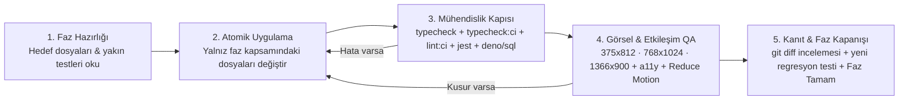

# Aderyth — Uçtan Uca Mühendislik, Mimari Dönüşüm ve 28 Rakip Özellik Uygulama Rehberi (`implementation.md`)

**Durum:** `ONAY BEKLİYOR (AWAITING USER APPROVAL)`  
**Kaynak Denetim Belgesi:** [aderyth_360_audit_and_competitor_master_report.md](docs/ADERYTH_360_AUDIT_AND_COMPETITOR_REPORT.md)  
**Hedef Kapsam:** Master rapordaki **tüm teknik bozuklukların, güvenlik açıklarının, veritabanı/migrasyon kopukluklarının, Spatial UI/UX & Bilgi Mimarisi sorunlarının, production operasyon katmanlarının ve 28 rakip uygulamadan eşlenen özelliklerin** **4 Dalga / 24 Atomik Faz** halinde sıfır regresyonla hayata geçirilmesi.  
**Çalışma Dizini:** `c:\Users\Trade Bilisim\Mobile_Uygulama` (`frontend/`, `supabase/`, `.github/workflows/`, `docs/`, `tools/`)

---

## 0. Yürütme Anayasası, Sıfır-Regresyon Kuralları & Mimari Karar Kayıtları (ADR)

### 0.1 Atomik Faz Yürütme Döngüsü ("Teker Teker ve Kusursuz" Protokolü)

Hiçbir faz toplu veya doğrulanmadan geçilmez. Her **Faz (`Faz 01` .. `Faz 24`)** kendi içinde bağımsız, derlenebilir, testleri %100 yeşil ve geri alınabilir bir mühendislik teslimatıdır:



#### Her Faz Sonunda Zorunlu Doğrulama Komutları (Hard Gates)
```powershell
# 1. Frontend Tip Güvenliği (Yerel + CI Paritesi)
cd frontend
npm run typecheck
npm run typecheck:ci

# 2. Sıfır Uyarı ESLint Kapısı
npm run lint:ci

# 3. Çalışma Zamanı Test Paketi (Mevcut 264+ suite + ilgili fazın yeni testleri)
npx jest --runInBand

# 4. Web Production Bundle Doğrulaması (UI/Rota değişen her fazda)
npx expo export --platform web

# 5. Backend / SQL / Edge Değişen Fazlarda Ek Zorunlu Kapılar
deno check supabase/functions/_shared/*.ts supabase/functions/*/index.ts
deno test supabase/functions/_shared/
# + Yerel/CI Postgres 17 üzerinde live_schema.sql + 028..03X migrasyon + xp_drift() = 0 testi
```

> [!CAUTION]
> **Değiştirilemez Güvenlik Sınırları (Hard Invariants):**
> 1. **Canlı DB Koruması:** Canlı Supabase projesine (`kbcuolhjjnmhjaarxxmu`) doğrudan ham `supabase db push` çalıştırılmaz ([ciGatesWired.test.ts](file:///c:/Users/Trade%20Bilisim/Mobile_Uygulama/frontend/__tests__/repo/ciGatesWired.test.ts#L51) bu kuralı denetler). Tüm SQL migrasyonları önce izole `postgres:17` konteynerinde [live_schema.sql](file:///c:/Users/Trade%20Bilisim/Mobile_Uygulama/supabase/live_schema.sql) üzerine uygulanarak ve **Supabase Staging Branch** üzerinde `supabase db advisors` + `xp_drift() = 0` kanıtlanarak doğrulanır.
> 2. **Supabase RLS & Fonksiyon Güvenliği:** Yeni veya güncellenen her tabloda `ALTER TABLE ... ENABLE ROW LEVEL SECURITY;`, açık `REVOKE ALL ON TABLE ... FROM anon, PUBLIC;`, `GRANT ... TO authenticated;` ve `auth.role()` yerine `TO authenticated USING ((select auth.uid()) = user_id) WITH CHECK ((select auth.uid()) = user_id)` kalıbı zorunludur. Tüm yeni view'lar `WITH (security_invoker = true)` ile tanımlanır.
> 3. **Görsel QA Kapısı:** Derlemenin geçmesi görsel başarı sayılmaz; UI değişen her fazda mobil (`375×812`), tablet (`768×1024`) ve masaüstü (`1366×900`) görünümlerinde taşma, kesilme, klavye odak halkası, `>= 44×44pt` dokunma hedefi ve `Reduce Motion` davranışı doğrulanır.

---

### 0.2 Onaya Sunulan 6 Temel Mimari Karar (ADR-01 .. ADR-06)

Bu planda aşağıdaki 6 mimari karar varsayılan standart olarak benimsenmiştir (onay aşamasında yorum bırakarak herhangi birini değiştirebilirsiniz):

| Kod | Konu | Alınan Mühendislik & Ürün Kararı |
| :--- | :--- | :--- |
| **ADR-01** | **Tema Mimarisi** | 158 WebP görsel ve Kintsugi sanat yönetimi sıcak koyu kanvas üzerine inşa edildiği için çalışmayan (placebo) `Açık / Koyu / Sistem` anahtarı kaldırılır; **Spatial Kintsugi Koyu Tema** kanonik tema olur. Buna karşılık [useAccent.ts](file:///c:/Users/Trade%20Bilisim/Mobile_Uygulama/frontend/lib/useAccent.ts) içindeki 4 Kintsugi vurgu rengi (*Toprak, Adaçayı, Arduvaz, Kehribar*) tüm aktif bileşenlere bağlanır ve neon SaaS renkleri (`#6366f1`, `#ec4899`) temizlenir. |
| **ADR-02** | **Uyuyan Oyunlaştırma Şeması & Calm-Tech Sınırı** | Canlı DB'deki `user_pets`, `pet_stages`, `quests`, `user_quests`, `shop_items`, `user_inventory`, `challenges`, `user_challenges` ve `boss_contributors` silinmez; önce `on_habit_completed_damage_boss` satır kilidi kaldırılır (`Faz 03`), ardından `today.tsx` dinginliğine **tek piksel sokulmadan** yalnızca [hub.tsx](file:///c:/Users/Trade%20Bilisim/Mobile_Uygulama/frontend/app/tabs/hub.tsx) (**"Kintsugi Sığınağı"**) içinde *ölümü olmayan, `recovery_plans` ile altın damarlarla iyileşen yoldaş + kişisel gerçek hayat ödül menüsü* olarak canlandırılır (`Faz 16`). Yerine yeni yapı geçmiş 6 miras tablo (`ai_calls`, `daily_capacity`, `habit_reminders`, `habit_templates`, `routine_items`, `user_gamification`) ise güvenli `archive_legacy` şemasına taşınır. |
| **ADR-03** | **Backend Dil & Runtime** | `%100 Supabase Native` (**PostgreSQL 17 PLpgSQL/RLS + Deno 2 TypeScript Edge Functions** + istemciyle ortak `zod`/TS sözleşmeleri) korunur; çift kod tabanı yaratacak erken bir Go göçü yapılmaz. |
| **ADR-04** | **Migrasyon Stratejisi** | Mevcut `001..037` dosya adları ve [ciGatesWired.test.ts](file:///c:/Users/Trade%20Bilisim/Mobile_Uygulama/frontend/__tests__/repo/ciGatesWired.test.ts) CI sözleşmesi kırılmadan `028..037` eksikleri tamamlanır, güvenlik/indeks/saat dilimi yamaları yeni sıralı migrasyonlarla (`038+`) eklenir ve uzak `schema_migrations` defteri Staging üzerinde `supabase migration repair` protokolüyle hizalanır. |
| **ADR-05** | **Çevrimdışı (Offline) Motor** | 3 ayrı kuyruk (`syncQueue.ts`, `outbox.ts`, `coreOutbox.ts`) ve 5 sahte Network-First store kademeli olarak `expo-sqlite` tabanlı **Tekil Atomik Outbox-First Motorunda** (`Faz 24`) birleştirilir. |
| **ADR-06** | **Küresel Dil (`i18n`)** | `expo-localization` + `i18next` altyapısı `Faz 21`'de 5 dil (**TR, EN, JA, DE, ES**) destekleyecek şekilde kurulur; TR ve EN %100 insan kalitesinde ana sözlük olarak, JA/DE/ES genişleme sözlükleri olarak paketlenir. |

---

### 0.3 24 Fazlık Master Yol Haritası Özeti

| Dalga | Faz Aralığı | Odak Alanı | Yeni Native Binary Derlemesi? |
| :--- | :--- | :--- | :---: |
| **Dalga 0 (`P0 BLOCKER`)** | `Faz 01` – `Faz 04` | Auth kilidi, `signOut` + 29 store hesap izolasyonu, `restoreRepository` çökme yaması, SDK 57 paket hijyeni, `028..038` DB güvenlik/indeks/saat dilimi yamaları, `subscription-webhook` & yasal URL'ler | Hayır *(yalnız Expo uyumlu `expo-document-picker` / `expo-sharing`)* |
| **Dalga 1 (`P0 CORE`)** | `Faz 05` – `Faz 12` | `zod` + 281 tip kaçışı temizliği, EMA Alışkanlık Gücü, Kintsugi Onarılmış Seri, Habit Stacking, HabitKit 16×7 SVG ızgara, satır içi süre sayacı, TTS Sesli Rutin Yürütücü, Todoist NLP + kayan tekrar + gerçek alt görevler + AI SOS, 24s `DayRibbon` + Boşluk Avcısı + Due Nagging bildirimler, Daylio 5 sn bağlam check-in + 4-kaynak korelasyon motoru, 6-bar Matruşka yıkımı, Reanimated/BottomSheet/FlashList & 401 MB bitmap optimizasyonu | Hayır *(halihazırda kurulu Reanimated 4, Gesture Handler, SVG, Speech kullanılır)* |
| **Dalga 2 (`P1 DIFFERENTIATION`)** | `Faz 13` – `Faz 20` | RevenueCat IAP, APNs/FCM çoklu cihaz push + `pg_cron` + analitik, iOS WidgetKit/Dynamic Island & Android Glance, Apple Health / Health Connect oto-tamamlama, `hub.tsx` Kintsugi Sığınağı (`user_pets`/`quests`/`shop_items`/`challenges`), Supabase Realtime Presence Body Doubling + Forest Derin Kalkan, MindShift BDT & Dear Me `low_day` Zaman Kapsülü, HelloHabit saniyelik bırakma sayacı + Loop CSV göçü + Year in Pixels, TimeTune şablonları & Todoist Kanban/Ramble | **Evet** *(EAS Dev/Prod Build: RevenueCat, HealthKit/Health Connect, Widget targets)* |
| **Dalga 3 (`P2 SCALE & GLOBAL`)** | `Faz 21` – `Faz 24` | 5 dil `i18n` (TR/EN/JA/DE/ES), canlı `google-sync` & idempotent `notion-sync` + PKCE `spotify-auth` + Share Intent, Geofencing + Fotoğraf/Ses anıları + Arkadaş meydan okumaları + WaterDo akşam hasadı, Tekil SQLite Outbox + React 19 Compiler + Maestro/Playwright E2E | Opsiyonel (`expo-share-intent`, `expo-location`, `expo-image-picker`) |

---

## DALGA 0 — Üretim Engelleyicileri, Güvenlik, Oturum İzolasyonu & Veritabanı Bütünlüğü (`Faz 01` – `Faz 04`)

---

### Faz 01 — Auth Kapısı, Gerçek `signOut`, 29 Store Hesap İzolasyonu & Placebo Tema Temizliği

#### Çözdüğü Rapor Bulguları
- Yönetici Özeti `#1` ([login.tsx](file:///c:/Users/Trade%20Bilisim/Mobile_Uygulama/frontend/app/(auth)/login.tsx#L49-L67) üretimde açık "🚀 Girişi Geç (Demo Modu)" birincil butonu)
- Yönetici Özeti `#2` & Bölüm `2.3` (Normal `signOut` butonu yokluğu; çıkışta 29 store'un 24'ünün RAM'de kalması; `<uid>` kapsamı olmayan 5 `AsyncStorage` anahtarından hesaplar arası veri sızıntısı)
- Yönetici Özeti `#3` & Bölüm `5.2.1` (259 dosyada 0 kez okunan placebo `Açık/Koyu` tema seçici; yarım kalan `useAccent`)
- Bölüm `5.3.3` ([register.tsx](file:///c:/Users/Trade%20Bilisim/Mobile_Uygulama/frontend/app/(auth)/register.tsx#L274-L283) tıklanamayan Kullanım Koşulları / Gizlilik metni — App Store 5.1.1 ret nedeni)

#### Değişecek ve Yeni Oluşturulacak Dosyalar
1. **Yeni:** `frontend/services/sessionLifecycleService.ts`
   - `frontend/store/*.ts` altındaki **29 Zustand store'un tamamı** için standart bir `resetMemoryState()` kayıt defteri (`registerStoreReset`) ve `resetAllStoresOnAccountChange(prevUserId, nextUserId)` orkestratörü oluştur.
   - Çıkış anında: (a) aktif zamanlayıcıları (`focusStore`, `routineRunnerStore`) durdur, (b) zamanlanmış yerel bildirimleri iptal et (`cancelAllScheduledNotificationsAsync`), (c) SQLite bellek içi okuma önbelleği referanslarını temizle, (d) `supabase.auth.signOut({ scope: 'local' })` + çevrimiçiyse global oturum kapatmayı çalıştır ve `/(auth)/login` rotasına yönlendir.
2. **Güncelleme:** `frontend/store/` altındaki `<uid>` kapsamsız ve RAM temizliksiz store'lar:
   - [focusStore.ts](file:///c:/Users/Trade%20Bilisim/Mobile_Uygulama/frontend/store/focusStore.ts#L50-L52): `focus.session.v1` anahtarını `focus.session.v2:${userId}` yap; eski unscoped anahtarı ilk okumada sil.
   - [aiConversationStore.ts](file:///c:/Users/Trade%20Bilisim/Mobile_Uygulama/frontend/store/aiConversationStore.ts): `lastConversationId` anahtarını `ai.lastConversation.v2:${userId}` kapsamına al ve çıkışta mesaj dizisini boşalt.
   - [logStore.ts](file:///c:/Users/Trade%20Bilisim/Mobile_Uygulama/frontend/store/logStore.ts): Hesap değişiminde `queueOwnerId` ve `logsByDate` Map'ini sıfırla.
   - [noteStore.ts](file:///c:/Users/Trade%20Bilisim/Mobile_Uygulama/frontend/store/noteStore.ts) & [journalStore.ts](file:///c:/Users/Trade%20Bilisim/Mobile_Uygulama/frontend/store/journalStore.ts): Modül-seviyesi `serverVersion` / `serverContent` Map yapılarını sıfırlayan `resetAccountCache()` fonksiyonlarını bağla.
   - [BadHabitsTracker.tsx](file:///c:/Users/Trade%20Bilisim/Mobile_Uygulama/frontend/components/BadHabitsTracker.tsx): Unscoped `deflected_urges_count` anahtarını yeni `frontend/store/badHabitStore.ts` içine `badHabits.urges.v2:${userId}` olarak taşı.
3. **Güncelleme:** [login.tsx](file:///c:/Users/Trade%20Bilisim/Mobile_Uygulama/frontend/app/(auth)/login.tsx) & [register.tsx](file:///c:/Users/Trade%20Bilisim/Mobile_Uygulama/frontend/app/(auth)/register.tsx)
   - `login.tsx`: `"Giriş Yap"` butonunu birincil (`variant="primary"`, `size="lg"`) yap. `"Demo Olarak Dene"` bloğunu yalnızca `if (__DEV__ && isSeedingAllowed())` koşulunda ikincil geliştirici aracı olarak göster ve [demoSeed.ts](file:///c:/Users/Trade%20Bilisim/Mobile_Uygulama/frontend/lib/demoSeed.ts) modülünü dinamik `await import('../../lib/demoSeed')` ile yükle.
   - `register.tsx`: Kullanım Koşulları ve Gizlilik Politikası metinlerini `Linking.openURL` / uygulama içi yasal görünüm açan erişilebilir (`accessibilityRole="link"`) tıklanabilir bağlantılara dönüştür.
4. **Güncelleme:** [app/_layout.tsx](file:///c:/Users/Trade%20Bilisim/Mobile_Uygulama/frontend/app/_layout.tsx), [app/tabs/_layout.tsx](file:///c:/Users/Trade%20Bilisim/Mobile_Uygulama/frontend/app/tabs/_layout.tsx), [app/tabs/settings.tsx](file:///c:/Users/Trade%20Bilisim/Mobile_Uygulama/frontend/app/tabs/settings.tsx), [store/themeStore.ts](file:///c:/Users/Trade%20Bilisim/Mobile_Uygulama/frontend/store/themeStore.ts), [lib/useAccent.ts](file:///c:/Users/Trade%20Bilisim/Mobile_Uygulama/frontend/lib/useAccent.ts)
   - `app/_layout.tsx` `onAuthStateChange` dinleyicisinde `SIGNED_OUT` veya `session?.user?.id !== prevUserId` yakalandığında `resetAllStoresOnAccountChange` çağır.
   - `settings.tsx` Hesap bölümüne bekleyen outbox kaydı varsa kullanıcıyı uyaran (*"Senkronize edilmemiş X değişiklik var, yine de çıkılsın mı?"*) gerçek **"Çıkış Yap"** aksiyonu ekle.
   - Üst bardaki ve `settings.tsx` içindeki işlevsiz `Açık / Koyu / Sistem` tema düğmelerini kaldır; yerine `settings.tsx` Görünüm kartında 4 Kintsugi Vurgu Rengi (*Toprak `#C87D55`, Adaçayı `#7A9A86`, Arduvaz `#7B8FA1`, Kehribar `#D4AF37`*) seçicisini öne çıkar ve aktif tab ikonu, birincil buton, ilerleme halkası ve odak vurgularına gerçek zamanlı bağla.

#### Kabul Kriterleri & Faz 01 Testleri
- Üretim modunda (`__DEV__ === false`) `login.tsx` render edildiğinde Demo butonu DOM/ağaçta kesinlikle bulunmaz.
- Hesap A'da görev, alışkanlık, odak seansı, AI sohbeti ve not oluşturup `Çıkış Yap` -> Hesap B'ye giriş yapıldığında Hesap A'ya ait **sıfır** RAM state'i ve **sıfır** unscoped `AsyncStorage` anahtarı okunur (`__tests__/services/sessionAccountIsolation.test.ts` — 29 store'un tamamını döngüyle doğrulayan yeni otomatik test).

---

### Faz 02 — Yedekleme/Geri Yükleme Saatli Bombası (`restoreRepository.ts`) & SDK `57.0.22` Paket/Derleyici Hijyeni

#### Çözdüğü Rapor Bulguları
- Bölüm `6.4` ([restoreRepository.ts](file:///c:/Users/Trade%20Bilisim/Mobile_Uygulama/frontend/repositories/restoreRepository.ts#L44) `.order('id')` çağrısının `id` kolonu olmayan `habit_goal_versions` ve `habit_checklist_checks` tablolarında `42703` ile çökmesi; panodan MB'larca JSON yapıştırma zorunluluğu)
- Bölüm `1.2` & `1.3` (SDK `57.0.22` native sürüm sapmaları, `fix-expo-tsconfig.js` monkey-patch, `metro.config.js` `maxWorkers = 2` darboğazı, ölü `react-native-dotenv` / `@expo/ngrok` / `react-native-animatable` paketleri, eksik `zod`)

#### Değişecek ve Yeni Oluşturulacak Dosyalar
1. **Güncelleme:** [frontend/repositories/restoreRepository.ts](file:///c:/Users/Trade%20Bilisim/Mobile_Uygulama/frontend/repositories/restoreRepository.ts) & [frontend/lib/backupFormat.ts](file:///c:/Users/Trade%20Bilisim/Mobile_Uygulama/frontend/lib/backupFormat.ts)
   - Sabit `.order('id', { ascending: true })` yerine her yedeklenen tablo için deterministik birincil/bileşik anahtar haritası (`BACKUP_TABLE_ORDER_SPEC`) tanımla:
     - `habit_goal_versions`: `['habit_id', 'effective_from']`
     - `habit_checklist_checks`: `['item_id', 'checked_date']`
     - `weekly_xp`: `['user_id', 'week_start']`
     - `willpower_state`: `['user_id', 'state_date']`
     - `user_onboarding` / `user_subscriptions`: `['user_id']`
     - Standart `id` tabloları: `['id']`
   - `028..031` tablolarını (`habit_pauses`, `habit_goal_versions`, `habit_checklist_items`, `habit_checklist_checks`, `routine_templates`, `mood_checkins`, `review_next_actions`) yedekleme şeması `v3`'e (`zod` doğrulamalı, `v1/v2` geriye uyumlu) dahil et.
2. **Güncelleme:** [frontend/app/tabs/settings.tsx](file:///c:/Users/Trade%20Bilisim/Mobile_Uygulama/frontend/app/tabs/settings.tsx) & [frontend/package.json](file:///c:/Users/Trade%20Bilisim/Mobile_Uygulama/frontend/package.json)
   - `npx expo install expo-document-picker expo-sharing zod` kurulumu (Web'de `<input type="file" accept=".json,application/json">` + Blob indirme, mobilde native paylaşım sayfası ve dosya seçici).
   - SDK `57.0.22` sürüm hizalaması: `expo-sqlite` -> `~57.0.3`, `expo-asset` -> `~57.0.17`, `expo-constants` -> `~57.0.18`, `expo-font` -> `~57.0.4`, `@react-native-async-storage/async-storage` -> `2.2.0`, `react-native-web` -> `~0.21.0`, `@types/react-test-renderer` -> `~19.2.0`.
   - `react-native-dotenv` paketini sil; `@expo/ngrok` paketini `devDependencies` altına taşı; [timeline.tsx](file:///c:/Users/Trade%20Bilisim/Mobile_Uygulama/frontend/app/tabs/timeline.tsx#L17) ve [habits.tsx](file:///c:/Users/Trade%20Bilisim/Mobile_Uygulama/frontend/app/tabs/habits.tsx#L18) içindeki `react-native-animatable` kullanımını `react-native-reanimated` (`Animated.View entering={FadeInDown.duration(220)}`) ile değiştirip `react-native-animatable` paketini kaldır.
3. **Güncelleme:** [frontend/metro.config.js](file:///c:/Users/Trade%20Bilisim/Mobile_Uygulama/frontend/metro.config.js#L27) & [frontend/scripts/fix-expo-tsconfig.js](file:///c:/Users/Trade%20Bilisim/Mobile_Uygulama/frontend/scripts/fix-expo-tsconfig.js)
   - `metro.config.js`: Sabit `config.maxWorkers = 2` yerine `Math.max(2, Math.min(8, os.cpus().length - 1))` (veya `process.env.METRO_MAX_WORKERS` override) kullan.
   - `node_modules` içine fiziksel yazım yapan `postinstall` yamasını (`fix-expo-tsconfig.js`) `tsconfig.json` `skipLibCheck: true` + temiz yerel tip bildirimleriyle gereksiz kılıp kaldır.

#### Kabul Kriterleri & Faz 02 Testleri
- `BACKUP_TABLE_ORDER_SPEC` içindeki her tablonun sıralama kolonlarının [live_schema.sql](file:///c:/Users/Trade%20Bilisim/Mobile_Uygulama/supabase/live_schema.sql) + `028..031` SQL tanımlarıyla %100 eşleştiğini kanıtlayan `__tests__/repositories/restoreRepositoryOrderColumns.test.ts` testi yeşil geçer.
- `npx expo-doctor` paket sürüm uyumluluğu kontrolünde SDK 57 sapması sıfırlanır.

---

### Faz 03 — Veritabanı Migrasyon Uzlaştırması (`028..037`) & `038` Güvenlik, XP, İndeks ve Saat Dilimi Sertleştirmesi

#### Çözdüğü Rapor Bulguları
- Bölüm `4.1` & `4.2` (`028..037` uygulanmamış migrasyonlar, `028..031` unutulmuş `GRANT/REVOKE` blokları, soğuk açılışta boşa giden `get_today_bootstrap` `PGRST202` RTT'si, 6 atıl miras tablo)
- Bölüm `4.3` (`weekly_xp` liderlik tablosu sabotajı, `S11` + `036` sonrası kalan **`purged_xp` 1990..1995 sonsuz XP istismarı**, 100K kullanıcıda tek satırı kilitleyen `on_habit_completed_damage_boss` trigger'ı, `notion_integrations.access_token` istemci sızıntısı, `get_user_rank` BOLA ve tam tablo taraması, eksik 12 `user_id` + sıcak keyset bileşik indeksler, `tasks_parent_task_id_fkey` `ON DELETE CASCADE` eksikliği, Türkiye Pazartesi `00:00-02:59` UTC kayması, `habit_deletions` çift kayıt hatası)

#### Değişecek ve Yeni Oluşturulacak Dosyalar
1. **Yeni Migrasyon:** `supabase/migrations/038_security_indexes_and_tz_hardening.sql`
   - **A. Eksik API Yetkileri (`028..031` Düzeltmesi):** `habit_pauses`, `habit_goal_versions`, `habit_checklist_items`, `habit_checklist_checks`, `routine_templates`, `routine_template_versions`, `routine_sessions`, `mood_definitions`, `mood_checkins`, `review_next_actions` tablolarında `REVOKE ALL ON TABLE ... FROM anon, PUBLIC; GRANT SELECT, INSERT, UPDATE, DELETE ON TABLE ... TO authenticated;` ve `(select auth.uid()) = user_id` (`USING` + `WITH CHECK`) politikalarının sıkılaştırılması.
   - **B. `global_bosses` Küresel Satır Kilidinin Kaldırılması (`DB-03`):**
     ```sql
     DROP TRIGGER IF EXISTS on_habit_completed_damage_boss ON public.habit_logs;
     ```
     *(Topluluk hedefi `Faz 16`'da kilitsiz append-only `boss_contributors` üzerinden ve `xp_drift()` uyumlu olarak yeniden bağlanacaktır).*
   - **C. `S11` + `purged_xp` Sonsuz XP İstismarının Tam Kapatılması:**
     - `habit_xp_awards` tablosundaki `habit_id` foreign key kısıtından `ON DELETE CASCADE` kaldırılır (`habit_id UUID NOT NULL` düz değer olarak kalır); böylece bir alışkanlık silinip yeniden açılsa bile aynı `(user_id, habit_id, awarded_date)` veya günlük XP tavanı (`MAX_DAILY_HABIT_XP = 300`) aşılamaz!
     - Doğrudan istemci `habit_logs` `INSERT/UPDATE` işlemlerinde `completed_date` alanı kullanıcının yerel bugününe göre `[today - 31 days, today + 1 day]` penceresiyle sınırlandırılır; daha eski tarihsel veri göçleri (`Faz 19` CSV import) yalnızca `xp_awarded = 0` garantili `import_historical_habit_logs` RPC'si üzerinden yapılır.
   - **D. `notion_integrations` Token İzolasyonu & `get_user_rank` Yaması:**
     - `REVOKE ALL ON TABLE public.notion_integrations FROM anon, authenticated;` — istemciye yalnız `workspace_name`, `connected_at`, `last_synced_at`, `database_id` döndüren `get_notion_integration_status()` (`SECURITY DEFINER`, `SET search_path = public`, `WHERE user_id = (select auth.uid())`) RPC'si açılır (`access_token` asla istemciye çıkmaz!).
     - `get_user_rank()` parametresiz veya yalnız `(select auth.uid())` için çalışacak şekilde daraltılır ve `profiles(total_xp DESC)` indeksini kullanan `O(log N)` sorguya çevrilir.
   - **E. Eksik 12 `user_id` İndeksi + Sıcak Keyset / Zaman İndeksleri + Cascade:**
     - `projects(user_id)`, `goals(user_id)`, `okrs(user_id)`, `key_results(okr_id)`, `focus_tasks(user_id)`, `deep_work_sessions(user_id, started_at DESC)`, `habit_deletions(user_id)`, `routines(user_id)`, `habit_checklist_items(user_id, habit_id)`, `routine_templates(user_id)`, `routine_template_versions(template_id)`, `mood_definitions(user_id)`
     - `tasks(user_id, created_at DESC, id DESC)`, `tasks(user_id, due_date) WHERE is_completed = false`, `habit_logs(user_id, completed_date DESC)`, `mood_checkins(user_id, created_at DESC)`, `profiles(total_xp DESC)`, `weekly_xp(week_start, xp_earned DESC)`
     - `tasks_parent_task_id_fkey` -> `ON DELETE CASCADE` olarak yenilenmesi; JSONB kolonlarına `pg_column_size(...) <= 32768` `CHECK` kısıtları.
   - **F. `profiles.timezone` (`Europe/Istanbul`) Saat Dilimi Doğrulaması:**
     - `track_weekly_xp`, `get_weekly_leaderboard` ve `get_today_bootstrap` içinde UTC `CURRENT_DATE` yerine kullanıcının `COALESCE(profiles.timezone, 'Europe/Istanbul')` saat dilimine göre hesaplanan yerel tarih ve yerel Pazartesi başlangıcı (`date_trunc('week', (now() AT TIME ZONE tz))::date`) kullanılır.
   - **G. 6 Atıl Miras Tablonun İzolasyonu:** `CREATE SCHEMA IF NOT EXISTS archive_legacy;` -> `ai_calls`, `daily_capacity`, `habit_reminders`, `habit_templates`, `routine_items`, `user_gamification` tablolarından `anon`/`authenticated` yetkileri tamamen geri alınır (`REVOKE ALL`) ve şema kalabalığından çıkarılır.
2. **Güncelleme:** [frontend/repositories/habitRepository.ts](file:///c:/Users/Trade%20Bilisim/Mobile_Uygulama/frontend/repositories/habitRepository.ts#L141)
   - DB trigger'ı zaten `habit_deletions` kaydı ürettiği için istemcinin mükerrer `habit_deletions` insert çağrısını tekilleştir (veya `ON CONFLICT DO NOTHING` / tek otoriteye indir).
3. **Güncelleme:** [.github/workflows/ci.yml](file:///c:/Users/Trade%20Bilisim/Mobile_Uygulama/frontend/../.github/workflows/ci.yml) & `supabase/predeploy_guard.sh`
   - `db-migrations-verify` (`postgres:17`) işine `038_security_indexes_and_tz_hardening.sql` uygulanmasını, negatif güvenlik testlerini (`weekly_xp` doğrudan yazım reddi, `1995` tarihli log XP farming reddi, `notion_integrations` token okuma reddi, `xp_drift() = 0`) ve Staging release runbook'unu ([supabase/migrations/README.md](file:///c:/Users/Trade%20Bilisim/Mobile_Uygulama/supabase/migrations/README.md)) ekle *(Not: [ciGatesWired.test.ts](file:///c:/Users/Trade%20Bilisim/Mobile_Uygulama/frontend/__tests__/repo/ciGatesWired.test.ts) içindeki tüm mevcut beklentiler %100 korunur!)*.

#### Kabul Kriterleri & Faz 03 Testleri
- `postgres:17` CI işinde `live_schema.sql` + `028..038` sıfır hatayla uygulanır; simüle edilen `authenticated` rolüyle yapılan `weekly_xp` sahteciliği, `purged_xp` döngüsü ve `notion_integrations` token okuması Postgres tarafından reddedilir; `xp_drift()` sonucu `0` satır döner.

---

### Faz 04 — Edge Functions Deno 2 Sertleştirmesi, `subscription-webhook` İstismar Yaması & Mağaza Hukuki Uyumluluğu

#### Çözdüğü Rapor Bulguları
- Bölüm `4.4.1` (Deno 2 altında eski `deno.land/std@0.168.0` importları, `deno.lock` yokluğu, `config.toml` içinde eksik `[functions.<slug>] verify_jwt` tanımları)
- Bölüm `4.4.2` (`subscription-webhook` idempotency yokluğu, **`UNCANCELLATION` sonsuz ücretsiz abonelik + 1.000 FP kredi istismarı**, haftalık planda 4x kredi hatası, `` `$RCAnonymousID:` `` `500` çökmesi, `get_or_init_subscription` `FOR UPDATE` yarış koşulu)
- Bölüm `4.4.5` (`generate-routine` RPM burst sınırı yokluğu, `routine` modunda kırılgan regex `JSON.parse`, `summarize`/`insights` ham metin LLM proxy açığı, tek sağlayıcı `529` çökme riski)
- Bölüm `6.6` (`delete-account` OAuth token revocation eksikliği, `aderyth.com/{privacy,support,delete-account}` yayın doğrulaması, Auth CAPTCHA)

#### Değişecek ve Yeni Oluşturulacak Dosyalar
1. **Yeni Migrasyon:** `supabase/migrations/039_subscription_webhook_idempotency.sql`
   - `public.subscription_webhook_events(event_id TEXT PRIMARY KEY, event_type TEXT NOT NULL, app_user_id TEXT, processed_at TIMESTAMPTZ NOT NULL DEFAULT now())` (`REVOKE ALL FROM anon, authenticated;` — yalnız `service_role`).
   - `process_revenuecat_event_v2(...)` atomik PLpgSQL fonksiyonu:
     - `INSERT INTO subscription_webhook_events ... ON CONFLICT (event_id) DO NOTHING` ile %100 replay/retry koruması.
     - `INITIAL_PURCHASE` ve `RENEWAL`: Gerçek `p_expiration_at` tarihini yazar ve dönem uzunluğuna göre kredi verir (`weekly -> 250 FP`, `monthly -> 1000 FP`, `annual -> ilk ay 1000 FP + aylık yenileme`).
     - `UNCANCELLATION` ve `PRODUCT_CHANGE`: **Asla yeni kredi basmaz** ve süreyi `now() + 1 month` diye uzatmaz; yalnızca `p_expiration_at > now()` ise `cancel_at_period_end = false` ve gerçek `sub_period_end = p_expiration_at` günceller!
     - `get_or_init_subscription`: `SELECT * FROM public.user_subscriptions WHERE user_id = v_uid FOR UPDATE;` kilidiyle ay dönümü çift kredi yarışını kapatır.
2. **Güncelleme:** `supabase/config.toml`, `supabase/functions/deno.json` (YENİ) & 7 Edge Function
   - Tüm Edge Function'larda `Deno.serve(...)` ve pinlenmiş `npm:@supabase/supabase-js@2.107.0` / `jsr:` importlarına geç; `deno.lock` üret.
   - `supabase/config.toml` içine 7 fonksiyonun tamamı için açık `[functions.<slug>]` bloklarını ekle (`subscription-webhook` -> `verify_jwt = false` + zorunlu sabit-zamanlı `Authorization: Bearer <REVENUECAT_WEBHOOK_SECRET>` kontrolü; OAuth callback'leri ve `generate-routine` / `delete-account` kendi güvenlik politikalarıyla).
   - [subscription-webhook/index.ts](file:///c:/Users/Trade%20Bilisim/Mobile_Uygulama/supabase/functions/subscription-webhook/index.ts): `` `$RCAnonymousID:` `` veya geçersiz UUID geldiğinde `500` yerine `202 Accepted ({ ignored: 'anonymous_id' })` döndür.
   - [generate-routine/index.ts](file:///c:/Users/Trade%20Bilisim/Mobile_Uygulama/supabase/functions/generate-routine/index.ts): (a) Son 60 saniyede `ai_requests` sayısına göre `RPM <= 10` burst rate-limit (`HTTP 429 + Retry-After`), (b) `routine` ve `split_task` modlarında regex yerine yapılandırılmış `tool_choice` (`coachContractSchema`), (c) `summarize` ve `insights` modlarında ham metin yerine kullanıcının kendi `journal_entry_id` / `note_id` kaydını DB'den okuma (veya sıkı uzunluk + sistem görevi kilidi), (d) Anthropic `529/5xx` veya `8 sn` ilk-token zaman aşımında `GEMINI_API_KEY` varsa otomatik `gemini-2.5-flash` yedek akışı, `Nexus Pro` abonelerinde üst model seçimi.
   - [delete-account/index.ts](file:///c:/Users/Trade%20Bilisim/Mobile_Uygulama/supabase/functions/delete-account/index.ts): Kullanıcı silinmeden önce `google_calendar_integrations` (`oauth2.googleapis.com/revoke`), `spotify_accounts` ve `notion_integrations` token iptallerini `Promise.allSettled` ile çalıştır; aktif mağaza aboneliği varsa istemci onay ekranında Google Play / App Store abonelik yönetim linkini zorunlu göster.
3. **Güncelleme:** `docs/store/web/` & `tools/verify-public-legal-urls.mjs` (YENİ)
   - `privacy.html`, `support.html`, `delete-account.html` sayfalarını tek komutla Cloudflare Pages / Vercel / GitHub Pages üzerinden `aderyth.com` alan adına yayınlayacak yapılandırma (`vercel.json` / `_redirects`) ve HTTP 200 doğrulama betiği.

#### Kabul Kriterleri & Faz 04 Testleri
- `deno test supabase/functions/` altında: (a) aynı `event_id` ile 3 kez gönderilen `INITIAL_PURCHASE` yalnız 1 kez kredi yazar, (b) 10 kez gönderilen `UNCANCELLATION` **0 FP** kredi yazar ve tarihi keyfi uzatmaz, (c) `` `$RCAnonymousID:abc` `` `202` döner, (d) `generate-routine` 11. dakikadaki burst isteğe `429` döner.

---

## DALGA 1 — Çekirdek Motor Onarımları, Tip/Mimari Temizlik, Bilgi Mimarisi & Sıfır-Paket Rakip Özellikleri (`Faz 05` – `Faz 12`)

---

### Faz 05 — Tip Güvenliği (`dynamicClient` & 281 Tip Kaçışı Temizliği), `zod` Şemaları & Katman Mimarisi Onarımı

#### Çözdüğü Rapor Bulguları
- Bölüm `1.1` (`repositories/shared.ts:18` `dynamicClient()` ile tüm PostgREST şema tip korumasının sıfırlanması, 281 tip kaçışı, `today.tsx` 34 `as any`, `tsconfig.json` vs `tsconfig.ci.json` ayrışması, `noUncheckedIndexedAccess` eksikliği, 4 GB heap baskısı)
- Bölüm `1.3.B.1` (`zod` olmadığı için 2.300+ satır elle yazılmış `typeof` doğrulayıcısı)
- Bölüm `2.1` (`services/` katmanını atlayan 9+5 store, `activateHabit` + `willpower.spend` yarışı, `todayBootstrapService` stale-overwrite yarışı)

#### Değişecek ve Yeni Oluşturulacak Dosyalar
1. **Güncelleme:** [frontend/lib/database.types.ts](file:///c:/Users/Trade%20Bilisim/Mobile_Uygulama/frontend/lib/database.types.ts) & [frontend/repositories/shared.ts](file:///c:/Users/Trade%20Bilisim/Mobile_Uygulama/frontend/repositories/shared.ts#L18)
   - `database.types.ts` dosyasını `028..039` tablolarını/RPC'lerini içerecek ve `archive_legacy` şemasındaki ölü tabloları dışlayacak şekilde yenile (TSC bellek tüketimini düşürür).
   - `dynamicClient = () => supabase as unknown as SupabaseClient` kaçışını kaldır; `typedClient = () => supabase` üzerinden tüm `repositories/*.ts` dosyalarındaki **50 adet `as unknown as`** ifadesini gerçek `Database['public']['Tables'][T]['Row']` satır eşleyicileriyle değiştir.
2. **Yeni:** `frontend/lib/schemas/` (`routineProposalSchema.ts`, `taskDecompositionSchema.ts`, `coachActionsSchema.ts`, `backupSchema.ts`)
   - `zod` şemaları ile [routineProposal.ts](file:///c:/Users/Trade%20Bilisim/Mobile_Uygulama/frontend/lib/routineProposal.ts), [taskDecomposition.ts](file:///c:/Users/Trade%20Bilisim/Mobile_Uygulama/frontend/lib/taskDecomposition.ts), [coachActions.ts](file:///c:/Users/Trade%20Bilisim/Mobile_Uygulama/frontend/lib/coachActions.ts) ve [backupFormat.ts](file:///c:/Users/Trade%20Bilisim/Mobile_Uygulama/frontend/lib/backupFormat.ts) içindeki yüzlerce satırlık manuel `typeof` bloklarını sadeleştir (tüm mevcut birim testleri birebir yeşil kalacak şekilde).
3. **Güncelleme:** `frontend/lib/routes.ts` (YENİ tipli rota yardımcıları) + `frontend/tsconfig.json` & `tsconfig.ci.json`
   - `today.tsx` içindeki 34 adet `router.push(... as any)` çağrısını tipli `Href` sabitleriyle sıfırla.
   - `tsconfig.json` içinde `noImplicitOverride: true` ve `noUncheckedIndexedAccess: true` bayraklarını açıp ortaya çıkan indeks erişimlerini güvenli hale getir.
4. **Yeni / Güncelleme (`services/` Katman Tamamlaması):**
   - `goalService.ts`, `projectService.ts`, `okrService.ts`, `readingListService.ts`, `lifeAreasService.ts`, `deepWorkService.ts`, `insightsService.ts`, `profileService.ts`, `subscriptionService.ts` ve `integrationAuthService.ts` üzerinden tüm store'ların `UI -> Store -> Service -> Repository` katman kuralına uymasını sağla.
   - [habitStore.ts](file:///c:/Users/Trade%20Bilisim/Mobile_Uygulama/frontend/store/habitStore.ts#L284-L312) `activateHabit`: İrade harcaması başarısız olursa alışkanlık durumunu geri alan (compensating rollback) veya tek RPC/servis işleminde yürüten atomik akış kur.
   - [todayBootstrapService.ts](file:///c:/Users/Trade%20Bilisim/Mobile_Uygulama/frontend/services/todayBootstrapService.ts#L174-L205): Her store için `mutationEpoch` sayacı tut; bootstrap uçuş halindeyken kullanıcı bir görev/alışkanlık işaretlediyse eski bootstrap yanıtının o store'u ezmesini engelle!

#### Kabul Kriterleri & Faz 05 Testleri
- `repositories/` dizininde `as unknown as` sayısı `50 -> 0`; `app/tabs/today.tsx` içinde `as any` sayısı `34 -> 0`.
- Bootstrap uçuş sırasında yapılan kullanıcı check-in işleminin bootstrap döndüğünde ezilmediğini kanıtlayan `__tests__/services/todayBootstrapRace.test.ts` yeşil geçer.

---

### Faz 06 — Çekirdek Davranış Motorları: Bilimsel EMA Alışkanlık Gücü (*Loop*), Kintsugi Onarılmış Seri (*Disciplined / Dear Me*) & Aktif Habit Stacking (*Habitify*)

#### Çözdüğü Rapor Bulguları
- Bölüm `3.2.1` & `7.3 (#15 Loop)` ([habitStrength.ts](file:///c:/Users/Trade%20Bilisim/Mobile_Uygulama/frontend/lib/habitStrength.ts#L154-L197) takvim-körlüğü nedeniyle haftada 3 günlük %100 başarılı alışkanlığın `%43`'te kilitlenmesi, mola günlerinin `miss` sayılması, `partial` oranın sabit `0.5`'e ezilmesi)
- Bölüm `3.2.2`, `7.2 (#12 Dear Me)` & `7.3 (#21 Disciplined)` (`currentStreak` sabahleyin `0` göstermesi; tamamlanan `recovery_plans` telafisinin `source_date`'i köprülememesi; `recovery.tsx:548` kırmızı `colors.error` ceza kutusu)
- Bölüm `3.1` (`habits.tsx` vs `timeline.tsx` ~150 satır kopya yaşam döngüsü kodu ve `timeline.tsx`'te eksik kapasite override hakkı)
- Bölüm `7.3 (#13 Habitify)` (`habits.cue_habit_id` kolonunun pasif metin olarak kalması)

#### Değişecek ve Yeni Oluşturulacak Dosyalar
1. **Güncelleme:** [frontend/lib/habitStrength.ts](file:///c:/Users/Trade%20Bilisim/Mobile_Uygulama/frontend/lib/habitStrength.ts)
   - Yeni kanonik imza: `computeHabitStrength(habit, logsByDate, pauses, mendedDates, todayStr)` (eski imza geriye uyumlu sarmalayıcıyla `@deprecated` işaretlenir, tüm çağrı noktaları yeni imzaya geçirilir).
   - **Loop (`uhabits`) Sıklık-Ölçekli EMA Denklemi:**
     - Alışkanlığın haftalık beklenen sıklığından günlük frekans `f = expectedPerWeek / 7` hesaplanır; zayıflama çarpanı `alpha = 1 - Math.pow(0.5, Math.sqrt(f) / 13.0)`.
     - Kronolojik taramada:
       - `isPausedOn(habit, date, pauses)` veya `log?.status === 'skip'`: **Dondur** (`score` değişmez — ne ödül ne ceza!).
       - `carriesDayLoad(habit, date) === false` ve o gün ekstra tamamlama yok: **Dinlenme günü** (`score` korunur).
       - `done` veya `mendedDates.has(date)` (Kintsugi onarımı): `score = score * (1 - alpha) + 1.0 * alpha` (`mended` için `0.85` onarım katsayısı).
       - `partial`: Gerçek `clamp(value / target, 0.15, 0.95)` oranıyla ağırlıklı güncelleme.
       - Planlı gün kaçırıldıysa (`miss`, ancak `date === todayStr` ve gün henüz bitmediyse cezalandırma!): `score = score * (1 - alpha)`.
   - `today.tsx`, `timeline.tsx` ve `habit-detail.tsx` üzerinde her alışkanlıkta `%91 Güç` mikro-halkası/rozeti gösterilir.
2. **Güncelleme:** [frontend/lib/behaviorIntelligence.ts](file:///c:/Users/Trade%20Bilisim/Mobile_Uygulama/frontend/lib/behaviorIntelligence.ts#L457-L468) & [frontend/app/screens/recovery.tsx](file:///c:/Users/Trade%20Bilisim/Mobile_Uygulama/frontend/app/screens/recovery.tsx)
   - **Sabah Grace-Period:** `todayStr` henüz tamamlanmadıysa seri sayacı `0` döndürmez; bir önceki planlı günden geriye doğru sayar (`today` tamamlandığında `+1` eklenir).
   - **Kintsugi Onarılmış Seri (`mendedStreak`):** `recoveryStore` içinde `status === 'completed'` olan `recovery_plans` kayıtlarının `source_date` tarihleri seri motoruna `mendedDates` kümesi olarak verilir; kaçan gün altın dikişle köprülenir ve kullanıcıya [GoldMendShimmer.tsx](file:///c:/Users/Trade%20Bilisim/Mobile_Uygulama/frontend/components/spatial/GoldMendShimmer.tsx) efektiyle *"14 Günlük Seri (1 Kintsugi Onarımı)"* olarak gösterilir. Ayrıca hastalık/seyahat için ayda 2 haklı retroaktif dün-`skip` (**"Şefkat İzni"**) eklenir.
   - `recovery.tsx:548-555`: Parlak hata kırmızısı (`colors.error`) tamamen sıcak Kintsugi altınına (`#D4AF37`) çevrilir ve Kristin Neff'in 3 adımlı öz-şefkat karşılaması (*Farkındalık -> Ortak İnsanlık -> Nazik İlk Adım*) yerleştirilir.
3. **Yeni:** `frontend/lib/habitChains.ts` & `frontend/hooks/useHabitLifecycleActions.ts`
   - `habitChains.ts`: `habits.cue_habit_id` bağlantılarını döngü-korumalı (cycle-safe) topolojik zincirlere dönüştürür. `today.tsx` ve `timeline.tsx` üzerinde bağlı alışkanlıkları sol kenarda altın Kintsugi bağlantı rayıyla gruplar; çapa alışkanlık tamamlandığında *"⛓️ Sıradaki halka: 10 dk Esneme -> [Şimdi Başlat]"* çubuğu açar ve tüm zinciri tek tuşla `routine-runner.tsx` oturumu olarak başlatabilir.
   - `useHabitLifecycleActions.ts`: `habits.tsx` ve `timeline.tsx` içindeki kopya silme/geri alma/etkinleştirme/kapasite override mantığını tek kancada birleştirir.

#### Kabul Kriterleri & Faz 06 Testleri
- Haftada 3 gün (`Pzt/Çar/Cum`) planlanıp 90 gün %100 yapılan alışkanlık `%43` yerine **`>= %95` ("Köklü")** güç skoru üretir; 14 günlük `habit_pauses` tatili boyunca güç `%0,0` düşer (`__tests__/lib/habitStrengthScheduleAware.test.ts`).
- Sabah 08:30'da henüz bugünkü kutu işaretlenmemişken 21 günlük aktif seri tüm ekranlarda `21` görünür; dünkü kaçan günü `recovery_plans` ile telafi eden kullanıcının serisi kırılmaz (`__tests__/lib/kintsugiMendedStreak.test.ts`).

---

### Faz 07 — HabitKit Tarzı 16×7 SVG Katkı Izgarası, Satır İçi Canlı Süre Sayacı (*HabitNow*) & `today.tsx` Ölçülebilir Check-in Akışı

#### Çözdüğü Rapor Bulguları
- Bölüm `7.3 (#14 HabitKit)` (`timeline.tsx` üzerinde çoklu-alışkanlık GitHub katkı ızgarası olmaması; `fetchCompletedHabitLogsRange` sorgusunun `.eq('is_completed', true)` yüzünden `partial` ve `skip` kayıtlarını silmesi)
- Bölüm `7.3 (#16 HabitNow / #20 HelloHabit)` (`duration` alışkanlıklarda satır üstü canlı kronometre/geri sayım olmaması)
- Bölüm `5.1.4` ([today.tsx](file:///c:/Users/Trade%20Bilisim/Mobile_Uygulama/frontend/app/tabs/today.tsx#L454-L457) üzerinde ölçülebilir alışkanlığa basınca kullanıcıyı `/tabs/timeline` ekranına fırlatma sürtünmesi)

#### Değişecek ve Yeni Oluşturulacak Dosyalar
1. **Güncelleme:** [frontend/repositories/habitRepository.ts](file:///c:/Users/Trade%20Bilisim/Mobile_Uygulama/frontend/repositories/habitRepository.ts#L166-L185) + **Yeni:** `frontend/components/habits/HabitTileGridCard.tsx`
   - `fetchHabitGridStatesRange(userId, startDate, endDate)`: Tek sorguda son 112 günün (`16 hafta × 7 gün`) `habit_id, completed_date, status, is_completed, value` alanlarını eksiksiz çeker (`partial` ve `skip` dahil!).
   - `HabitTileGridCard.tsx`: Kurulu `react-native-svg` ile alışkanlık başına **tek bir `<Svg>`** yüzeyinde (112 ayrı RN `<View>` mount etmeden, 60 FPS!) 16×7 katkı ızgarası çizer:
     - `done`: Alışkanlık vurgu rengi (`1.0` opaklık)
     - `partial`: Orantılı opaklık (`0.35 – 0.75`)
     - `skip` / `pause` / `mended`: İç dolgusu koyu, **1px altın Kintsugi çerçeveli (`#D4AF37`)** hücre
     - Kartın sağ üstünde 1-tap tamamlama / `+` artırım butonu ve `%Güç` + `Seri` rozeti.
   - [timeline.tsx](file:///c:/Users/Trade%20Bilisim/Mobile_Uygulama/frontend/app/tabs/timeline.tsx#L533-L547): Görünüm seçiciye `'flow' | 'matrix' | 'grid'` (**"Akış | 7 Gün | Izgara"**) olarak eklenir.
2. **Yeni:** `frontend/store/activeHabitTimerStore.ts` + `frontend/components/habits/InlineHabitTimerPill.tsx`
   - `startedAtEpochMs`, `accumulatedSeconds`, `targetSeconds` ve `habitId` alanlarını `<uid>` kapsamlı saklar (uygulama arka plana atılıp 12 dakika sonra açıldığında duvar saatinden saniyesi saniyesine doğru hesaplar!).
   - `goal_type === 'duration'` olan her alışkanlık satırında (`today.tsx` ve `timeline.tsx`) doğrudan `[▶ 20:00]` / `[⏸ 14:22 · Kaydet]` hapı görünür; hedef dolduğunda nazik haptik + `persistCompletion` otomatik çalışır.
3. **Yeni:** `frontend/components/habits/MeasuredCheckInSheet.tsx` + **Güncelleme:** [today.tsx](file:///c:/Users/Trade%20Bilisim/Mobile_Uygulama/frontend/app/tabs/today.tsx#L454-L457)
   - `today.tsx` üzerinde `"2000 ml Su"` gibi sayısal bir alışkanlığa dokunulduğunda sayfa değiştirmeden anında `"+250 ml"`, `"+500 ml"`, `"Hedefi Tamamla"` ve özel sayı çipleri sunan kompakt alt çekmece açılır.

#### Kabul Kriterleri & Faz 07 Testleri
- 15 aktif alışkanlık × 112 gün (`1.680` hücre) `Izgara` görünümünde tek toplu sorgu ve 15 `<Svg>` düğümüyle `< 16ms` kare süresinde çizilir; `partial` ve `skip` hücreleri görsel olarak ayrışır.
- Süreli alışkanlık sayacı başlatılıp 5 dakika arka planda bekledikten sonra ön plana dönüldüğünde tam `5:00` ilerlemiş görünür.

---

### Faz 08 — Sesli Rutin Yürütücü (*RoutineDay / Routinery*) & `030` Bulut Senkronizasyonu

#### Çözdüğü Rapor Bulguları
- Yönetici Özeti `#6`, Bölüm `3.2.4` & `7.2 (#3 RoutineDay, #4 Routinery)` (`routine-runner.tsx` `expo-speech` çağırmadığı için %100 sessiz çalışması; Act 1 şablon kartlarında toplam süre ve *"Şimdi başlarsan 08:47'de biter"* projeksiyonunun olmaması; ölçülebilir alışkanlıkların atlanması)
- Bölüm `2.2` & `4.1` (`030_routine_runner.sql` tablolarına %0 frontend bağlantısı; rutin şablonlarının cihaz silinince yok olması)

#### Değişecek ve Yeni Oluşturulacak Dosyalar
1. **Yeni:** `frontend/repositories/routineRunnerRepository.ts` & `frontend/services/routineRunnerService.ts`
   - `routine_templates`, `routine_template_versions` ve `routine_sessions` tablolarına Outbox-First CRUD bağlantısı.
   - İlk oturum açılışında `routineRunnerStore` içindeki mevcut yerel `AsyncStorage` şablonlarını buluta kayıpsız göç ettiren tek seferlik `migrateLocalRoutineTemplatesToCloud(userId)` köprüsü.
2. **Güncelleme:** [frontend/app/screens/routine-runner.tsx](file:///c:/Users/Trade%20Bilisim/Mobile_Uygulama/frontend/app/screens/routine-runner.tsx) & [frontend/lib/routineRunner.ts](file:///c:/Users/Trade%20Bilisim/Mobile_Uygulama/frontend/lib/routineRunner.ts)
   - **Act 1 Başlangıç Öncesi Zaman Projeksiyonu:** Her şablon kartında her dakikada bir güncellenen **`"5 adım · 18 dk · Şimdi başlarsan 08:47'de biter"`** satırı.
   - **Gerçek `expo-speech` Sesli Koç (`lib/routineVoiceCoach.ts`):** Kapatılabilir `🔊 Sesli Rehber` anahtarıyla:
     - Adım başladığında: *"Sıradaki adım: Yatağı topla. Süre: 3 dakika."*
     - Son 60 saniyede (adım `>= 3 dk` ise): *"Son bir dakika."*
     - Adım tamamlandığında nazik haptik + sesli geçiş (*"Harika. Sıradaki adıma geçiyoruz."*). `Speech.stop()` yaşam döngüsü unmount ve duraklatmada temizlenir.
   - **Pozitif Overtime & Esnek Uzatma:** Süre `00:00` olduğunda kırmızı hata vermez; sıcak kehribar renginde **`+01:24 Ek Süre`** olarak ileri saymaya devam eder ve tek dokunuşla `+1 dk` / `+5 dk` uzatma sunar.
   - **Adım İçi Ölçülebilir Tamamlama:** Adım bir `numeric` veya `duration` alışkanlığa bağlıysa (`routineRunner.ts:275` atlama hatası giderilerek) adım kartında doğrudan `[Hedef: 500 ml — Kaydet ✓]` veya adım kronometresi değeriyle otomatik `persistCompletion` çalıştırılır.

#### Kabul Kriterleri & Faz 08 Testleri
- `Speech.speak` çağrılarının adım geçişlerinde ve son 60 saniyede tetiklendiğini, sessiz modda sustuğunu ve unmount anında `Speech.stop()` çağırdığını doğrulayan `__tests__/screens/routineRunnerVoiceAndSync.test.ts` yeşil geçer.

---

### Faz 09 — Görev Motoru Evrimi (*Todoist* TR/EN NLP, Kayan Tekrar, Gerçek Alt Görevler, *Inflow* Canlı AI SOS & `focus_tasks` Birleştirmesi)

#### Çözdüğü Rapor Bulguları
- Yönetici Özeti `#7` & Bölüm `3.2.3` (`ADHDTaskSplitter` sahte yerel şablonu ve `parent_task_id` kullanmadığı için 1 görevi 4 kök göreve şişirmesi)
- Bölüm `5.1.3` (`focus.tsx` ekranının ana `tasks` tablosu yerine kopuk `focus_tasks` tablosunu okuması)
- Bölüm `7.2 (#1 Inflow)` (`FocusFlowView.tsx:200` `lowEnergy: false` sabit kodu; `today.tsx` üzerinde "Başlayamıyorum (SOS)" butonu yokluğu)
- Bölüm `7.4 (#24 Todoist)` (`tasks.tsx` Yeni Görev modalında tarih ve proje seçicisinin bile olmaması; %0 NLP hızlı ekleme; %0 görev tekrarlama)

#### Değişecek ve Yeni Oluşturulacak Dosyalar
1. **Yeni Migrasyon:** `supabase/migrations/040_tasks_recurrence_estimates_and_focus_unification.sql`
   - `tasks` tablosuna `estimated_minutes SMALLINT CHECK (estimated_minutes IS NULL OR estimated_minutes BETWEEN 1 AND 720)`, `recurrence_config JSONB CHECK (pg_column_size(recurrence_config) <= 2048)`, `reminder_at TIMESTAMPTZ`, `nag_interval_minutes SMALLINT CHECK (nag_interval_minutes IN (5, 10, 15, 30))` kolonlarını ekle.
   - `focus_sessions` tablosuna `main_task_id UUID REFERENCES public.tasks(id) ON DELETE SET NULL` ekle ve mevcut `focus_tasks` satırlarını kullanıcının `tasks` tablosuna (`category = 'focus'`) kayıpsız göç ettiren veri migrasyonunu çalıştır.
2. **Yeni:** `frontend/lib/taskNlpParser.ts` + `frontend/components/tasks/NlpChipPreviewBar.tsx`
   - Sıfır AI token harcayan deterministik **TR + EN Doğal Dil Ayrıştırıcı**:
     - Tarih: `bugün`, `yarın`, `öbür gün`, `haftaya pazartesi..pazar`, `15 mayıs`, `tomorrow`, `next tue`
     - Saat & Zaman Bloğu: `14:30`, `saat 09:00`, `14:00-15:30` (-> otomatik `time_block_start` & `time_block_end` + `estimated_minutes = 90`!)
     - Tahmini Süre: `~25dk`, `~1s`, `45m` (-> `estimated_minutes`, [capacity.ts](file:///c:/Users/Trade%20Bilisim/Mobile_Uygulama/frontend/lib/capacity.ts#L59) sabit 15 dk varsayımı yerine gerçek süreyi kullanır!)
     - Proje & Öncelik & Etiket: `#ProjeAdı` (mevcut projeyle eşleştirir), `p1`/`p2`/`p3` veya `!!!`/`!!`, `@etiket`
     - **Çift Modlu Tekrar:** `her gün` / `her pazartesi` (`anchor: 'schedule'` sabit takvim) vs **`her! 3 gün` / `every! 2 weeks` (`anchor: 'completion'` — gecikse bile birikme yapmayan DEHB-dostu kayan tekrar!)**
   - [InlineComposer.tsx](file:///c:/Users/Trade%20Bilisim/Mobile_Uygulama/frontend/components/InlineComposer.tsx) ve [tasks.tsx](file:///c:/Users/Trade%20Bilisim/Mobile_Uygulama/frontend/app/tabs/tasks.tsx) görev oluşturma çekmecesine tam Tarih, Saat Bloğu, Tahmini Süre, Proje, Tekrar seçicileri ve canlı `NlpChipPreviewBar` bağlanır.
3. **Güncelleme:** [frontend/lib/taskDecomposition.ts](file:///c:/Users/Trade%20Bilisim/Mobile_Uygulama/frontend/lib/taskDecomposition.ts), [frontend/components/ADHDTaskSplitter.tsx](file:///c:/Users/Trade%20Bilisim/Mobile_Uygulama/frontend/components/ADHDTaskSplitter.tsx), `frontend/store/energyStore.ts` (YENİ) & [frontend/app/tabs/focus.tsx](file:///c:/Users/Trade%20Bilisim/Mobile_Uygulama/frontend/app/tabs/focus.tsx)
   - `ADHDTaskSplitter`: Canlı `generate-routine` (`mode: 'split_task'`) uç noktasını çağırır (çevrimdışıysa yerel şablona düşer); oluşturulan 3–5 mikro-adımı `parent_task_id = rootTask.id, is_subtask = true` olarak kaydeder; `computeDailyLoad` ana görev + alt görevleri çift saymaz ve ilk 2 dakikalık mikro-adımı tek tuşla `SmallStartSheet` sayacında başlatır.
   - `today.tsx` üst aksiyon şeridine **"⚡ Başlayamıyor musun? (SOS)"** çekmecesi ve küresel `energyStore` (`low | steady | high`) bağlanır (`FocusFlowView.tsx:200` gerçek enerji durumunu okur).
   - `focus.tsx`: Kopuk `focus_tasks` yerine doğrudan `useTaskStore` üzerindeki bugünkü görevleri ve alt görevleri listeler; tamamlanan Pomodoro seansı gerçek görevin ilerlemesine yazılır.

#### Kabul Kriterleri & Faz 09 Testleri
- `"Yarın 14:00-15:00 Sunum taslağını bitir #Ürün p1 ~60dk her! 7 gün"` metni `< 1ms` içinde başlık, tarih, zaman bloğu, proje, `high` öncelik, `60 dk` süre ve `completion`-bazlı 7 günlük tekrar nesnesine ayrışır (`__tests__/lib/taskNlpParser.test.ts`).
- 1 görevi 4 alt adıma bölmek kök görev sayısını `1`'de tutar ve `dailyLoad` kapasitesini 4x şişirmez.

---

### Faz 10 — Birleşik 24 Saatlik Gün Şeridi (*Super Planner / TimeTune*), Boşluk Avcısı, Yeniden Planlama & Israrcı Bildirimler (*Due / Habit It*)

#### Çözdüğü Rapor Bulguları
- Bölüm `7.0` & `7.4 (#25 TimeTune, #26 Super Planner)` (Canlı DB'de hazır bekleyen `tasks.time_block_start/end`, `calendars`, `events` tablolarının %0 UI olması; `calendar.tsx`'in sadece aylık nokta takvimi göstermesi; `computeDailyLoad` kapasite motorunun takvimdeki 6 saatlik toplantıdan habersiz olması)
- Bölüm `6.2`, `7.3 (#18 Habit It)` & `7.4 (#27 Apple Reminders & Due)` (Görevler için %0 bildirim; `notifications.ts:26` `shouldPlaySound: false` sabit kodu; `opensAppToForeground: true` yüzünden bildirim aksiyonunun uygulamayı zorla açması; DEHB bildirim körlüğü için otomatik takip hatırlatıcısı olmaması)

#### Değişecek ve Yeni Oluşturulacak Dosyalar
1. **Yeni:** `frontend/repositories/calendarEventRepository.ts`, `frontend/lib/dayRibbonEngine.ts` & `frontend/components/calendar/DayRibbonView.tsx`
   - Canlı DB'deki `calendars` ve `events` tablolarını tipli repository ile aktif hale getirir (`RLS` + Outbox-First etkinlik ekleme/düzenleme).
   - **`DayRibbonEngine`:** Seçilen gün için (1) sabit takvim etkinliklerini (`events`), (2) zaman bloklu görevleri (`tasks.time_block_start/end`), (3) saate bağlı alışkanlıkları ve rutinleri tek bir 24 saatlik kronolojik akışta birleştirir.
   - **Boşluk Avcısı (*Gap Matcher*):** Bloklar arasındaki `>= 25 dk` serbest aralıkları otomatik tespit edip şerit üzerinde **`[14:00–15:30 • 90 dk Serbest Pencere — Uygun Görev Yerleştir +]`** kartı olarak çizer; dokunulduğunda yalnızca `estimated_minutes <= 90` olan bekleyen görevleri önerir.
   - **`replanRemainingDay(now)` ("Öğleden Sonrayı Yeniden Planla"):** Saat 15:00'te sarkan esnek görevleri, sabit `events` bloklarına dokunmadan `now + 10dk` sonrasındaki serbest pencerelere otomatik kaydırır; akşama sığmayanları tek onayla yarına veya düşük enerji moduna aktarır.
   - **Toplantı-Duyarlı `computeDailyLoad` ([capacity.ts](file:///c:/Users/Trade%20Bilisim/Mobile_Uygulama/frontend/lib/capacity.ts)):** O günkü sabit `events` toplam dakikasını günlük kullanılabilir kapasite bütçesinden düşer (*6 saat toplantısı olan günde kullanıcıya aşırı görev yüklenmesini engeller!*).
   - [calendar.tsx](file:///c:/Users/Trade%20Bilisim/Mobile_Uygulama/frontend/app/screens/calendar.tsx) ekranına **`Gün Şeridi (24s) | Hafta | Ay`** görünüm geçişi eklenir.
2. **Güncelleme:** [frontend/lib/notifications.ts](file:///c:/Users/Trade%20Bilisim/Mobile_Uygulama/frontend/lib/notifications.ts) + **Yeni:** `frontend/lib/taskNotifications.ts`
   - `shouldPlaySound`: Kullanıcı ayarına bağlı olarak varsayılan `true` yapılır; Android kanalları (`habit-reminders`, `task-urgent-nag`) ve iOS `interruptionLevel: 'timeSensitive'` yapılandırılır.
   - **Uygulamayı Açmadan Arka Plan Aksiyonları:** `COMPLETE_ACTION` ve yeni `QUICK_INCREMENT_ACTION` (`"+1"`) için `opensAppToForeground: false` ayarlanır; arka plan bildirim dinleyicisi doğrudan `habitLogService` / `taskStore.toggleDone` çağırarak kilit ekranından 1 saniyede tamamlama yapar.
   - **Due Tarzı Israrcı Takip Kaskadı (`Nagging Cascade`):** iOS 64 yerel bildirim limiti içinde `44 Alışkanlık + 20 Görev/Nag` bütçe yöneticisi kurulur. `nag_interval_minutes` (`5 | 10 | 15 | 30`) seçili kritik görevlerde `[T, T+Δ, T+2Δ, T+3Δ]` 4 bildirimlik yerel kaskad zamanlanır; görev tamamlandığı veya bildirimden `"+15 dk" / "5 dk Küçük Başlangıç" / "Bu Akşam 20:00" / "Yarın 09:00"` seçildiği anda kalan kaskad iptal edilir.

#### Kabul Kriterleri & Faz 10 Testleri
- `09:00-12:00` ve `13:30-17:00` toplantıları olan bir günde `DayRibbonEngine` tam olarak `12:00-13:30 (90 dk)` ve `17:00+` boşluklarını bulur; `replanRemainingDay(15:00)` sabah kaçan 45 dakikalık görevi `17:10-17:55` penceresine taşır (`__tests__/lib/dayRibbonEngine.test.ts`).
- `nag_interval_minutes = 10` olan görev tamamlandığında bekleyen 3 takip bildiriminin tamamı iptal edilir ve toplam zamanlanmış bildirim sayısı asla `60`'ı aşmaz (`__tests__/lib/taskNotificationsBudget.test.ts`).

---

### Faz 11 — 5 Saniyelik Bağlam Check-in (*Daylio*), `031` Bulut Senkronu, Sıfır-Token 4-Kaynak Korelasyon Motoru & V2 Koç Aksiyonları

#### Çözdüğü Rapor Bulguları
- Bölüm `2.2`, `4.1` & `7.4 (#28 Daylio)` (`moodStore.ts` ve `reviewActions.ts` dosyalarının `031_moods_and_review_actions.sql` bulut tablolarına %0 bağlı olması; bağlam etiketleri olmaması; korelasyon motorunun `journal-archive.tsx:160` içinde gizli kalıp `focus_sessions`, `tasks` ve ertesi gün Lag-1 etkisini hesaplamaması)
- Bölüm `2.4` (`032..035` hazır olduğu halde `COACH_ACTIONS_V2_ENABLED` ve `LOG_TIMEZONE_ENABLED` kilitlerinin kapalı kalması)

#### Değişecek ve Yeni Oluşturulacak Dosyalar
1. **Yeni Migrasyon:** `supabase/migrations/041_mood_context_tags.sql`
   - `mood_checkins` tablosuna `context_tags TEXT[] NOT NULL DEFAULT '{}'::TEXT[] CHECK (cardinality(context_tags) <= 12)` ekle.
2. **Yeni:** `frontend/repositories/moodRepository.ts`, `frontend/repositories/reviewActionRepository.ts` & `frontend/components/mood/QuickMoodContextSheet.tsx`
   - `moodStore.ts` ve `reviewActions.ts` Outbox-First olarak `031` + `041` bulut tablolarına bağlanır (mevcut yerel `AsyncStorage` kayıtları ilk senkronda buluta taşınır).
   - `QuickMoodContextSheet`: `today.tsx` üzerindeki duygu çubuğuna dokunulduğunda klavye açmadan 5 saniyede `1..5 Mod + 12 Bağlam Çipi (İyi Uyku, Kötü Uyku, Egzersiz, Açık Hava, Sosyal, Derin Odak, Geç Ekran, Kafein, Sağlıklı Öğün, Stres, Mola, Şükran)` kaydeder.
3. **Yeni:** `frontend/lib/correlationEngine.ts` + **Güncelleme:** `frontend/app/screens/insights.tsx` & `frontend/app/screens/ai-coach.tsx`
   - Sıfır AI kredisi harcayan cihaz-içi **4-Kaynak Çapraz Korelasyon Motoru**:
     - Aynı gün etkisi (`Lag-0`): `habit_logs × mood_checkins`, `context_tags × mood_checkins`, `focus_sessions dakikası × mood_checkins`, `dailyLoad aşımı × ertesi gün tamamlama oranı`.
     - **Ertesi Gün Etkisi (`Lag-1`):** *"Geç Ekran işaretlediğin gecelerin ertesi günü odak süren ortalama %32 daha düşük"* veya *"Akşam Yürüyüşü yaptığın günlerin ertesi sabahı rutin tamamlama oranın +%28 daha yüksek"*.
     - İstatistiksel güvenlik: Yalnızca `n >= 10` gözlem (`>= 5` pozitif + `>= 5` negatif gün) ve anlamlı etki büyüklüğü (`|Δ| >= 0.4` mod puanı veya `>= %18` tamamlama farkı) olduğunda kart üretir; nedensellik iddia etmeyen dürüst dil (*"Birlikte görülme eğilimi"*) kullanır.
   - `insights.tsx` ana ekranının en üstüne **"Keşfedilen Kişisel Örüntülerin"** vitrini olarak yerleşir ve `ai-coach` sohbet başlangıcına özet bağlam olarak enjekte edilir.
4. **Güncelleme:** [frontend/lib/featureGates.ts](file:///c:/Users/Trade%20Bilisim/Mobile_Uygulama/frontend/lib/featureGates.ts#L242-L251)
   - `032..035` migrasyonları doğrulandıktan sonra `COACH_ACTIONS_V2_ENABLED = true` ve `LOG_TIMEZONE_ENABLED = true` bayraklarını üretimde aç.

#### Kabul Kriterleri & Faz 11 Testleri
- `n < 10` veriyle gürültülü/yanıltıcı korelasyon üretilmediğini, `n >= 14` sentetik veriyle hem `Lag-0` hem `Lag-1` örüntülerinin doğru bulunduğunu doğrulayan `__tests__/lib/correlationEngine.test.ts` yeşil geçer.

---

### Faz 12 — Bilgi Mimarisi ("6 Barlı Matruşka" Yıkımı), Reanimated/BottomSheet Devrimi, FlashList, a11y & 401 MB Bitmap Optimizasyonu

#### Çözdüğü Rapor Bulguları
- Yönetici Özeti `#8`, `#9`, `#11` & Bölüm `5.1` (`plan.tsx` + `goals.tsx` üzerinde üst üste 6 navigasyon barı; 6 gizli yetim `/tabs/*` rotası ve Dual-Mount çift SafeArea/Canvas sorunu; ilk günden 35+ modül ADHD aşırı yüklemesi; `dashboard.tsx` sahte matris rotası; `profile.tsx` kopya entegrasyon listesi)
- Bölüm `5.2` & `5.3` (0% Reanimated/Gesture kullanımı; 35 ham `<Modal>`; Android/Web'de kırık 6-butonlu `Alert.alert`; `ChecklistSheet` 20×20pt kapanmayan modal; `MorphingPillTabs` JS-thread takılması; `useReducedMotion` ilk kare sıçraması; `stats.tsx`/`life-areas.tsx` SE 320pt taşması; çift `edges={['top']}`; `timeline.tsx:951` FAB ve Undo Toast çakışması; `< 44×44pt` dokunma hedefleri; `Drawer.tsx:258` iç içe `<button>` Web DOM hatası; çalışmayan `⌘ K` / `ESC` rozetleri)
- Bölüm `3.1` & `3.3` (Top-6 God-File monolitleri; 57 sanallaştırılmamış liste ve 365 `<TouchableOpacity>` ısı haritası; 401,17 MB RGBA8888 bitmap bellek ayak izi)

#### Değişecek ve Yeni Oluşturulacak Dosyalar
1. **Navigasyon & Bilgi Mimarisi Tekilleştirmesi:**
   - **5 Kök Alt Sekme:** `Bugün (today)` | `Plan (plan: Görevler & 24s Gün Şeridi)` | `Alışkanlıklar (timeline: Akış / 7 Gün / 16×7 Izgara)` | `İçgörüler (insights + stats)` | `Sığınak (hub + profil)`.
   - `plan.tsx` ve `goals.tsx` içindeki kopya 3. ve 4. sekme çubuklarını tek bir bağlamsal segment şeridine indir (**maksimum 1 üst bağlam şeridi + 1 alt kök sekme çubuğu!**).
   - 6 gizli yetim `/tabs/*` rotasını (`tasks`, `focus`, `stats`, `habits`, `hub`, `settings`) Dual-Mount olmaktan çıkar: kanonik tam ekran rotalar yalnız `/screens/*` altında (açık `<BackHeader />` ile, çift `SafeAreaView` ve çift `AtmosphericScreenCanvas` olmadan!) çalışır; eski `/tabs/*` linkleri `<Redirect />` ile kanonik rotaya yönlendirilir.
   - **ADHD Kademeli Açılım (*Progressive Disclosure*):** Yeni kullanıcı modunda `Bugün` ekranı yalnızca *Enerji/Mod Çubuğu + Odak Taşı (#1 Öncelik) + Bugünkü Alışkanlıklar + Bugünkü Görevler* gösterir (`Odak Akışı` daraltılmış tek satırlık kapsül olur; OKR, Eisenhower, Haftalık/Aylık İnceleme gibi ileri modüller kullanıcı 3. günü tamamladığında veya *"İleri Planlama Araçlarını Göster"* dediğinde açılır).
   - `Drawer.tsx` içindeki `"Triage & Matris"` linkini gerçekten Eisenhower Matrisi görünümüne bağla; `profile.tsx` içindeki kopya entegrasyon sekmesini teke indir ve hazır olmayan 20+ `'comingSoon'` kalabalığını tek bir *"Yakında Gelecek Bağlantılar"* daraltılabilir (collapsible) çekmecesinde topla.
2. **Reanimated 4 + Gesture Handler + `@gorhom/bottom-sheet` Geçişi:**
   - `npx expo install @gorhom/bottom-sheet @shopify/flash-list` kurulumu.
   - Paylaşımlı `frontend/components/ui/AtlasBottomSheet.tsx` ve `ConfirmActionSheet.tsx` oluştur:
     - `today.tsx:370` (6-butonlu kırık `Alert.alert`), `routine-runner.tsx:361`, `ChecklistEditor.tsx:37`, `ChecklistSheet.tsx` ve `today/timeline/focus/settings` içindeki ham `<Modal>` yığınlarını arka plana dokununca ve aşağı kaydırınca kapanan gerçek bottom-sheet'lere taşı.
   - `frontend/components/motion/SwipeableActionRow.tsx` (YENİ): `GestureDetector` + Reanimated ile alışkanlık ve görev satırlarında **sağa kaydır -> Tamamla (Haptic)**, **sola kaydır -> Yarına Ertele / 5 dk Küçük Başlangıç**.
   - [MorphingPillTabs.tsx](file:///c:/Users/Trade%20Bilisim/Mobile_Uygulama/frontend/components/motion/MorphingPillTabs.tsx#L69-L82): `useNativeDriver: false` JS animasyonunu Reanimated `useSharedValue` + `useAnimatedStyle` ile UI thread'e taşı.
   - [useReducedMotion.ts](file:///c:/Users/Trade%20Bilisim/Mobile_Uygulama/frontend/components/seasonalMotion/useReducedMotion.ts): İlk senkron değeri `AccessibilityInfo.isReduceMotionEnabled()` önbelleğinden / Web `matchMedia('(prefers-reduced-motion: reduce)')` üzerinden okuyarak ilk kare sıçramasını bitir ve tüm animasyon bileşenlerine uygula.
3. **Performans, Görsel RAM Bütçesi, Responsive & Erişilebilirlik (a11y):**
   - `YearlyHeatmap.tsx`: 365 ayrı `<TouchableOpacity>` yerine **tek bir `<Svg>`** + dokunma `(x, y)` koordinatından gün hesaplayan `Pressable` kapsayıcıya geç (365 fiber düğümü -> 1 düğüm!) ve seçili günü büyüteçli bilgi kartında göster.
   - `@shopify/flash-list` + `useMemo`: `today.tsx` seçicilerini (`selectTodayHabits`, `dueToday`, `overdue`) ve `habit-detail.tsx` 10 analitik hesabını `useMemo` ile sar; uzun listeleri `FlashList` ile sanallaştır.
   - **401 MB Bitmap RAM Optimizasyonu:**
     - [AtmosphericScreenCanvas.tsx](file:///c:/Users/Trade%20Bilisim/Mobile_Uygulama/frontend/components/spatial/AtmosphericScreenCanvas.tsx): `useIsFocused()` `false` olduğunda arka plan katman görsellerini unmount ederek aktif olmayan sekmelerin GPU doku belleğini sıfırla; `allowDownscaling={true}` ve hafif Kintsugi renk `placeholder` geçişi ekle; [OnboardingScaffold.tsx](file:///c:/Users/Trade%20Bilisim/Mobile_Uygulama/frontend/components/onboarding/OnboardingScaffold.tsx#L55-L84) çift görsel render'ını teke indir; [GlassPanel.tsx](file:///c:/Users/Trade%20Bilisim/Mobile_Uygulama/frontend/components/ui/GlassPanel.tsx) içine performans-korumalı gerçek `BlurView` (`expo-blur`) katmanı ekle.
     - `tools/optimize-webp-dimensions.mjs` ile ekran genişliğinin 2 katını aşan dev arka plan WebP dosyalarını görsel kalite kaybı olmadan optimal piksel sınırlarına (`<= 1080px` dikey kanvas) indirerek disk ve RGBA8888 RAM ayak izini `%70` küçült.
   - **Responsive & a11y Tamiri:** `stats.tsx`, `journal-reader.tsx` ve `life-areas.tsx` (`320pt` SE taşması) içinde `useWindowDimensions()` dinamik genişliğine geç; `timeline.tsx`, `habits.tsx`, `settings.tsx` çift `edges={['top']}` boşluğunu kaldır; `timeline.tsx:951-971` Undo Toast konumunu FAB'ın üstüne (`bottom: fabBottom + 68`) taşı; tüm ikon/kapatma butonlarına `minWidth: 44, minHeight: 44` veya `hitSlop={12}` ekle; `Drawer.tsx:258` iç içe `<TouchableOpacity>` yapısını kardeş (sibling) düzene çevirerek Web `<button><button>` HTML hatasını sıfırla; Web'de gerçek `window.addEventListener('keydown', ...)` ile `⌘ K` / `Ctrl+K` (`CommandPalette`) ve `ESC` kısayollarını çalıştır.
   - **God-File Modülerleştirme:** `today.tsx` (1.490 satır), `hub.tsx` (2.115 satır), `FocusFlowView.tsx` (1.855 satır), `ai-coach.tsx` (1.251 satır), `HabitOnboarding.tsx` (1.243 satır) ve `settings.tsx` (1.126 satır) ekranlarını odaklanmış alt bileşenlere (`components/today/*`, `components/hub/*`, `components/coach/*`, `components/settings/*`) böl.

#### Kabul Kriterleri & Faz 12 Testleri
- `320×568` (SE), `375×812` (Mobil), `768×1024` (Tablet) ve `1366×900` (Web Masaüstü) çözünürlüklerinin hiçbirinde yatay taşma, çift üst boşluk, FAB/Toast çakışması, `< 44×44pt` etkileşim hedefi veya konsolda Web `<button>` iç içe geçme uyarısı kalmaz.
- Herhangi bir ekranda aynı anda görünen navigasyon barı sayısı **en fazla 2** (`1 Alt Kök Tab Bar + maks 1 İkincil Bağlam Şeridi`) olur.


---

## DALGA 2 — Native Ekosistem, Gelir/Operasyon Katmanı, Kintsugi Sığınağı & BDT/DEHB Derinliği (`Faz 13` – `Faz 20`)

---

### Faz 13 — Gerçek Mağaza Aboneliği (RevenueCat), Çoklu Cihaz Uzak Bildirimler (APNs / FCM), `pg_cron` & Ürün Analitiği

#### Çözdüğü Rapor Bulguları
- Bölüm `2.4` & `6.1` (`react-native-purchases` eksikliği, `PAID_SUBSCRIPTIONS_ENABLED = false`)
- Bölüm `6.2` (%100 yerel bildirim sınırı nedeniyle 7 gün uygulama açılmazsa bildirimlerin tamamen susması; ölü `profiles.push_token` tekil kolonu)
- Bölüm `6.3` & `6.5` (`analytics.ts:151` `noopSink` — sıfır ürün verisi; Sentry anonim *crash-free user* metriği ve Edge korelasyon logu eksikliği; `0` adet `pg_cron` bakım işi)

#### Değişecek ve Yeni Oluşturulacak Dosyalar
1. **Yeni Migrasyon:** `supabase/migrations/042_push_tokens_and_pg_cron_maintenance.sql`
   - `public.user_push_tokens(id UUID PK, user_id UUID NOT NULL REFERENCES auth.users ON DELETE CASCADE, platform TEXT CHECK (platform IN ('ios','android','web')), expo_push_token TEXT NOT NULL, device_name TEXT, is_active BOOLEAN DEFAULT true, last_seen_at TIMESTAMPTZ DEFAULT now(), UNIQUE(user_id, expo_push_token))` (`RLS` + `TO authenticated` sahiplik politikası).
   - `pg_cron` zamanlanmış bakım görevleri:
     - Her gece `03:15 UTC`: `DELETE FROM public.ai_requests WHERE created_at < now() - INTERVAL '7 days';` ve `DELETE FROM public.subscription_webhook_events WHERE processed_at < now() - INTERVAL '90 days';`
     - Her saat başı: `UPDATE public.user_subscriptions SET tier = 'free', status = 'expired' WHERE status = 'active' AND sub_period_end IS NOT NULL AND sub_period_end < now() - INTERVAL '24 hours';` (mağaza grace-period payıyla).
2. **Yeni:** `frontend/services/purchasesService.ts` + **Güncelleme:** `frontend/app/screens/paywall.tsx` & [subscriptionStore.ts](file:///c:/Users/Trade%20Bilisim/Mobile_Uygulama/frontend/store/subscriptionStore.ts)
   - `react-native-purchases` (RevenueCat SDK) kurulumu; `Purchases.logIn(session.user.id)` ile anonim ID çakışmasını kaynağında önleme; StoreKit 2 / Google Play Billing paket listeleme, satın alma, *"Satın Alımları Geri Yükle"* ve mağaza abonelik iptal/yönetim sayfası bağlantısı; doğrulama sonrası `PAID_SUBSCRIPTIONS_ENABLED = true`.
3. **Yeni:** `supabase/functions/dispatch-push-reminders/index.ts` & `frontend/services/pushRegistrationService.ts`
   - İstemci izin verdiğinde Expo Push / FCM / APNs cihaz jetonunu `user_push_tokens` tablosuna kaydeder, `SIGNED_OUT` anında o cihazın jetonunu `is_active = false` yapar!
   - Sunucu işçisi 3+ gündür uygulamayı açmayan kullanıcıların kritik hatırlatıcılarını ve nazik Kintsugi geri dönüş davetini (günde maks 1 bildirim spam korumasıyla) iletir.
4. **Güncelleme:** `frontend/lib/analytics.ts`, `frontend/lib/sentry.ts` & `supabase/functions/_shared/telemetry.ts` (YENİ)
   - Kullanıcı verisi / günlük metni / görev başlığı **asla** göndermeyen (PII-free), KVKK/GDPR onayına (`profiles.analytics_opt_in`) bağlı AB-merkezli `PostHog` / `TelemetryDeck` sink entegrasyonu.
   - `SecureStore` içinde dönen anonim `installation_id` ile Sentry *crash-free user rate* ölçümü ve 7 Edge Function için yapılandırılmış `{ request_id, fn, duration_ms, status, error_code }` JSON log standardı.

#### Kabul Kriterleri & Faz 13 Testleri
- Çıkış yapılan cihazın push token'ı `is_active = false` olur (aynı telefonda başka hesaba veya çıkış sonrası eski hesaba bildirim sızmaz!).
- `analytics_opt_in = false` iken hiçbir ağ telemetri isteği çıkmaz; `true` iken yalnızca beyaz listedeki anonim olay adları gönderilir (`__tests__/lib/analyticsPrivacyGuard.test.ts`).

---

### Faz 14 — İnteraktif Ana Ekran / Kilit Ekranı Widget'ları & Dynamic Island (*HabitGenius / HabitKit / Routinery*)

#### Çözdüğü Rapor Bulguları
- Bölüm `7.2 (#4 Routinery)` & `7.3 (#14 HabitKit, #19 HabitGenius)` (Native iOS/Android ana ekran widget'larının ve kilit ekranı / Dynamic Island canlı sayaçlarının %0 olması)

#### Değişecek ve Yeni Oluşturulacak Dosyalar
1. **Yeni:** `frontend/services/widgetBridgeService.ts` + iOS `targets/widgets/` (`@bacons/apple-targets`) + Android `frontend/widgets/` (`react-native-android-widget`)
   - Uygulama içi her `logStore`, `taskStore`, `focusStore` ve `routineRunnerStore` güncellemesinde App Groups (`group.com.aderyth.app`) / Android `SharedPreferences` üzerine hafif, şemasız/PII-kontrollü `widget_snapshot_v1.json` yazılır.
   - **3 Native Widget Varyantı:**
     1. **Küçük (`2×2` — Günün Odak Alışkanlığı):** 16×7 mini Kintsugi katkı ızgarası + iOS 17+ `AppIntent` / Android `WidgetTaskHandler` ile **uygulamayı açmadan 1-tap tamamlama!**
     2. **Orta (`4×2` — Bugün Özeti):** Günün en önemli 3 alışkanlığı + #1 Odak Görevi + kapasite çubuğu (satır başı anında tikleme).
     3. **Kilit Ekranı & Dynamic Island (`ActivityKit` Live Activity):** `focus.tsx` Pomodoro sayacı veya `routine-runner.tsx` aktif adımı çalışırken kilit ekranında ve Dynamic Island'da gerçek zamanlı geri sayım + `[⏸ Duraklat]` / `[⏭ Sıradaki Adım]` kontrolü.

#### Kabul Kriterleri & Faz 14 Testleri
- `widgetBridgeService` snapshot serileştiricisinin çevrimdışı tamamlamaları outbox'a kuyruklayıp ana uygulama açıldığında bulutla uzlaştırdığını doğrulayan `__tests__/services/widgetBridgeSync.test.ts` yeşil geçer; EAS Development Build üzerinde iOS ve Android widget etkileşimi doğrulanır.

---

### Faz 15 — Apple Health & Google Health Connect Biyometrik Oto-Tamamlama (*Habitify*)

#### Çözdüğü Rapor Bulguları
- Bölüm `7.3 (#13 Habitify)` ([integrations.ts](file:///c:/Users/Trade%20Bilisim/Mobile_Uygulama/frontend/lib/integrations.ts#L79-L91) içinde Apple Health / Google Fit bağlantısının `'comingSoon'` kalması)

#### Değişecek ve Yeni Oluşturulacak Dosyalar
1. **Yeni Migrasyon:** `supabase/migrations/043_habit_health_sync.sql`
   - `habits` tablosuna `health_sync_config JSONB CHECK (pg_column_size(health_sync_config) <= 1024)` (`{ provider: 'healthkit' | 'health_connect', metric: 'steps' | 'water_ml' | 'sleep_minutes' | 'workout_minutes' | 'mindful_minutes', autoComplete: boolean }`) ve `habit_logs` tablosuna `source TEXT NOT NULL DEFAULT 'manual' CHECK (source IN ('manual','routine','widget','notification','apple_health','health_connect','import'))` ekle.
2. **Yeni:** `frontend/services/healthSyncService.ts` + **Güncelleme:** [HabitOnboarding.tsx](file:///c:/Users/Trade%20Bilisim/Mobile_Uygulama/frontend/components/HabitOnboarding.tsx) & `settings.tsx`
   - `@kingstinct/react-native-healthkit` (iOS) ve `react-native-health-connect` (Android) üzerinden salt-okunur (minimum izin ilkesiyle yalnız kullanıcının seçtiği metrik için!) günlük toplam okuma.
   - Uygulama ön plana geldiğinde (`AppState -> active`) ve iOS arka plan gözlemcisinde günlük toplamı mevcut [habitLogService.ts](file:///c:/Users/Trade%20Bilisim/Mobile_Uygulama/frontend/services/habitLogService.ts) `persistCompletion` motoruna aktarır (`value >= target` ise `done`, değilse gerçek oranla `partial`!).

#### Kabul Kriterleri & Faz 15 Testleri
- Sağlık verisi `6.400 / 8.000 adım` geldiğinde `partial (6400)`, `8.200 adım` geldiğinde `done (8200, source: 'apple_health')` yazıldığını ve kullanıcının elle girdiği daha yüksek değeri ezmediğini (`Math.max`) kanıtlayan `__tests__/services/healthSyncService.test.ts` yeşil geçer.

---

### Faz 16 — "Kintsugi Sığınağı" (`hub.tsx`): Uyuyan Oyunlaştırma Veritabanının Sakin Aktivasyonu (*Rabit / Roubit / Fun Habit / Wipepp*)

#### Çözdüğü Rapor Bulguları
- Yönetici Özeti `#5`, Bölüm `4.1`, `7.0` & `7.2 (#7 Rabit, #8 Fun Habit, #9 Roubit, #10 Hizo, #11 Wipepp)` (Canlı DB'de hazır bekleyen `user_pets`, `pet_stages`, `quests`, `user_quests`, `shop_items`, `user_inventory`, `challenges`, `user_challenges`, `boss_contributors` ve `profiles.coins` tablolarının %0 UI olması)
- Bölüm `5.1.3` & `7.3 (#22 Alışkanlık Takip, #23 Hedef ve Alışkanlık Takibi)` (`goals.tsx` hedef ilerlemesinin bağlı alışkanlık/görev tamamlandıkça otomatik yükselmemesi)

#### Değişecek ve Yeni Oluşturulacak Dosyalar
1. **Yeni Migrasyon:** `supabase/migrations/044_sanctuary_economy_and_lockfree_coop.sql`
   - `shop_items` tablosuna kullanıcıya özel ödül desteği için `owner_user_id UUID REFERENCES auth.users ON DELETE CASCADE` (`NULL` = sistem kataloğu, dolu = kullanıcının kişisel gerçek hayat ödülü!) ekle.
   - Kilitsiz Topluluk Anıtı RPC'si `record_coop_monument_contribution(p_points INT)`: `global_bosses` satırına senkron kilit atmadan yalnız `boss_contributors(boss_id, user_id, damage_dealt)` (`ON CONFLICT (boss_id, user_id) DO UPDATE`) yazar; anıt ilerlemesi `SUM(damage_dealt)` önbellekli view'dan okunur ve ödüller kanonik XP defterine uyumlu verilir (`xp_drift() = 0` korunur!).
2. **Yeni:** `frontend/store/sanctuaryStore.ts`, `frontend/services/sanctuaryService.ts`, `frontend/repositories/sanctuaryRepository.ts` & `frontend/components/sanctuary/*`
   - **Calm-Tech Sınır Kuralı:** `today.tsx` ekranına **sıfır** oyunlaştırma rozeti/sayacı girer; tüm deneyim `Sığınak (hub.tsx)` sekmesinde yaşar:
     1. **Kintsugi Bonsai / Sığınak Yoldaşı (`user_pets` + `pet_stages`):** Alışkanlıklarla büyür; gün kaçırıldığında **asla ölmez**, dingin uyku moduna geçer. Kullanıcı `recovery.tsx` üzerinde bir Kintsugi onarım planı tamamladığında **altın Kintsugi damarlarıyla tam canlılığa (`health: 100`) döner!**
     2. **Fun Habit Tarzı Kişisel Ödül Menüsü (`shop_items` + `profiles.coins`):** Alışkanlık, odak seansı, günlük `quests` ve `Urge Shield` (+15 Altın) tamamlamalarından kazanılan altınlarla kullanıcı kendi gerçek hayat ödüllerini (*"Kahve Molası = 50 Altın", "1 Bölüm Dizi = 120 Altın", "Suçluluksuz Oyun Saati = 200 Altın"*) satın alır.
     3. **Wipepp Tarzı Kırılgan Olmayan 21 Gün Yolculukları (`challenges` + `user_challenges`):** **"21 Günde 17 Gün + Kintsugi Onarım Hakkı = Başarı"** kuralıyla çalışan rehberli paketler + yerel günlük ritim şablonları (*Su, Okuma, Yürüyüş, Dijital Detoks, Farkındalık*).
3. **Güncelleme:** `frontend/services/goalService.ts` & [goals.tsx](file:///c:/Users/Trade%20Bilisim/Mobile_Uygulama/frontend/app/screens/goals.tsx)
   - Bir hedefe (`goal_id`) bağlı alışkanlıklar veya projeler/görevler tamamlandıkça hedefin yüzdesel ilerlemesini ve `goals.tsx` zirve taşını (`cairn`) otomatik güncelleyen `recomputeLinkedGoalProgress(goalId)` köprüsü.

#### Kabul Kriterleri & Faz 16 Testleri
- `today.tsx` bileşen ağacında `sanctuaryStore` aboneliği bulunmaz (Calm-Tech izolasyonu).
- `xp_drift()` sorgusu `quests` ve topluluk katkısı sonrasında bile `0` satır döner.

---

### Faz 17 — Canlı Sessiz Body Doubling (*Inflow*), Derin Kalkan & Kintsugi Bahçesi (*Forest*) ve Dopamin Menüsü

#### Çözdüğü Rapor Bulguları
- Bölüm `7.2 (#1 Inflow, #5 Forest)` (`focus.tsx` %100 solo olması; arka plana atılınca sessizce duraklaması; `focus_sessions` geçmişinin görsel bir bahçe üretmemesi; etkileşimli Dopamin Menüsü eksikliği)

#### Değişecek ve Yeni Oluşturulacak Dosyalar
1. **Yeni Migrasyon:** `supabase/migrations/045_dopamine_menu_and_focus_garden.sql`
   - `profiles` tablosuna `dopamine_menu JSONB` (`appetizers`, `mains`, `sides`, `desserts`) ve `focus_sessions` tablosuna `tree_archetype TEXT DEFAULT 'kintsugi_pine'`, `shield_intact BOOLEAN DEFAULT true` kolonlarını ekle.
2. **Yeni:** `frontend/services/focusPresenceService.ts`, `frontend/components/focus/SilentLibraryPresenceBar.tsx`, `frontend/components/focus/FocusGardenGrid.tsx` & `frontend/components/focus/DopamineMenuSheet.tsx`
   - **Sıfır-Tablolu Supabase Realtime Presence (`focus_room:silent_library`):** Kullanıcı odak sayacını başlattığında isteğe bağlı (varsayılan anonim, sıfır metin/kamera/moderasyon riski!) Presence kanalına `{ mode: 'deep_work' | 'small_start', startedAt }` yazar; ekranda *"🟢 Şu an 42 kişi Sessiz Kütüphane'de seninle odaklanıyor"* görünür ve seans bittiğinde anonim `✨ Kıvılcım Gönder` haptik dalgası paylaşılabilir.
   - **Opsiyonel `"🛡️ Derin Kalkan (Strict Focus)"`:** Kullanıcı bu anahtarı açarsa `AppState` arka plana düştüğünde yerel bildirimle *"15 saniye içinde Sığınağa dönmezsen odak taşın çatlayacak"* uyarısı verir (dönmezse seans silinmez ama bahçeye *çatlak taş* olarak kaydedilir — `recovery` ile altınla onarılabilir!).
   - **`FocusGardenGrid`:** Tamamlanan her `focus_sessions` kaydını aylık izometrik Kintsugi Taş & Bonsai Bahçesi üzerinde görselleştirir.
   - **`DopamineMenuSheet`:** Mola başladığında ve `today.tsx` SOS menüsünde kullanıcının önceden seçtiği sağlıklı mikro-ödülleri rastgele ("🎲 Bana 5 Dakikalık Sağlıklı Dopamin Seç") önerir.

#### Kabul Kriterleri & Faz 17 Testleri
- Odak seansı bittiğinde veya bileşen unmount olduğunda Realtime Presence kanalından `untrack()` ve `removeChannel()` çağrılarak soket sızıntısı sıfırlanır (`__tests__/services/focusPresenceService.test.ts`).

---

### Faz 18 — BDT Düşünce Tuzağı Çözücü, Chill Zone (*MindShift CBT*) & `low_day` Zaman Kapsülü Mektupları (*Dear Me*)

#### Çözdüğü Rapor Bulguları
- Bölüm `7.2 (#2 MindShift CBT, #12 Dear Me)` (`journal.tsx` içinde yapılandırılmış BDT bilişsel çarpıtma aracı olmaması; nefes/topraklama aracının `BadHabitsTracker` içinde kilitli kalması; gelecekteki zor günler için Zaman Kapsülü mektubu olmaması)

#### Değişecek ve Yeni Oluşturulacak Dosyalar
1. **Yeni Migrasyon:** `supabase/migrations/046_cbt_thought_records_and_time_capsules.sql`
   - `public.cbt_thought_records(id UUID PK, user_id UUID NOT NULL, situation TEXT, automatic_thought TEXT, distortions TEXT[], balanced_thought TEXT, anxiety_before SMALLINT, anxiety_after SMALLINT, created_at TIMESTAMPTZ)` (`RLS` + `TO authenticated`).
   - `public.time_capsules(id UUID PK, user_id UUID NOT NULL, title TEXT, body TEXT NOT NULL, unlock_type TEXT CHECK (unlock_type IN ('date','low_day')), unlock_at TIMESTAMPTZ, opened_at TIMESTAMPTZ, created_at TIMESTAMPTZ)` (`RLS` + `TO authenticated`).
2. **Yeni:** `frontend/components/journal/CbtThoughtTrapWizard.tsx`, `frontend/components/journal/TimeCapsuleComposer.tsx` & `frontend/components/wellness/ChillZoneSheet.tsx`
   - `journal.tsx`: Üst mod seçiciye `Serbest Günlük | 🧠 Düşünce Tuzağı Çözücü | ⏳ Zaman Kapsülü` eklenir.
   - **Düşünce Tuzağı Çözücü:** 60 saniyelik 4 adım (*Olay -> Otomatik Düşünce -> 10 Bilişsel Çarpıtma Çipi [Ya Hep Ya Hiç, Felaketleştirme, Zihin Okuma, Duygusal Kanıt, -meli/-malı...] -> Dengeli Yeniden Çerçeveleme* + isteğe bağlı Sokratik AI Koç yardımı).
   - **Paylaşımlı `ChillZoneSheet`:** *Fizyolojik İç Çekme (2 kısa nefes al + uzun ver)*, *Kutu Nefesi (4-4-4-4)*, *5-4-3-2-1 Duyusal Topraklama* ve *Kişisel Başa Çıkma Kartları* — hem `today.tsx` SOS butonundan hem `BadHabitsTracker` hem `focus.tsx` üzerinden erişilebilir. `SmallStartSheet` içine de 1 satırlık *Beklenen Zorluk vs Gerçekleşen Zorluk* **İnanç Deneyi** eklenir.
   - **Aderyth İmza Özelliği — `low_day` Zaman Kapsülü:** Kullanıcı iyi bir gününde *"Gelecekte Zincirim Kırıldığında Açılacak Mektup"* mühürler. Kullanıcı haftalar sonra bir serisini kaçırıp [recovery.tsx](file:///c:/Users/Trade%20Bilisim/Mobile_Uygulama/frontend/app/screens/recovery.tsx) ekranını açtığında balmumu mühür animasyonuyla **kendi geçmiş benliğinden gelen şefkat mektubu** açılır!

#### Kabul Kriterleri & Faz 18 Testleri
- `unlock_type === 'date'` kapsüllerinin `unlock_at > now()` iken içeriğinin arayüzde kilitli kaldığı, `unlock_type === 'low_day'` kapsülünün ise aktif bir `recovery` tetiklendiğinde açıldığı `__tests__/services/timeCapsuleService.test.ts` ile doğrulanır.

---

### Faz 19 — Saniyelik Canlı Bırakma Motoru (*HelloHabit*), Saat Histogramı, CSV Göç Sihirbazı (*Loop*), Year in Pixels & Viral Kintsugi Kartları

#### Çözdüğü Rapor Bulguları
- Bölüm `7.3 (#14 HabitKit, #15 Loop, #20 HelloHabit)` & `7.4 (#28 Daylio)` (`BadHabitsTracker` sadece tam gün sayması, relapse butonu ve tetikleyici kaydı olmaması; `morningEveningDifference` `'unsupported'` dönmesi; rakip uygulamalardan CSV içe aktarım olmaması; Year in Pixels ve Story paylaşım kartı eksikliği)

#### Değişecek ve Yeni Oluşturulacak Dosyalar
1. **Yeni Migrasyon:** `supabase/migrations/047_abstinence_events_performed_at_and_csv_import.sql`
   - `bad_habits` tablosuna `started_at TIMESTAMPTZ NOT NULL DEFAULT now()`, `category TEXT DEFAULT 'custom'`, `daily_cost_cents INT DEFAULT 0`, `daily_minutes_saved INT DEFAULT 0`, `longest_streak_seconds BIGINT DEFAULT 0`; yeni `public.bad_habit_events(id UUID PK, user_id UUID NOT NULL, bad_habit_id UUID REFERENCES public.bad_habits ON DELETE CASCADE, event_type TEXT CHECK (event_type IN ('urge_resisted','slip','reset')), trigger_tag TEXT, note TEXT, occurred_at TIMESTAMPTZ DEFAULT now())` (`RLS`).
   - `habit_logs` tablosuna `performed_at TIMESTAMPTZ`, `is_backfill BOOLEAN DEFAULT false`, `mood SMALLINT CHECK (mood BETWEEN 1 AND 5)` ekle.
   - `import_historical_habit_logs(p_rows JSONB)` RPC'si: Tarihsel göç loglarını **`xp = 0, source = 'import'`** ile toplu yazar (`012_xp_integrity` liderlik tablosunu bozmadan 5 yıllık geçmişi 2 saniyede içe aktarır!).
2. **Güncelleme:** [BadHabitsTracker.tsx](file:///c:/Users/Trade%20Bilisim/Mobile_Uygulama/frontend/components/BadHabitsTracker.tsx) & `frontend/lib/abstinenceMilestones.ts` (YENİ)
   - Saniyesine kadar canlı akan `14g 06s 42dk 19sn` + biriken TL ve kurtarılan saat sayacı.
   - Kategori bazlı (*Sigara/Nikotin, Şeker, Sosyal Medya/Doomscrolling, Kafein, Alkol, Özel*) bilimsel fizyolojik/zihinsel iyileşme eşikleri (*20 dk, 8 saat, 48 saat, 72 saat, 14 gün, 90 gün*).
   - `longest_streak_seconds` rekorunu koruyan şefkatli **Kayma / Yeniden Başlat (`slip` / `reset`)** akışı ve tetikleyici etiketi (*Stres, Yalnızlık, Sıkılma, Gece Geç Saat, Sosyal Ortam*) ısı haritası.
3. **Güncelleme & Yeni (`Loop` + `Daylio` + `HabitKit` Analitik/Paylaşım):**
   - [behaviorIntelligence.ts](file:///c:/Users/Trade%20Bilisim/Mobile_Uygulama/frontend/lib/behaviorIntelligence.ts#L793) & [habitSchedule.ts](file:///c:/Users/Trade%20Bilisim/Mobile_Uygulama/frontend/lib/habitSchedule.ts): `is_backfill === false` olan `performed_at` kayıtlarından gerçek **Günün Saati Histogramı** ve *"Hatırlatıcın 09:00'da ama %82 oranla 21:30'da tamamlıyorsun -> 21:15'e taşı"* önerisi + `rolling_window` (*"10 günde 3 kez"*) ve `anchor_mode: 'floating'` (*tamamlandığı günden N gün sonra*) sıklıkları + check-in sonrası 3.5 sn zorlamayan `[+ His / 🎙️ Sesli Not]` çubuğu.
   - `frontend/lib/importers/habitCsvImporter.ts` (YENİ): **Loop (`uhabits`), Habitify, HabitKit ve Aderyth CSV** formatlarını otomatik tanıyan önizlemeli Göç Sihirbazı (`settings.tsx`).
   - [YearlyHeatmap.tsx](file:///c:/Users/Trade%20Bilisim/Mobile_Uygulama/frontend/components/YearlyHeatmap.tsx): `Alışkanlık Yoğunluğu | Yılın Mod Gobleni (Year in Pixels 1..5)` mod anahtarı.
   - `frontend/components/share/KintsugiShareCardModal.tsx` (YENİ): `react-native-view-shot` + `expo-sharing` ile `9:16` Story ve `1:1` Post boyutunda, *"Alışkanlık adını gizle"* gizlilik anahtarlı Kintsugi paylaşım kartı.

#### Kabul Kriterleri & Faz 19 Testleri
- Loop (`Checkmarks.csv`) ve Habitify örnek CSV dosyaları içe aktarıldığında `xp_drift() = 0` kalır ve kullanıcının liderlik tablosu puanı yapay şişmez (`__tests__/lib/habitCsvImporter.test.ts`).

---

### Faz 20 — Gün Blok Şablonları (*TimeTune* `event_templates`), Proje Kanban Panosu & Sesli "Ramble" Çoklu Görev (*Todoist*)

#### Çözdüğü Rapor Bulguları
- Bölüm `7.0` & `7.4 (#24 Todoist, #25 TimeTune)` (Canlı DB'deki `event_templates` tablosunun %0 UI olması; `projects.tsx` üzerinde Kanban görünümü ve Akıllı Listeler olmaması; kurulu `expo-speech-recognition` paketinin çoklu görev beyin boşaltımı için kullanılmaması)

#### Değişecek ve Yeni Oluşturulacak Dosyalar
1. **Yeni:** `frontend/repositories/eventTemplateRepository.ts` & `frontend/components/calendar/DayTemplatePickerSheet.tsx`
   - Canlı DB'deki `event_templates` tablosunu **Gün Blok Şablonları** (*Ofis Günü, Evden Derin Çalışma, Düşük Enerji Kurtarma Günü, Hafta Sonu Yenilenme*) olarak canlandırır; tek dokunuşla seçilen güne sabit ve esnek blokları uygular.
2. **Güncelleme:** [frontend/app/screens/projects.tsx](file:///c:/Users/Trade%20Bilisim/Mobile_Uygulama/frontend/app/screens/projects.tsx) & [tasks.tsx](file:///c:/Users/Trade%20Bilisim/Mobile_Uygulama/frontend/app/tabs/tasks.tsx)
   - `projects.tsx` içine **`Liste | Kanban (Bekleyen · Odakta · Tamamlandı)`** görünümü ve sürükle-taşı durum geçişi eklenir.
   - `tasks.tsx` üstüne kayıtlı **Akıllı Filtreler** (*Bugün, Gecikmiş, `<15 dk` Hızlı Kazanç, Düşük Enerjiye Uygun, Bayraklı*) eklenir.
3. **Yeni:** `frontend/components/tasks/VoiceRambleSheet.tsx`
   - Kurulu `expo-speech-recognition` ile kullanıcının 30–60 saniyelik dağınık konuşmasını (*"Yarın sabah 10'da dişçiyi ara, cuma gününe kadar kira faturasını öde ve bugün 20 dakika sunum notlarını gözden geçir"*) canlı metne döker -> `generate-routine` (`mode: 'ramble_extract'`) ile yapılandırılmış görev + tarih + süre önerilerine ayırır -> Gate-D onay listesinde kullanıcı onayladıktan sonra toplu oluşturur!

#### Kabul Kriterleri & Faz 20 Testleri
- `VoiceRambleSheet` hiçbir görevi kullanıcı Gate-D önizleme kartında `"Onayla ve Ekle"` demeden veritabanına yazmaz (`__tests__/components/voiceRambleGateD.test.ts`).

---

## DALGA 3 — Küresel Ölçek (`i18n`), Çift Yönlü Entegrasyonlar, Zengin Medya, Tekil SQLite Outbox & E2E Kalite Kapısı (`Faz 21` – `Faz 24`)

---

### Faz 21 — Küresel Çoklu Dil Mimarisi (`expo-localization` + `i18next` — TR / EN / JA / DE / ES)

#### Çözdüğü Rapor Bulguları
- Bölüm `1.3.B.4` & `5.3.3` (139 `.tsx` bileşeninde ve 20 tarih/sıralama dosyasında %100 sabit kodlu Türkçe metinler ve `'tr-TR'` locale sabitleri)

#### Değişecek ve Yeni Oluşturulacak Dosyalar
1. **Yeni:** `frontend/i18n/` (`index.ts`, `formatters.ts`, `locales/{tr,en,ja,de,es}/{common,today,habits,tasks,focus,coach,recovery,sanctuary,settings}.json`)
   - `npx expo install expo-localization i18next react-i18next` kurulumu.
   - `profiles.locale` (`'tr' | 'en' | 'ja' | 'de' | 'es'`) tercihi + cihaz dili otomatik algılama + `date-fns/locale` dinamik tarih/gün formatlayıcı (`formatters.ts` — sabit `'tr-TR'` çağrılarının tamamı kaldırılır).
   - `taskNlpParser.ts` (aktif dile göre doğal dil kalıpları), `routineVoiceCoach.ts` (`Speech.speak` `language` parametresi) ve `generate-routine` Edge Function sistem promptu kullanıcının aktif diline tam uyumlu çalışır.
   - CI sözlük parite kapısı: `__tests__/i18n/localeKeyParity.test.ts` (`tr` ana sözlüğündeki her anahtarın `en, ja, de, es` sözlüklerinde eksiksiz ve parametre (`{{count}}`) uyumlu olduğunu denetler).

#### Kabul Kriterleri & Faz 21 Testleri
- Dil `Settings -> English` veya `日本語` olarak değiştirildiğinde yeniden başlatma gerekmeden tüm ekranlar, tarih başlıkları, TTS sesli rutin koçu ve AI Koç yanıtları seçilen dilde çalışır; eksik çeviri anahtarı sayısı `0`'dır.

---

### Faz 22 — Gerçek Çift Yönlü Entegrasyonlar (`google-sync`, Idempotent `notion-sync`, PKCE `spotify-auth`) & OS Share-Sheet

#### Çözdüğü Rapor Bulguları
- Bölüm `2.4` & `4.4.3 / 4.4.4` (`google-auth` arkasında hiç `google-sync` olmaması; `notion-sync` her basışta kopya sayfa üretmesi, saatli görevleri düşürmesi ve `3 req/s` `429` hatası alması; `spotify-auth` PKCE/state eksikliği)

#### Değişecek ve Yeni Oluşturulacak Dosyalar
1. **Yeni Migrasyon:** `supabase/migrations/048_external_sync_mappings.sql`
   - `tasks` ve `habit_logs` için harici senkron eşleme tablosu `public.external_entity_mappings(user_id UUID, provider TEXT CHECK (provider IN ('notion','google_calendar')), local_type TEXT, local_id UUID, remote_id TEXT, last_synced_hash TEXT, updated_at TIMESTAMPTZ, PRIMARY KEY (user_id, provider, local_type, local_id))` (`REVOKE ALL FROM anon, authenticated;` — yalnız Edge `service_role`).
2. **Yeni Edge Function:** `supabase/functions/google-sync/index.ts` + **Güncelleme:** `google-auth`, `notion-sync`, `spotify-auth`
   - `google-sync`: Süresi dolan `access_token`'ı `refresh_token` ile otomatik yeniler, Google Calendar etkinliklerini `events` tablosuna (`DayRibbonView` ve `computeDailyLoad` içine!) çeker ve zaman bloklu Aderyth görevlerini isteğe bağlı Google Takvim'e yazar -> `GOOGLE_CALENDAR_INTEGRATION_ENABLED = true`.
   - `notion-sync`: `external_entity_mappings` tablosunda `remote_id` (`notion_page_id`) varsa yeni sayfa açmak yerine `PATCH` ile günceller (**sıfır kopya!**); `tasks.due_date` sorgusunu `[dayStartUtc, dayEndUtc)` aralığına düzeltir ve Notion'ın `3 istek/sn` sınırına uyan `350ms` aralıklı sıralı/batch yürütücü + `Retry-After` backoff uygular -> `NOTION_INTEGRATION_ENABLED = true`.
   - `spotify-auth`: PKCE + `_shared/oauthState.ts` HMAC imzalı state + `_shared/redirectAllowlist.ts` doğrulamasıyla sertleştirilir -> `SPOTIFY_OAUTH_ENABLED = true` (`focus.tsx` odak çalma listesi kontrolü).
   - `ci.yml` `edge-deno-verify` listesine `supabase/functions/google-sync/index.ts` eklenir.
3. **Yeni:** OS Paylaşım Hedefi (`expo-share-intent`)
   - Safari/Chrome veya herhangi bir uygulamadan metin/URL paylaşıldığında Aderyth hızlı çekmecesi açılır (*"Görev Olarak Ekle"* veya *"Okuma Listesine Kaydet"*).

#### Kabul Kriterleri & Faz 22 Testleri
- Aynı gün içinde 5 kez art arda `"Notion ile Senkronize Et"` çağrıldığında Notion tarafında yalnızca **1** sayfa oluşturulur ve sonraki 4 çağrı yalnız değişen satırları `PATCH` eder (`deno test supabase/functions/notion-sync/`).

---

### Faz 23 — Konum Geofencing, Fotoğraf/Ses Mikro-Anıları, Arkadaş Meydan Okumaları & Akşam Küre Hasadı (*WaterDo*)

#### Çözdüğü Rapor Bulguları
- Bölüm `7.0`, `7.2 (#6 WaterDo)`, `7.3 (#13 Habitify, #19 HabitGenius)`, `7.4 (#25 TimeTune, #28 Daylio)` (Şemada hazır bekleyen `habit_logs.photo_url` ve `voice_note_url` kolonlarının %0 UI olması; konum hatırlatıcısı, arkadaş meydan okuması, akşam hasat ritüeli ve 168 saat planlanan vs gerçekleşen analizinin eksikliği)

#### Değişecek ve Yeni Oluşturulacak Dosyalar
1. **Yeni Migrasyon:** `supabase/migrations/049_storage_buckets_and_friend_challenges.sql`
   - Özel (`public = false`) Supabase Storage bucket'ları: `habit-proofs` ve `voice-notes` (`(storage.foldername(name))[1] = (select auth.uid())::text` kuralıyla `SELECT + INSERT + UPDATE + DELETE` tam RLS politikaları — upsert hatasız çalışır!).
   - Davet kodlu ortak alışkanlık meydan okumaları: `public.friend_challenges` ve `public.friend_challenge_members` (`RLS` — katılımcılar yalnızca paylaştıkları o tek meydan okumanın tamamlama yüzdesini görür, özel günlük/not verisi asla paylaşılmaz!).
2. **Yeni Bileşenler & Servisler:**
   - `frontend/services/geofenceReminderService.ts`: `expo-location` + `expo-task-manager` ile OS limiti içinde (`<= 15` aktif bölge) *Spor Salonu'na Varınca / Ofisten Çıkınca* konum tetikleyicisi.
   - `frontend/components/habits/HabitProofGallery.tsx` & `VoiceMicroNoteRecorder.tsx`: `expo-image-picker` (istemci tarafında `<= 1080px` WebP sıkıştırmalı!) ile `habit_logs.photo_url` *Before/After* ilerleme galerisi ve 30 saniyelik `voice_note_url` sesli mikro-anı kaydı.
   - `frontend/app/screens/leaderboard.tsx`: Küresel XP sıralamasının yanına davet kodlu **"Arkadaş Meydan Okumaları"** sekmesi.
   - `frontend/components/today/EveningHarvestRitual.tsx`: `today.tsx` Akşam Kapanışı ekranında *WaterDo* tarzı 10 saniyelik `Reanimated` + Haptic **"Gün Sonu Küre Hasadı"** ve `insights.tsx` üzerinde *Planlanan Zaman Bloğu vs Gerçekleşen Odak (`168 Saat`)* karşılaştırma grafiği.

#### Kabul Kriterleri & Faz 23 Testleri
- Kullanıcı A'nın yüklediği `habit-proofs/<uid_A>/...` görseline Kullanıcı B'nin imzalı URL veya doğrudan Storage okumasıyla erişmesi Storage RLS tarafından `%100` engellenir.

---

### Faz 24 — Tekil Atomik SQLite Outbox Motoru, React 19 Compiler Aktivasyonu & Maestro / Playwright E2E Kalite Kapısı

#### Çözdüğü Rapor Bulguları
- Yönetici Özeti `#10` & Bölüm `2.2` (3 ayrı offline kuyruğu: `syncQueue.ts`, `outbox.ts`, `coreOutbox.ts`; 5 sahte Network-First store; outbox kullanmayan `habitStore` mutasyonları; `expo-sqlite` motorunun atıl kalması)
- Bölüm `1.2` (React 19 Compiler'ın kapalı olması ve `eslint.config.js` içinde 87 kural ihlalinin bastırılması)
- Bölüm `3.4` (112 `fs.readFileSync` metin-dilimleme testi, deprecated `react-test-renderer` ve 0 E2E testi)

#### Değişecek ve Yeni Oluşturulacak Dosyalar
1. **Yeni:** `frontend/lib/sqliteOutboxEngine.ts` + **Güncelleme:** `unifiedOutbox.ts` & Tüm Mutasyon Servisleri
   - `expo-sqlite` (WAL modunda) içinde tekil `outbox_mutations(id TEXT PK, user_id TEXT, entity_type TEXT, entity_id TEXT, op TEXT, payload_json TEXT, base_updated_at TEXT, attempt_count INT, next_retry_at INT, last_error TEXT, status TEXT, created_at INT)` tablosu.
   - `syncQueue.ts` (`habit_logs`), `outbox.ts` (`tasks`), `coreOutbox.ts` (`notes`, `journal`, `recovery`, `focus`), 5 sahte Network-First store (`goals`, `projects`, `reading_list`, `okr`, `life_areas`) ve `habitStore` yaşam döngüsü (`habits`, `habit_pauses`, `habit_checklists`, `mood_checkins`, `routine_templates`) **%100 gerçek Outbox-First** olarak bu tekil SQLite motoruna bağlanır!
   - İlk açılışta eski `AsyncStorage` kuyruklarında bekleyen kayıt varsa sıfır kayıpla SQLite kuyruğuna aktarılıp flush edilir; HTTP `502/503/504/429` hataları veri kaybetmeden üstel backoff (`1s, 4s, 16s, 60s, 300s`) ile yeniden denenir ve `OutboxStatusSheet` tüm varlık tiplerini tek ekranda yönetir.
2. **Güncelleme:** [frontend/eslint.config.js](file:///c:/Users/Trade%20Bilisim/Mobile_Uygulama/frontend/eslint.config.js#L35-L90) & [frontend/app.json](file:///c:/Users/Trade%20Bilisim/Mobile_Uygulama/frontend/app.json#L74-L76)
   - Bastırılmış 87 React Compiler kural ihlali (`react-hooks/refs`, `react-hooks/set-state-in-effect`, `preserve-manual-memoization`, `purity`) tek tek temizlenir; `eslint.config.js` içindeki `'off'` istisnaları kaldırılır ve `app.json` içinde `"experiments": { "typedRoutes": true, "reactCompiler": true }` aktif edilir.
3. **Test Piramidi Modernizasyonu & E2E CI Kapısı:**
   - `@testing-library/react-native` kurularak deprecated `react-test-renderer` testleri modern erişilebilirlik sorgularına (`getByRole`, `getByLabelText`) geçirilir; kırılgan `.indexOf()` metin-dilimleme testleri gerçek modül çalıştıran davranış testleriyle güçlendirilir.
   - **Playwright Web E2E (`frontend/e2e/web/*.spec.ts`):** `375×812`, `768×1024`, `1366×900` çözünürlüklerinde *Giriş -> Onboarding -> NLP Görev Ekleme -> Alışkanlık Tamamlama & 16×7 Izgara -> 24s Gün Şeridi -> Kintsugi Onarım -> Çıkış Yap & Hesap İzolasyonu* uçtan uca akışı.
   - **Maestro Mobil E2E (`frontend/e2e/maestro/*.yaml`):** iOS Simulator ve Android Emulator üzerinde çekirdek kullanıcı yolculukları, sesli rutin yürütücü ve çevrimdışı uçak modu senkronizasyon testi.

#### Kabul Kriterleri & Faz 24 Testleri
- Uçak modunda (veya sunucu `HTTP 503` dönerken) alışkanlık ekleme, alışkanlık işaretleme, görev ekleme, hedef oluşturma, günlük yazma ve mod kaydı anında optimist olarak arayüze yansır; uygulama kapatılıp açıldığında SQLite kuyruğundan kaybolmaz ve ağ geldiğinde tek seferde bulutla eşitlenir (`__tests__/lib/sqliteOutboxEngine.test.ts`).
- `npm run lint:ci` React Compiler kuralları açıkken **0 hata / 0 uyarı** döner; Playwright + Jest + Deno + Postgres 17 CI kapılarının tamamı %100 yeşil geçer.

---

## Ek A — 28 Rakip Uygulama -> Faz İzlenebilirlik Matrisi (%100 Kapsama Kanıtı)

| # | Rakip Uygulama | Uygulanan Özellikler | Atandığı Faz(lar) |
| ---: | :--- | :--- | :--- |
| 1 | **Inflow** | Canlı AI görev parçalayıcı + `today.tsx` SOS + küresel enerji modu; Realtime Presence Sessiz Body Doubling + Dopamin Menüsü | `Faz 09`, `Faz 17` |
| 2 | **MindShift CBT** | 4 adımlı BDT Düşünce Tuzağı Çözücü, küresel `ChillZoneSheet` (nefes/topraklama), Küçük Başlangıç İnanç Deneyi | `Faz 18` |
| 3 | **RoutineDay** | Başlamadan önce kart üstünde canlı bitiş saati (*"08:47'de biter"*), gerçek `expo-speech` TTS sesli koç | `Faz 08` |
| 4 | **Routinery** | Pozitif `+overtime` sayacı, `+1/+5 dk`, adım içi ölçülebilir tamamlama, `030` bulut senkronu, Dynamic Island Live Activity | `Faz 08`, `Faz 14` |
| 5 | **Forest** | Opsiyonel `"🛡️ Derin Kalkan"` modu, `focus_sessions` verisinden izometrik Kintsugi Odak Bahçesi, topluluk hedefi | `Faz 16`, `Faz 17` |
| 6 | **WaterDo** | `today.tsx` #1 Odak Taşı görsel hiyerarşisi + Akşam Kapanışında 10 sn Haptic/Reanimated Küre Hasadı | `Faz 12`, `Faz 23` |
| 7 | **Rabit** | `user_pets` + `pet_stages` ile büyüyen, asla ölmeyen, `recovery_plans` ile altın damarlarla canlanan Kintsugi Bonsai/Yoldaş | `Faz 16` |
| 8 | **Fun Habit** | `profiles.coins` + `quests` + kullanıcının kendi gerçek hayat ödüllerini eklediği Kişisel Ödül Menüsü (`shop_items`) | `Faz 16` |
| 9 | **Roubit** | `hub.tsx` tam ekran Spatial Kintsugi Sığınağı + yoldaş durumu ile mikro-rutin bağlantısı | `Faz 16` |
| 10 | **Hizo** | `today.tsx` kademeli açılım dinginliği ve oyunlaştırmanın %100 `hub.tsx` Sığınağında izole edilmesi | `Faz 12`, `Faz 16` |
| 11 | **Wipepp** | `challenges` + `user_challenges` aktivasyonu ile kırılgan olmayan *"21 Günde 17 Gün + Kintsugi Onarım"* yolculukları | `Faz 16` |
| 12 | **Dear Me** | `recovery.tsx` sıcak altın öz-şefkat dili + zincir kırıldığında mührü açılan `low_day` Zaman Kapsülü mektupları | `Faz 06`, `Faz 18` |
| 13 | **Habitify** | Aktif `cue_habit_id` Habit Stacking, Apple Health/Health Connect oto-tamamlama, check-in his/sesli not, geofence, arkadaş yarışması | `Faz 06`, `Faz 15`, `Faz 19`, `Faz 23` |
| 14 | **HabitKit** | `timeline.tsx` 16×7 SVG GitHub katkı ızgarası (altın Kintsugi `skip` çerçeveli) + 1-tap check-in + Viral Story/Post kartı | `Faz 07`, `Faz 19` |
| 15 | **Loop (`uhabits`)** | Sıklık-ölçekli bilimsel EMA Alışkanlık Gücü (`%0-100`), `performed_at` saat histogramı, esnek sıklık, CSV Göç Sihirbazı | `Faz 06`, `Faz 19` |
| 16 | **HabitNow** | `duration` alışkanlık satırına gömülü canlı sayaç (`activeHabitTimerStore`) + zengin alt görev/kontrol listesi | `Faz 07`, `Faz 09` |
| 17 | **Habit360** | Çoklu hatırlatıcı desteği, alışkanlık bazlı yıllık ısı haritası ve kategori şablonları | `Faz 10`, `Faz 16`, `Faz 19` |
| 18 | **Habit It** | `opensAppToForeground: false` ile kilit ekranı bildiriminden uygulamayı açmadan `"✓"` ve `"+1"` tamamlama | `Faz 10` |
| 19 | **HabitGenius** | Native iOS WidgetKit & Android Glance interaktif widget'ları + `habit-proofs` *Before/After* fotoğraf galerisi | `Faz 14`, `Faz 23` |
| 20 | **HelloHabit** | Canlı saniyelik bırakma sayacı (`Gün:Saat:Dk:Sn`), kurtarılan TL/zaman, fizyolojik iyileşme eşikleri, tetikleyici analizi | `Faz 19` |
| 21 | **Disciplined** | Sabah grace-period düzeltmesi + `recovery_plans` destekli Kintsugi Onarılmış Seri + ayda 2 Şefkat İzni | `Faz 06` |
| 22 | **Alışkanlık Takip** | Tek dokunuşluk yerel günlük ritim şablonları ve sürtünmesiz ölçülebilir check-in çekmecesi | `Faz 07`, `Faz 16` |
| 23 | **Hedef ve Alışkanlık Takibi** | Bağlı alışkanlık ve görevler tamamlandıkça `goals.tsx` hedef ilerlemesinin ve zirve taşının otomatik yükselmesi | `Faz 16` |
| 24 | **Todoist** | Sıfır-token TR/EN `taskNlpParser`, `her!` kayan tekrar, `parent_task_id` alt görevler, Proje Kanban, Akıllı Listeler, Sesli Ramble | `Faz 09`, `Faz 20` |
| 25 | **TimeTune** | 24s Boşluk Avcısı (*Gap Matcher*), `event_templates` Gün Blok Şablonları, 168 saat planlanan vs gerçekleşen analizi | `Faz 10`, `Faz 20`, `Faz 23` |
| 26 | **Super Planner** | Takvim + Görev + Alışkanlık birleşik 24s `DayRibbon`, *"Öğleden Sonrayı Yeniden Planla"*, toplantı-duyarlı `computeDailyLoad` | `Faz 10`, `Faz 22` |
| 27 | **Apple Reminders & Due** | Sesli `timeSensitive` görev bildirimleri + `[T..T+30dk]` Israrcı Takip Kaskadı (*Nagging Cascade*) + zengin erteleme | `Faz 10` |
| 28 | **Daylio** | `031` bulut senkronu, 5 sn klavyesiz `Mod + 12 Bağlam İkonu`, sıfır-token 4-Kaynak (`Lag-0` + `Lag-1`) Korelasyon Motoru, *Year in Pixels* | `Faz 11`, `Faz 19` |

---

## Ek B — Faz Başlatma Onayı

Bu `implementation.md` rehberini onayladığınız anda (`Proceed`), **Dalga 0 -> `Faz 01` (Auth Kapısı, Gerçek `signOut`, 29 Store Hesap İzolasyonu & Placebo Tema Temizliği)** adımından başlayarak her fazı sırayla kodlayacak, mühendislik + görsel QA kapılarından geçirecek ve her faz tamamlandığında kanıtlarıyla birlikte bir sonraki faza ilerleyeceğim.
